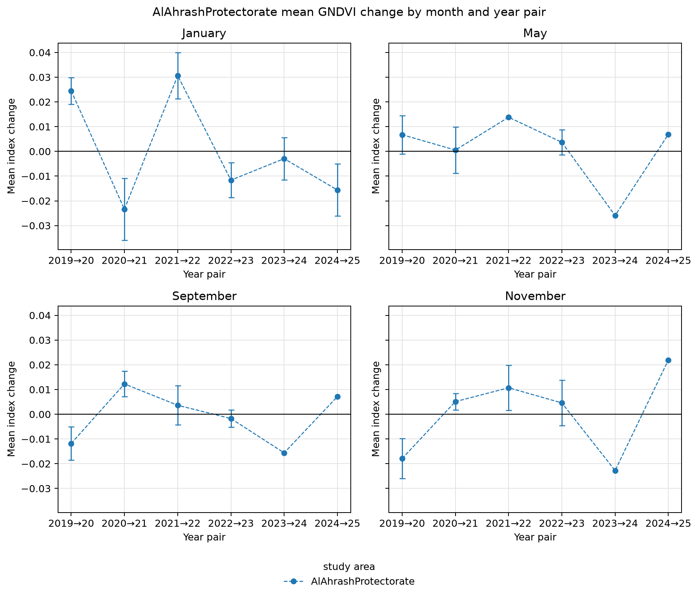
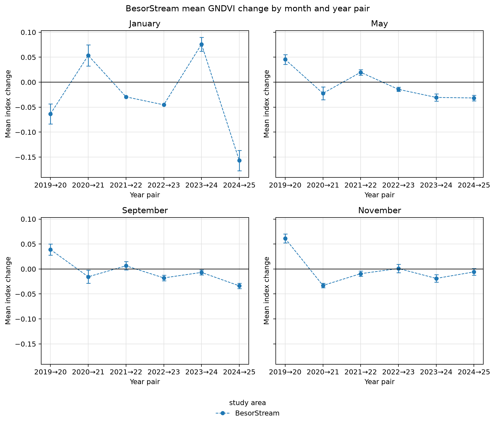
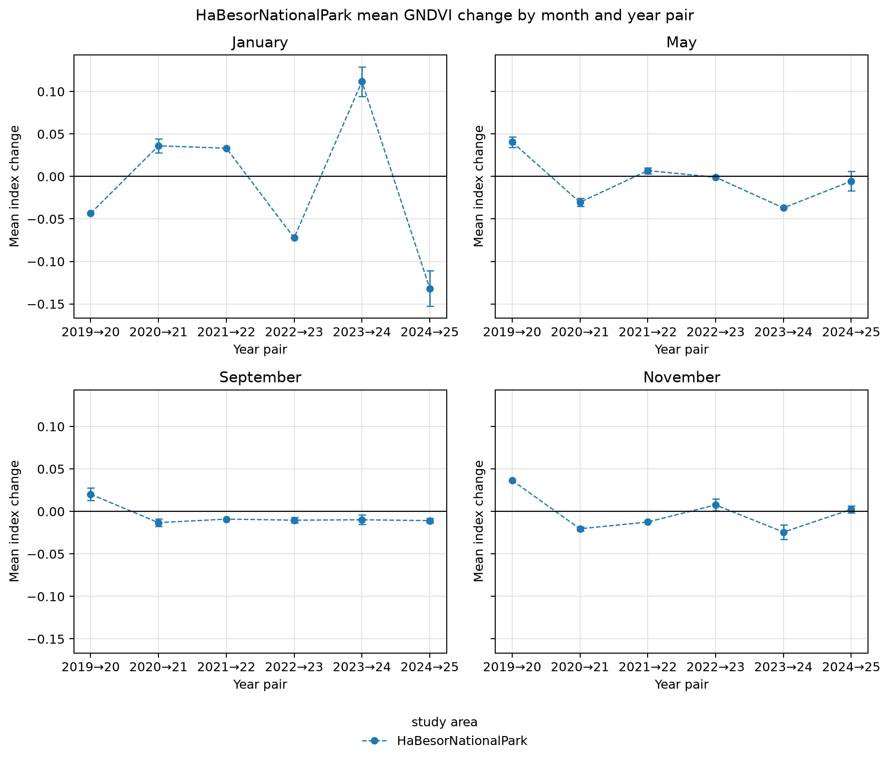
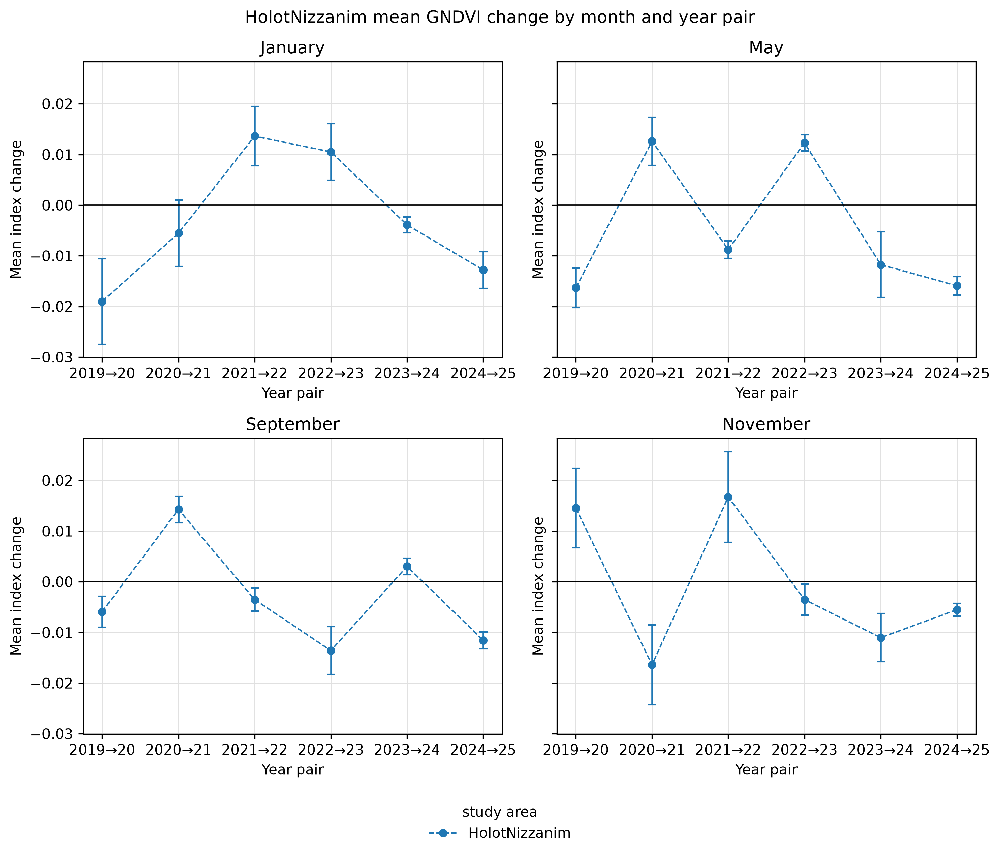
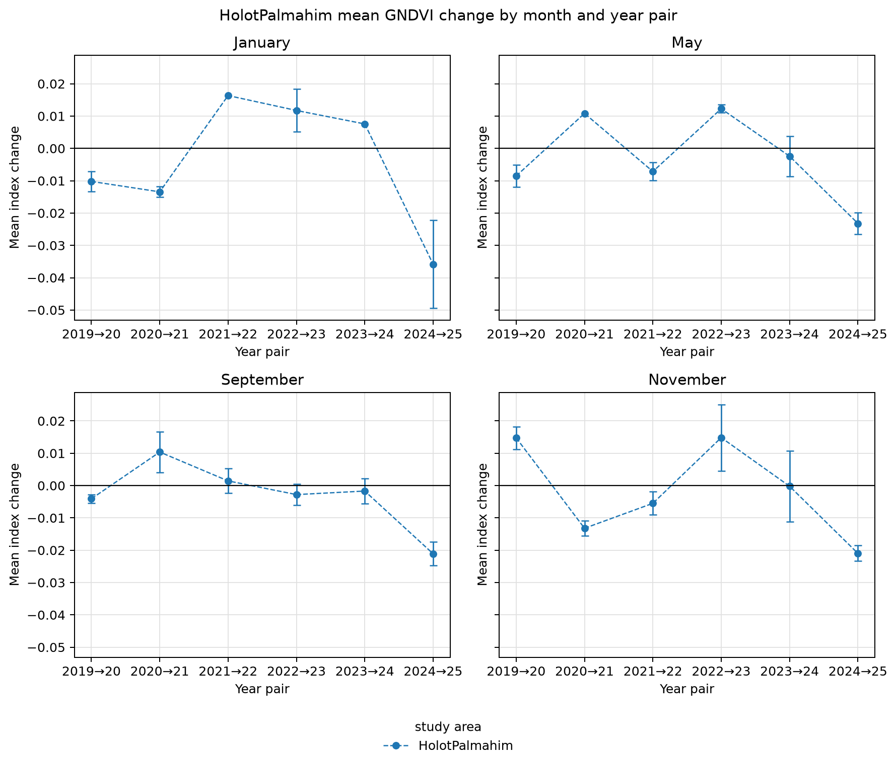
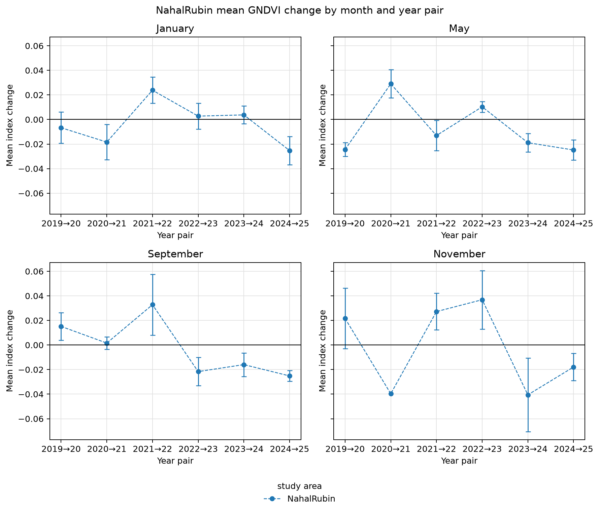
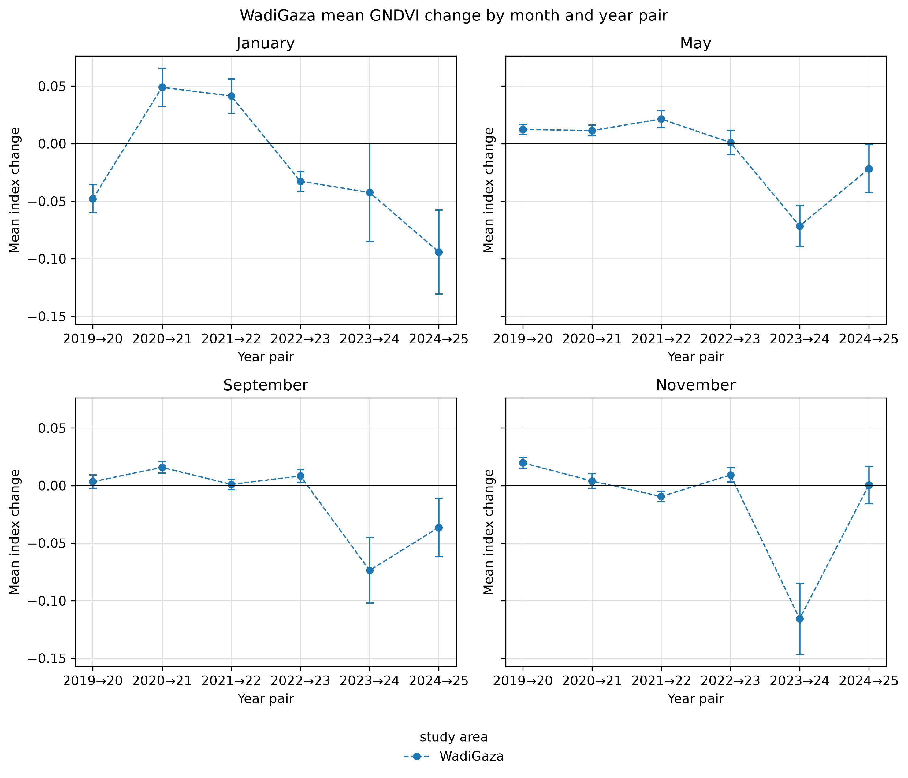
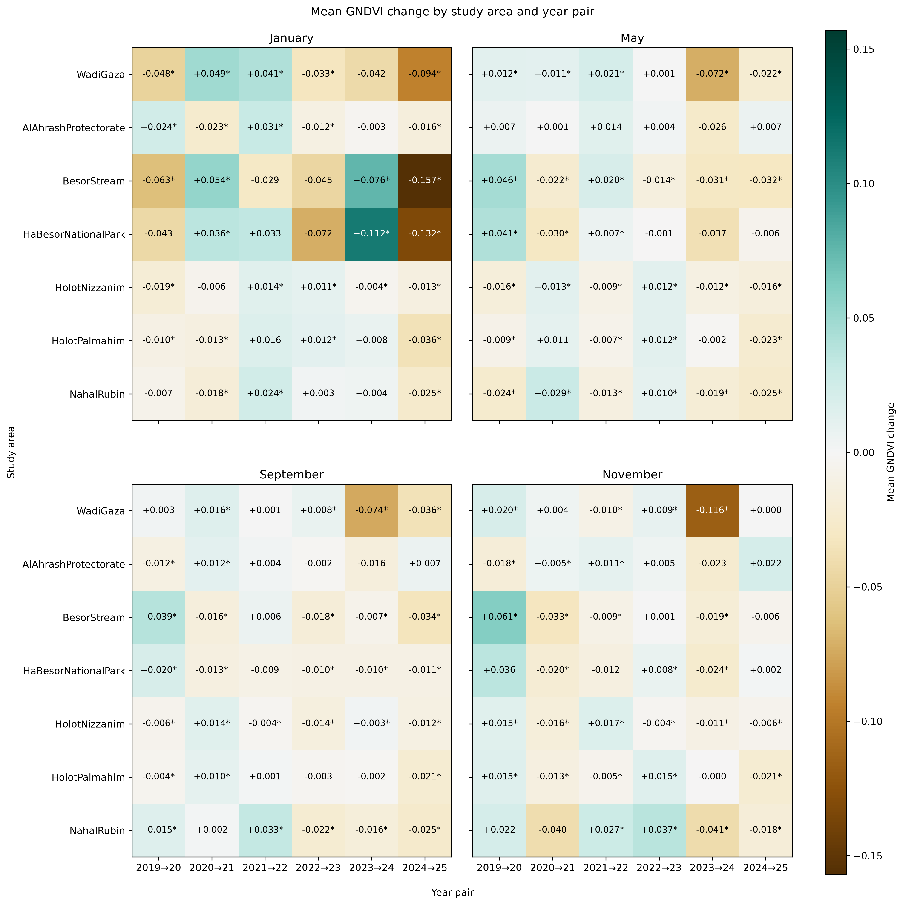

<!-- Generated by generate_figure_captions.py; do not edit. -->

# Figure captions

Maintained in [figure-captions.yaml](../../../../docs/figure-captions.yaml). Captions cover the current notebook selections only; other images in this folder may be retired or from a different selection. Figure numbering is assigned in the manuscript. Review captions alongside the images before publication.

## Al Ahrash Protectorate: monthly GNDVI changes

Figure: [AlAhrashProtectorate_GNDVI_mean_change_month_panels.png](AlAhrashProtectorate_GNDVI_mean_change_month_panels.png)

**Caption.** Mean year-to-year GNDVI change at Al Ahrash Protectorate, with monthly panels and spatially adjusted 95% confidence intervals.

**Explanation.** Mean change in the green normalized difference vegetation index (GNDVI) at Al Ahrash Protectorate across consecutive year pairs, with one panel per calendar month. Points show spatial means and whiskers their uncertainty; the horizontal line marks no change. Change is the later year's index minus the earlier year's index for the same calendar month, averaged over pixels valid in both composites; negative values indicate a decrease. Intervals are spatially adjusted 95% Student's t confidence intervals, using effective sample sizes derived from Moran's I correlograms at the primary range threshold tau = 0.05. Means remain visible when an autocorrelation range, and hence an interval, cannot be estimated.

Source: [12_visualize_change_results.ipynb](../../../../notebooks/12_visualize_change_results.ipynb); [method](../../../../docs/white-papers/Mean-Index-Change-Confidence-Intervals.md).

<!-- Figure SHA-256: 7b96970c2a28107eae8c27a8bf0492f55a9cde708747c9a1f4396efa96d08fcb -->

## Besor Stream: monthly GNDVI changes

Figure: [BesorStream_GNDVI_mean_change_month_panels.png](BesorStream_GNDVI_mean_change_month_panels.png)

**Caption.** Mean year-to-year GNDVI change at Besor Stream, with monthly panels and spatially adjusted 95% confidence intervals.

**Explanation.** Mean change in the green normalized difference vegetation index (GNDVI) at Besor Stream across consecutive year pairs, with one panel per calendar month. Points show spatial means and whiskers their uncertainty; the horizontal line marks no change. Change is the later year's index minus the earlier year's index for the same calendar month, averaged over pixels valid in both composites; negative values indicate a decrease. Intervals are spatially adjusted 95% Student's t confidence intervals, using effective sample sizes derived from Moran's I correlograms at the primary range threshold tau = 0.05. Means remain visible when an autocorrelation range, and hence an interval, cannot be estimated.

Source: [12_visualize_change_results.ipynb](../../../../notebooks/12_visualize_change_results.ipynb); [method](../../../../docs/white-papers/Mean-Index-Change-Confidence-Intervals.md).

<!-- Figure SHA-256: 614a9eb6ed550c7d3deb7371d3e210591a71aaac708d6fc24d24bb8cc2587004 -->

## HaBesor National Park: monthly GNDVI changes

Figure: [HaBesorNationalPark_GNDVI_mean_change_month_panels.png](HaBesorNationalPark_GNDVI_mean_change_month_panels.png)

**Caption.** Mean year-to-year GNDVI change at HaBesor National Park, with monthly panels and spatially adjusted 95% confidence intervals.

**Explanation.** Mean change in the green normalized difference vegetation index (GNDVI) at HaBesor National Park across consecutive year pairs, with one panel per calendar month. Points show spatial means and whiskers their uncertainty; the horizontal line marks no change. Change is the later year's index minus the earlier year's index for the same calendar month, averaged over pixels valid in both composites; negative values indicate a decrease. Intervals are spatially adjusted 95% Student's t confidence intervals, using effective sample sizes derived from Moran's I correlograms at the primary range threshold tau = 0.05. Means remain visible when an autocorrelation range, and hence an interval, cannot be estimated.

Source: [12_visualize_change_results.ipynb](../../../../notebooks/12_visualize_change_results.ipynb); [method](../../../../docs/white-papers/Mean-Index-Change-Confidence-Intervals.md).

<!-- Figure SHA-256: 2c887f620ab189d31810038b76da01dbc910a4eda4aa0ecd7e3ecc7cff09fe92 -->

## Holot Nizzanim: monthly GNDVI changes

Figure: [HolotNizzanim_GNDVI_mean_change_month_panels.png](HolotNizzanim_GNDVI_mean_change_month_panels.png)

**Caption.** Mean year-to-year GNDVI change at Holot Nizzanim, with monthly panels and spatially adjusted 95% confidence intervals.

**Explanation.** Mean change in the green normalized difference vegetation index (GNDVI) at Holot Nizzanim across consecutive year pairs, with one panel per calendar month. Points show spatial means and whiskers their uncertainty; the horizontal line marks no change. Change is the later year's index minus the earlier year's index for the same calendar month, averaged over pixels valid in both composites; negative values indicate a decrease. Intervals are spatially adjusted 95% Student's t confidence intervals, using effective sample sizes derived from Moran's I correlograms at the primary range threshold tau = 0.05. Means remain visible when an autocorrelation range, and hence an interval, cannot be estimated.

Source: [12_visualize_change_results.ipynb](../../../../notebooks/12_visualize_change_results.ipynb); [method](../../../../docs/white-papers/Mean-Index-Change-Confidence-Intervals.md).

<!-- Figure SHA-256: e7cc121342998d3752f8650fd4bf6e0baf8a482fb6fd7582bfe7b4705af6f26e -->

## Holot Palmahim: monthly GNDVI changes

Figure: [HolotPalmahim_GNDVI_mean_change_month_panels.png](HolotPalmahim_GNDVI_mean_change_month_panels.png)

**Caption.** Mean year-to-year GNDVI change at Holot Palmahim, with monthly panels and spatially adjusted 95% confidence intervals.

**Explanation.** Mean change in the green normalized difference vegetation index (GNDVI) at Holot Palmahim across consecutive year pairs, with one panel per calendar month. Points show spatial means and whiskers their uncertainty; the horizontal line marks no change. Change is the later year's index minus the earlier year's index for the same calendar month, averaged over pixels valid in both composites; negative values indicate a decrease. Intervals are spatially adjusted 95% Student's t confidence intervals, using effective sample sizes derived from Moran's I correlograms at the primary range threshold tau = 0.05. Means remain visible when an autocorrelation range, and hence an interval, cannot be estimated.

Source: [12_visualize_change_results.ipynb](../../../../notebooks/12_visualize_change_results.ipynb); [method](../../../../docs/white-papers/Mean-Index-Change-Confidence-Intervals.md).

<!-- Figure SHA-256: a299e9e952ff7c350b71d1b4c1332ea10b7a9f7d04ea9c7b3d0346124b595a1e -->

## Nahal Rubin: monthly GNDVI changes

Figure: [NahalRubin_GNDVI_mean_change_month_panels.png](NahalRubin_GNDVI_mean_change_month_panels.png)

**Caption.** Mean year-to-year GNDVI change at Nahal Rubin, with monthly panels and spatially adjusted 95% confidence intervals.

**Explanation.** Mean change in the green normalized difference vegetation index (GNDVI) at Nahal Rubin across consecutive year pairs, with one panel per calendar month. Points show spatial means and whiskers their uncertainty; the horizontal line marks no change. Change is the later year's index minus the earlier year's index for the same calendar month, averaged over pixels valid in both composites; negative values indicate a decrease. Intervals are spatially adjusted 95% Student's t confidence intervals, using effective sample sizes derived from Moran's I correlograms at the primary range threshold tau = 0.05. Means remain visible when an autocorrelation range, and hence an interval, cannot be estimated.

Source: [12_visualize_change_results.ipynb](../../../../notebooks/12_visualize_change_results.ipynb); [method](../../../../docs/white-papers/Mean-Index-Change-Confidence-Intervals.md).

<!-- Figure SHA-256: efa1df1671a418609e8dde3bc381ae3b6a7032701fabd98f59ba3d9f2afa46a0 -->

## Wadi Gaza: monthly GNDVI changes

Figure: [WadiGaza_GNDVI_mean_change_month_panels.png](WadiGaza_GNDVI_mean_change_month_panels.png)

**Caption.** Mean year-to-year GNDVI change at Wadi Gaza, with monthly panels and spatially adjusted 95% confidence intervals.

**Explanation.** Mean change in the green normalized difference vegetation index (GNDVI) at Wadi Gaza across consecutive year pairs, with one panel per calendar month. Points show spatial means and whiskers their uncertainty; the horizontal line marks no change. Change is the later year's index minus the earlier year's index for the same calendar month, averaged over pixels valid in both composites; negative values indicate a decrease. Intervals are spatially adjusted 95% Student's t confidence intervals, using effective sample sizes derived from Moran's I correlograms at the primary range threshold tau = 0.05. Means remain visible when an autocorrelation range, and hence an interval, cannot be estimated.

Source: [12_visualize_change_results.ipynb](../../../../notebooks/12_visualize_change_results.ipynb); [method](../../../../docs/white-papers/Mean-Index-Change-Confidence-Intervals.md).

<!-- Figure SHA-256: 9cf7b7a570f8a6612336eaea2e38b344ba2d1322d6013d18b6a0a0d4b8f70052 -->

## GNDVI change by site and year pair

Figure: [study_area_mean_change_heatmaps.png](study_area_mean_change_heatmaps.png)

**Caption.** Mean GNDVI change by site, month, and year pair; asterisks indicate spatially adjusted 95% confidence intervals excluding zero.

**Explanation.** Mean change in the green normalized difference vegetation index (GNDVI) by study site and consecutive year pair, with one panel per calendar month and Wadi Gaza in the top row. Brown denotes decreases and teal increases on a shared zero-centered scale. Cell labels report mean changes; asterisks mark individual spatially adjusted 95% confidence intervals excluding zero, without multiple-comparison adjustment. Change is the later year's index minus the earlier year's index for the same calendar month, averaged over pixels valid in both composites; negative values indicate a decrease. The primary range threshold is tau = 0.05; unmarked cells can include changes with undefined intervals.

Source: [12_visualize_change_results.ipynb](../../../../notebooks/12_visualize_change_results.ipynb); [method](../../../../docs/white-papers/Mean-Index-Change-Confidence-Intervals.md).

<!-- Figure SHA-256: 74b6acd89452091e16b9e1eaf957662e6cb666a0cb0e2cf367660201362485fb -->
