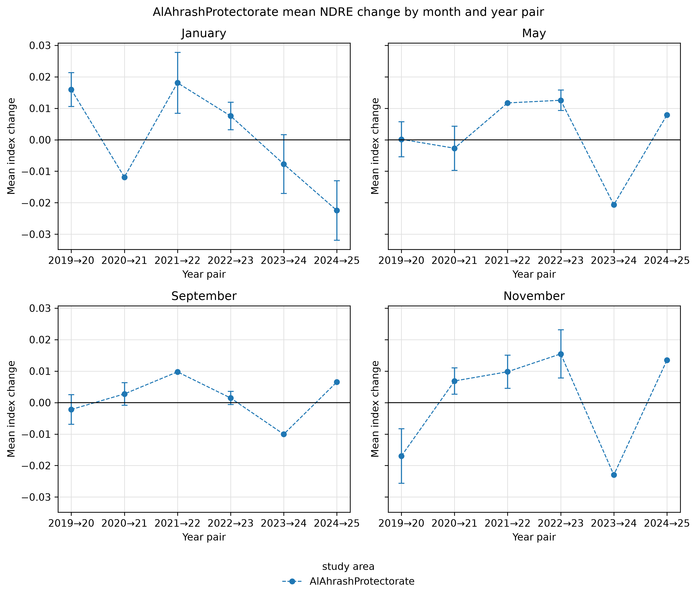
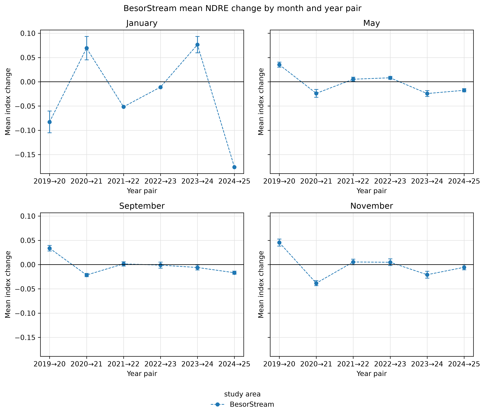
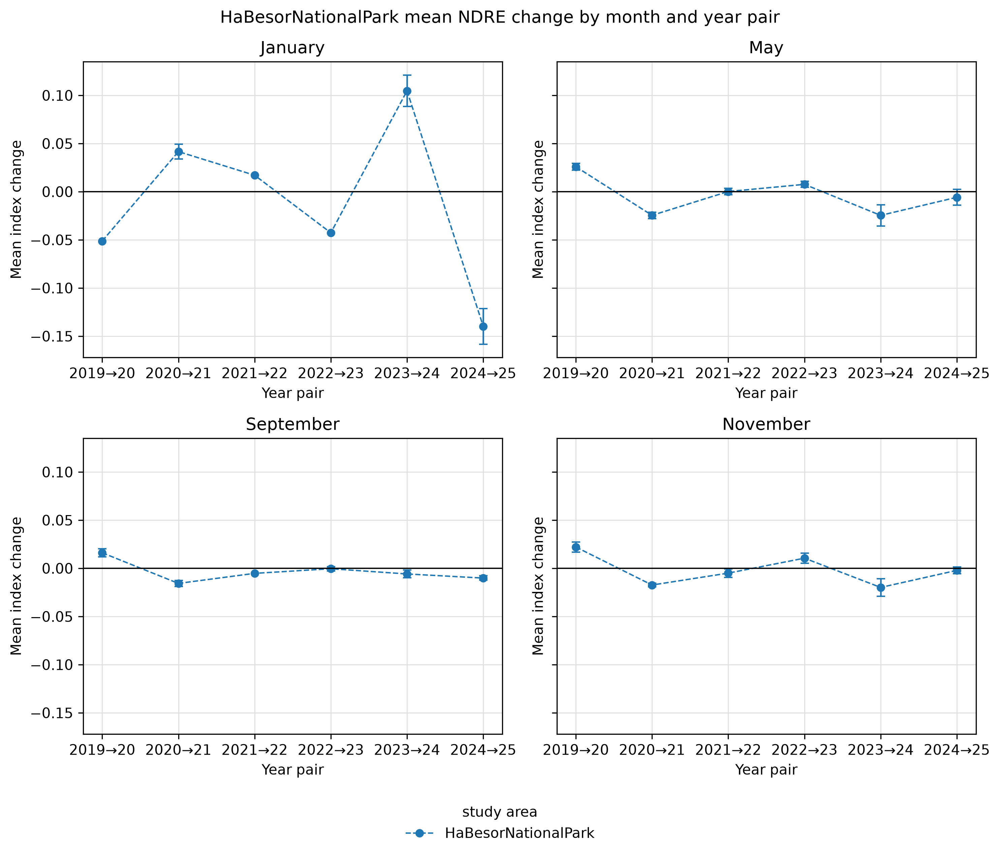
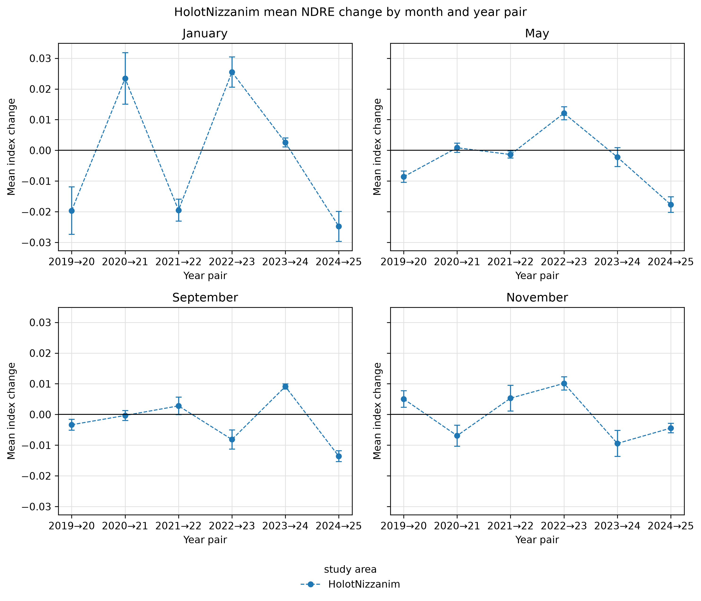
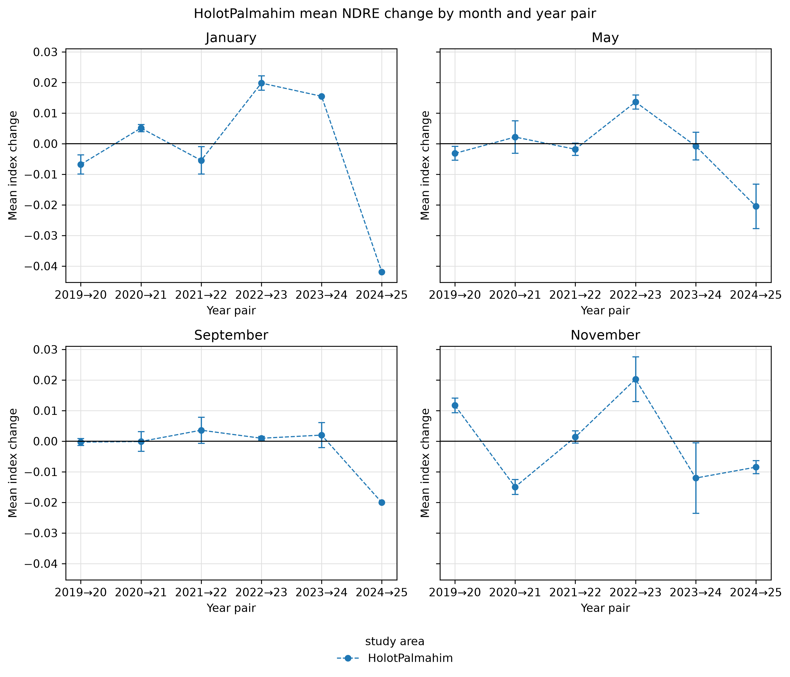
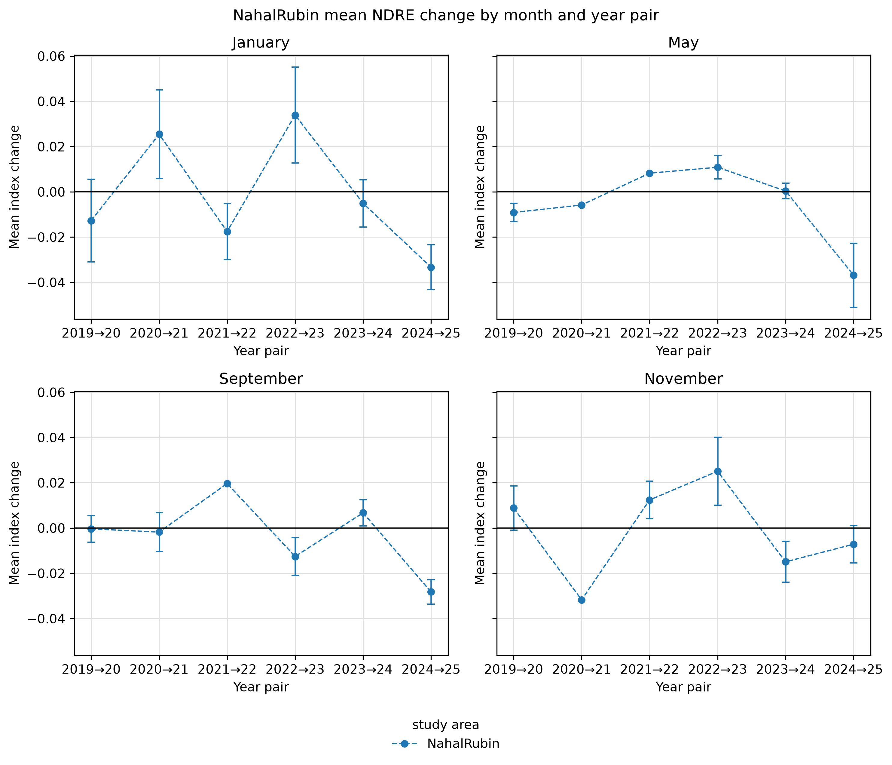
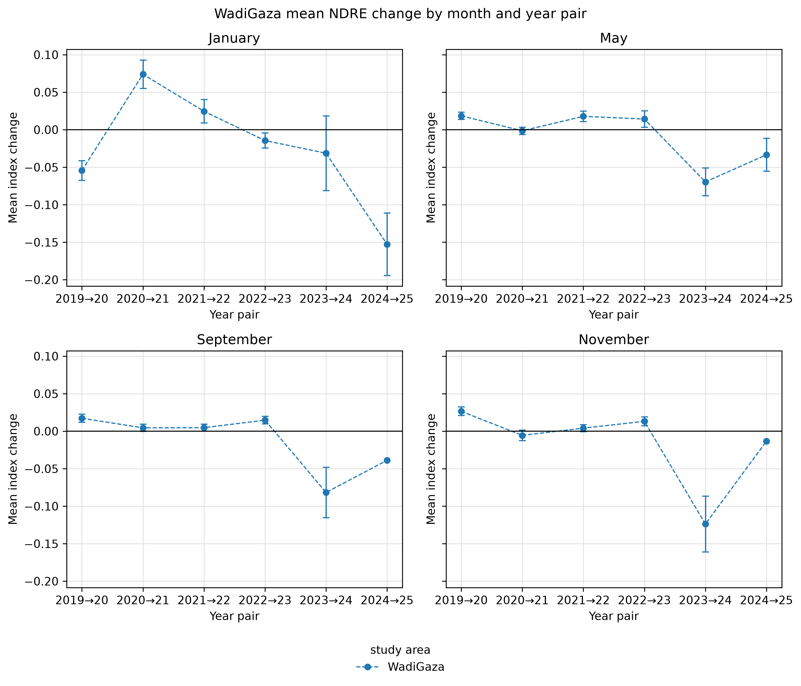
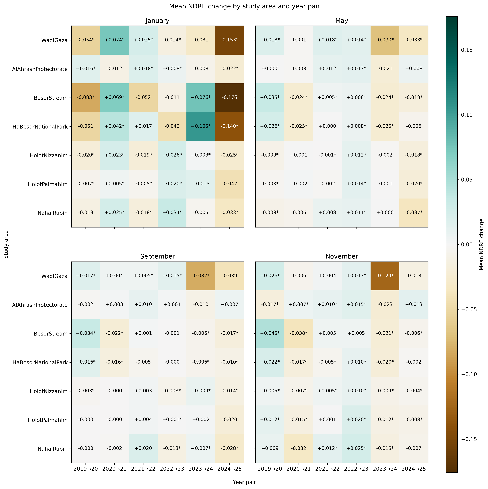

<!-- Generated by generate_figure_captions.py; do not edit. -->

# Figure captions

Maintained in [figure-captions.yaml](../../../../docs/figure-captions.yaml). Captions cover the current notebook selections only; other images in this folder may be retired or from a different selection. Figure numbering is assigned in the manuscript. Review captions alongside the images before publication.

## Al Ahrash Protectorate: monthly NDRE changes

Figure: [AlAhrashProtectorate_NDRE_mean_change_month_panels.png](AlAhrashProtectorate_NDRE_mean_change_month_panels.png)

**Caption.** Mean year-to-year NDRE change at Al Ahrash Protectorate, with monthly panels and spatially adjusted 95% confidence intervals.

**Explanation.** Mean change in the normalized difference red-edge index (NDRE) at Al Ahrash Protectorate across consecutive year pairs, with one panel per calendar month. Points show spatial means and whiskers their uncertainty; the horizontal line marks no change. Change is the later year's index minus the earlier year's index for the same calendar month, averaged over pixels valid in both composites; negative values indicate a decrease. Intervals are spatially adjusted 95% Student's t confidence intervals, using effective sample sizes derived from Moran's I correlograms at the primary range threshold tau = 0.05. Means remain visible when an autocorrelation range, and hence an interval, cannot be estimated.

Source: [12_visualize_change_results.ipynb](../../../../notebooks/12_visualize_change_results.ipynb); [method](../../../../docs/white-papers/Mean-Index-Change-Confidence-Intervals.md).

<!-- Figure SHA-256: 91faded9528fad60e642fbbae9fb715e23462d95de9c9f7fc477c47eb15df8a0 -->

## Besor Stream: monthly NDRE changes

Figure: [BesorStream_NDRE_mean_change_month_panels.png](BesorStream_NDRE_mean_change_month_panels.png)

**Caption.** Mean year-to-year NDRE change at Besor Stream, with monthly panels and spatially adjusted 95% confidence intervals.

**Explanation.** Mean change in the normalized difference red-edge index (NDRE) at Besor Stream across consecutive year pairs, with one panel per calendar month. Points show spatial means and whiskers their uncertainty; the horizontal line marks no change. Change is the later year's index minus the earlier year's index for the same calendar month, averaged over pixels valid in both composites; negative values indicate a decrease. Intervals are spatially adjusted 95% Student's t confidence intervals, using effective sample sizes derived from Moran's I correlograms at the primary range threshold tau = 0.05. Means remain visible when an autocorrelation range, and hence an interval, cannot be estimated.

Source: [12_visualize_change_results.ipynb](../../../../notebooks/12_visualize_change_results.ipynb); [method](../../../../docs/white-papers/Mean-Index-Change-Confidence-Intervals.md).

<!-- Figure SHA-256: e3099e0e4f14c63f4546bf5742bc91de2340f14cb8d10acb897e5fb19b67a5cb -->

## HaBesor National Park: monthly NDRE changes

Figure: [HaBesorNationalPark_NDRE_mean_change_month_panels.png](HaBesorNationalPark_NDRE_mean_change_month_panels.png)

**Caption.** Mean year-to-year NDRE change at HaBesor National Park, with monthly panels and spatially adjusted 95% confidence intervals.

**Explanation.** Mean change in the normalized difference red-edge index (NDRE) at HaBesor National Park across consecutive year pairs, with one panel per calendar month. Points show spatial means and whiskers their uncertainty; the horizontal line marks no change. Change is the later year's index minus the earlier year's index for the same calendar month, averaged over pixels valid in both composites; negative values indicate a decrease. Intervals are spatially adjusted 95% Student's t confidence intervals, using effective sample sizes derived from Moran's I correlograms at the primary range threshold tau = 0.05. Means remain visible when an autocorrelation range, and hence an interval, cannot be estimated.

Source: [12_visualize_change_results.ipynb](../../../../notebooks/12_visualize_change_results.ipynb); [method](../../../../docs/white-papers/Mean-Index-Change-Confidence-Intervals.md).

<!-- Figure SHA-256: 981d28185d39ba92f40829b62a513ba8852af9bdbcc56433f950f9a986de686c -->

## Holot Nizzanim: monthly NDRE changes

Figure: [HolotNizzanim_NDRE_mean_change_month_panels.png](HolotNizzanim_NDRE_mean_change_month_panels.png)

**Caption.** Mean year-to-year NDRE change at Holot Nizzanim, with monthly panels and spatially adjusted 95% confidence intervals.

**Explanation.** Mean change in the normalized difference red-edge index (NDRE) at Holot Nizzanim across consecutive year pairs, with one panel per calendar month. Points show spatial means and whiskers their uncertainty; the horizontal line marks no change. Change is the later year's index minus the earlier year's index for the same calendar month, averaged over pixels valid in both composites; negative values indicate a decrease. Intervals are spatially adjusted 95% Student's t confidence intervals, using effective sample sizes derived from Moran's I correlograms at the primary range threshold tau = 0.05. Means remain visible when an autocorrelation range, and hence an interval, cannot be estimated.

Source: [12_visualize_change_results.ipynb](../../../../notebooks/12_visualize_change_results.ipynb); [method](../../../../docs/white-papers/Mean-Index-Change-Confidence-Intervals.md).

<!-- Figure SHA-256: 8ad26dff3b6d69c0d56a84d28e5b2e666d10d33807159c76359b577d0d62b0c1 -->

## Holot Palmahim: monthly NDRE changes

Figure: [HolotPalmahim_NDRE_mean_change_month_panels.png](HolotPalmahim_NDRE_mean_change_month_panels.png)

**Caption.** Mean year-to-year NDRE change at Holot Palmahim, with monthly panels and spatially adjusted 95% confidence intervals.

**Explanation.** Mean change in the normalized difference red-edge index (NDRE) at Holot Palmahim across consecutive year pairs, with one panel per calendar month. Points show spatial means and whiskers their uncertainty; the horizontal line marks no change. Change is the later year's index minus the earlier year's index for the same calendar month, averaged over pixels valid in both composites; negative values indicate a decrease. Intervals are spatially adjusted 95% Student's t confidence intervals, using effective sample sizes derived from Moran's I correlograms at the primary range threshold tau = 0.05. Means remain visible when an autocorrelation range, and hence an interval, cannot be estimated.

Source: [12_visualize_change_results.ipynb](../../../../notebooks/12_visualize_change_results.ipynb); [method](../../../../docs/white-papers/Mean-Index-Change-Confidence-Intervals.md).

<!-- Figure SHA-256: bb4059e1efa7f11a6f4ed7c8726e64f26592e11ec3827f1014e07db2f2c7803c -->

## Nahal Rubin: monthly NDRE changes

Figure: [NahalRubin_NDRE_mean_change_month_panels.png](NahalRubin_NDRE_mean_change_month_panels.png)

**Caption.** Mean year-to-year NDRE change at Nahal Rubin, with monthly panels and spatially adjusted 95% confidence intervals.

**Explanation.** Mean change in the normalized difference red-edge index (NDRE) at Nahal Rubin across consecutive year pairs, with one panel per calendar month. Points show spatial means and whiskers their uncertainty; the horizontal line marks no change. Change is the later year's index minus the earlier year's index for the same calendar month, averaged over pixels valid in both composites; negative values indicate a decrease. Intervals are spatially adjusted 95% Student's t confidence intervals, using effective sample sizes derived from Moran's I correlograms at the primary range threshold tau = 0.05. Means remain visible when an autocorrelation range, and hence an interval, cannot be estimated.

Source: [12_visualize_change_results.ipynb](../../../../notebooks/12_visualize_change_results.ipynb); [method](../../../../docs/white-papers/Mean-Index-Change-Confidence-Intervals.md).

<!-- Figure SHA-256: a4863af58a17894badb5c3b59d4f862facead2edbd9aa64f0eaa712990001d9d -->

## Wadi Gaza: monthly NDRE changes

Figure: [WadiGaza_NDRE_mean_change_month_panels.png](WadiGaza_NDRE_mean_change_month_panels.png)

**Caption.** Mean year-to-year NDRE change at Wadi Gaza, with monthly panels and spatially adjusted 95% confidence intervals.

**Explanation.** Mean change in the normalized difference red-edge index (NDRE) at Wadi Gaza across consecutive year pairs, with one panel per calendar month. Points show spatial means and whiskers their uncertainty; the horizontal line marks no change. Change is the later year's index minus the earlier year's index for the same calendar month, averaged over pixels valid in both composites; negative values indicate a decrease. Intervals are spatially adjusted 95% Student's t confidence intervals, using effective sample sizes derived from Moran's I correlograms at the primary range threshold tau = 0.05. Means remain visible when an autocorrelation range, and hence an interval, cannot be estimated.

Source: [12_visualize_change_results.ipynb](../../../../notebooks/12_visualize_change_results.ipynb); [method](../../../../docs/white-papers/Mean-Index-Change-Confidence-Intervals.md).

<!-- Figure SHA-256: da465f2e440af22a8669d4c12ce2ee67086bb3e45a0f9a945d119109298c843f -->

## NDRE change by site and year pair

Figure: [study_area_mean_change_heatmaps.png](study_area_mean_change_heatmaps.png)

**Caption.** Mean NDRE change by site, month, and year pair; asterisks indicate spatially adjusted 95% confidence intervals excluding zero.

**Explanation.** Mean change in the normalized difference red-edge index (NDRE) by study site and consecutive year pair, with one panel per calendar month and Wadi Gaza in the top row. Brown denotes decreases and teal increases on a shared zero-centered scale. Cell labels report mean changes; asterisks mark individual spatially adjusted 95% confidence intervals excluding zero, without multiple-comparison adjustment. Change is the later year's index minus the earlier year's index for the same calendar month, averaged over pixels valid in both composites; negative values indicate a decrease. The primary range threshold is tau = 0.05; unmarked cells can include changes with undefined intervals.

Source: [12_visualize_change_results.ipynb](../../../../notebooks/12_visualize_change_results.ipynb); [method](../../../../docs/white-papers/Mean-Index-Change-Confidence-Intervals.md).

<!-- Figure SHA-256: f9af9c8882a357eb21d448097eccad9918428e805da24b1485529d7c52d9633e -->
