<!-- Generated by generate_figure_captions.py; do not edit. -->

# Figure captions

Maintained in [figure-captions.yaml](../../../../docs/figure-captions.yaml). Captions cover the current notebook selections only; other images in this folder may be retired or from a different selection. Figure numbering is assigned in the manuscript. Review captions alongside the images before publication.

## Al Ahrash Protectorate: monthly NDVI changes

Figure: [AlAhrashProtectorate_NDVI_mean_change_month_panels.png](AlAhrashProtectorate_NDVI_mean_change_month_panels.png)

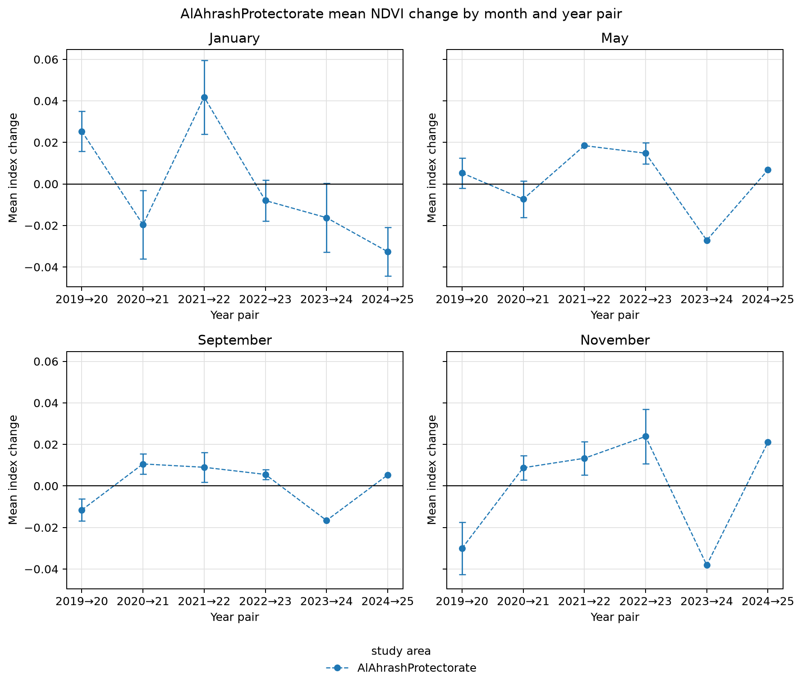

**Caption.** Mean year-to-year NDVI change at Al Ahrash Protectorate, with monthly panels and spatially adjusted 95% confidence intervals.

**Explanation.** Mean change in the normalized difference vegetation index (NDVI) at Al Ahrash Protectorate across consecutive year pairs, with one panel per calendar month. Points show spatial means and whiskers their uncertainty; the horizontal line marks no change. Change is the later year's index minus the earlier year's index for the same calendar month, averaged over pixels valid in both composites; negative values indicate a decrease. Intervals are spatially adjusted 95% Student's t confidence intervals, using effective sample sizes derived from Moran's I correlograms at the primary range threshold tau = 0.05. Means remain visible when an autocorrelation range, and hence an interval, cannot be estimated.

Source: [12_visualize_change_results.ipynb](../../../../notebooks/12_visualize_change_results.ipynb); [method](../../../../docs/white-papers/Mean-Index-Change-Confidence-Intervals.md).

<!-- Figure SHA-256: 34b0a5204e9a249c39ce83672ca6b4c9a598d76b253981fcdd6d560282eb670e -->

## Besor Stream: monthly NDVI changes

Figure: [BesorStream_NDVI_mean_change_month_panels.png](BesorStream_NDVI_mean_change_month_panels.png)

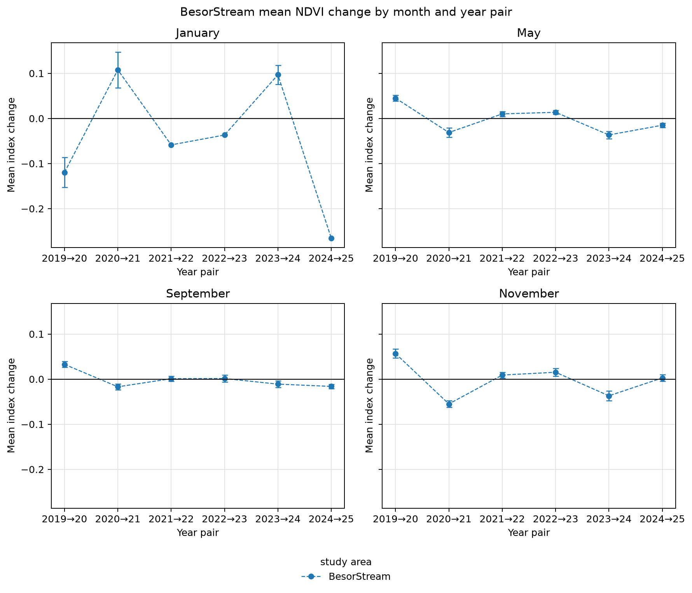

**Caption.** Mean year-to-year NDVI change at Besor Stream, with monthly panels and spatially adjusted 95% confidence intervals.

**Explanation.** Mean change in the normalized difference vegetation index (NDVI) at Besor Stream across consecutive year pairs, with one panel per calendar month. Points show spatial means and whiskers their uncertainty; the horizontal line marks no change. Change is the later year's index minus the earlier year's index for the same calendar month, averaged over pixels valid in both composites; negative values indicate a decrease. Intervals are spatially adjusted 95% Student's t confidence intervals, using effective sample sizes derived from Moran's I correlograms at the primary range threshold tau = 0.05. Means remain visible when an autocorrelation range, and hence an interval, cannot be estimated.

Source: [12_visualize_change_results.ipynb](../../../../notebooks/12_visualize_change_results.ipynb); [method](../../../../docs/white-papers/Mean-Index-Change-Confidence-Intervals.md).

<!-- Figure SHA-256: a8ec5c8c6b452223d9e0e3e6a6734e384836164d6291efa9c0fe21ddb3d98e2e -->

## HaBesor National Park: monthly NDVI changes

Figure: [HaBesorNationalPark_NDVI_mean_change_month_panels.png](HaBesorNationalPark_NDVI_mean_change_month_panels.png)

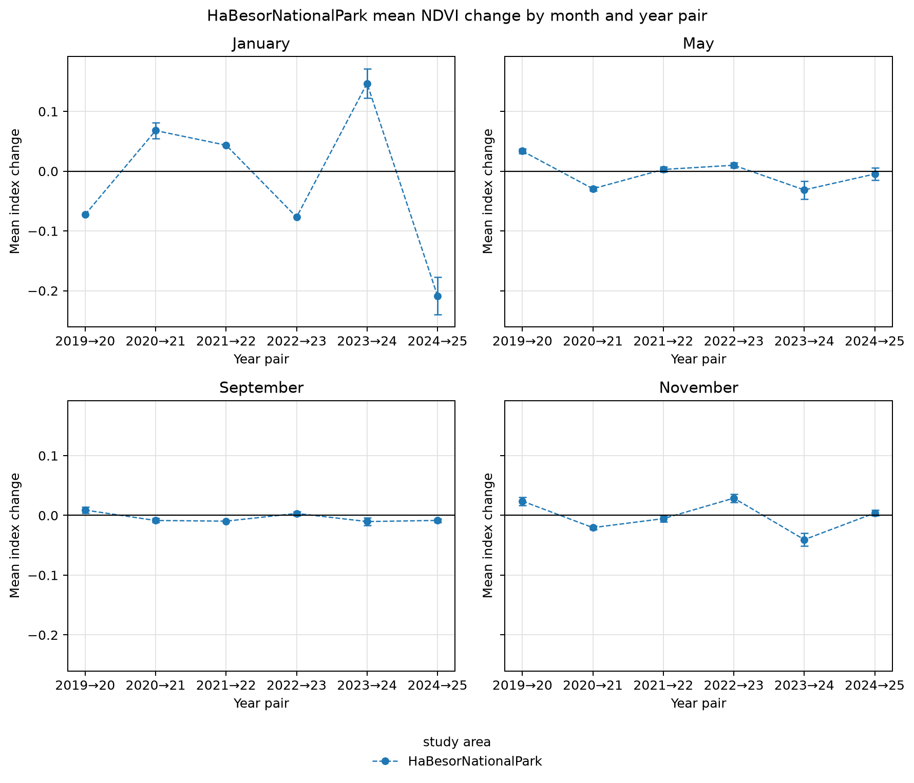

**Caption.** Mean year-to-year NDVI change at HaBesor National Park, with monthly panels and spatially adjusted 95% confidence intervals.

**Explanation.** Mean change in the normalized difference vegetation index (NDVI) at HaBesor National Park across consecutive year pairs, with one panel per calendar month. Points show spatial means and whiskers their uncertainty; the horizontal line marks no change. Change is the later year's index minus the earlier year's index for the same calendar month, averaged over pixels valid in both composites; negative values indicate a decrease. Intervals are spatially adjusted 95% Student's t confidence intervals, using effective sample sizes derived from Moran's I correlograms at the primary range threshold tau = 0.05. Means remain visible when an autocorrelation range, and hence an interval, cannot be estimated.

Source: [12_visualize_change_results.ipynb](../../../../notebooks/12_visualize_change_results.ipynb); [method](../../../../docs/white-papers/Mean-Index-Change-Confidence-Intervals.md).

<!-- Figure SHA-256: 22d72741770db3ea5b95721d33b565044203ce0b065acdc031f7309e29d7c498 -->

## Holot Nizzanim: monthly NDVI changes

Figure: [HolotNizzanim_NDVI_mean_change_month_panels.png](HolotNizzanim_NDVI_mean_change_month_panels.png)

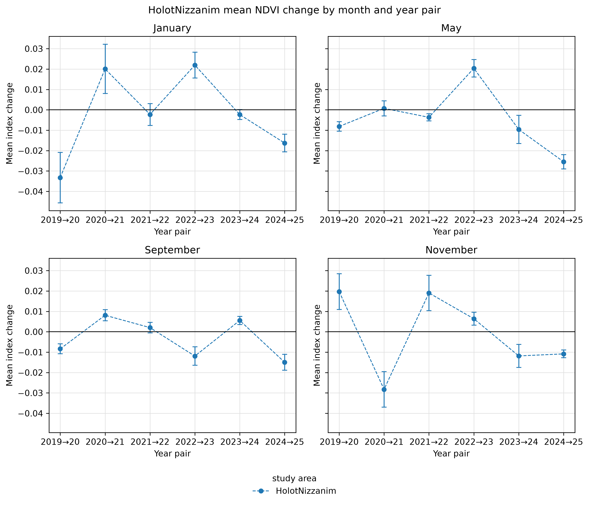

**Caption.** Mean year-to-year NDVI change at Holot Nizzanim, with monthly panels and spatially adjusted 95% confidence intervals.

**Explanation.** Mean change in the normalized difference vegetation index (NDVI) at Holot Nizzanim across consecutive year pairs, with one panel per calendar month. Points show spatial means and whiskers their uncertainty; the horizontal line marks no change. Change is the later year's index minus the earlier year's index for the same calendar month, averaged over pixels valid in both composites; negative values indicate a decrease. Intervals are spatially adjusted 95% Student's t confidence intervals, using effective sample sizes derived from Moran's I correlograms at the primary range threshold tau = 0.05. Means remain visible when an autocorrelation range, and hence an interval, cannot be estimated.

Source: [12_visualize_change_results.ipynb](../../../../notebooks/12_visualize_change_results.ipynb); [method](../../../../docs/white-papers/Mean-Index-Change-Confidence-Intervals.md).

<!-- Figure SHA-256: 4d8656341b1f8c0277ff6ecfea5356f584eee905060ce835a5ef5e57425c5d85 -->

## Holot Palmahim: monthly NDVI changes

Figure: [HolotPalmahim_NDVI_mean_change_month_panels.png](HolotPalmahim_NDVI_mean_change_month_panels.png)

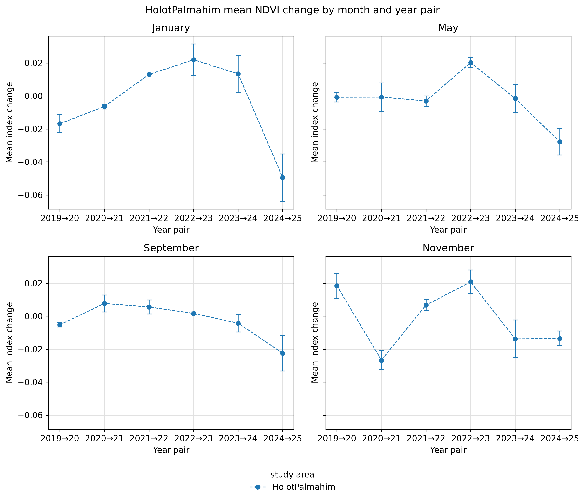

**Caption.** Mean year-to-year NDVI change at Holot Palmahim, with monthly panels and spatially adjusted 95% confidence intervals.

**Explanation.** Mean change in the normalized difference vegetation index (NDVI) at Holot Palmahim across consecutive year pairs, with one panel per calendar month. Points show spatial means and whiskers their uncertainty; the horizontal line marks no change. Change is the later year's index minus the earlier year's index for the same calendar month, averaged over pixels valid in both composites; negative values indicate a decrease. Intervals are spatially adjusted 95% Student's t confidence intervals, using effective sample sizes derived from Moran's I correlograms at the primary range threshold tau = 0.05. Means remain visible when an autocorrelation range, and hence an interval, cannot be estimated.

Source: [12_visualize_change_results.ipynb](../../../../notebooks/12_visualize_change_results.ipynb); [method](../../../../docs/white-papers/Mean-Index-Change-Confidence-Intervals.md).

<!-- Figure SHA-256: dfa4e996d9c87e7f65b3106fddb3adab749dfa8a195651f3b1c9185584bec306 -->

## Nahal Rubin: monthly NDVI changes

Figure: [NahalRubin_NDVI_mean_change_month_panels.png](NahalRubin_NDVI_mean_change_month_panels.png)

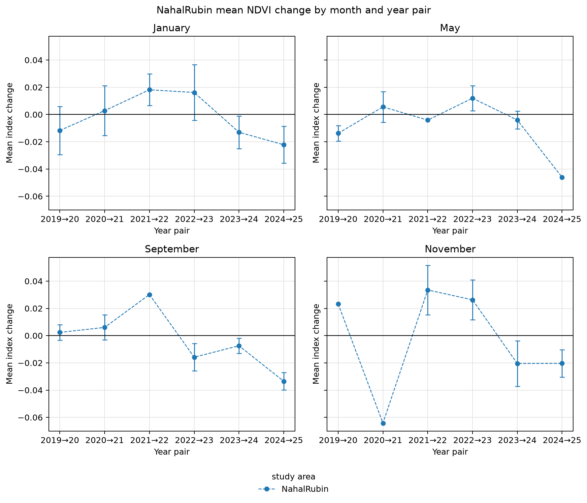

**Caption.** Mean year-to-year NDVI change at Nahal Rubin, with monthly panels and spatially adjusted 95% confidence intervals.

**Explanation.** Mean change in the normalized difference vegetation index (NDVI) at Nahal Rubin across consecutive year pairs, with one panel per calendar month. Points show spatial means and whiskers their uncertainty; the horizontal line marks no change. Change is the later year's index minus the earlier year's index for the same calendar month, averaged over pixels valid in both composites; negative values indicate a decrease. Intervals are spatially adjusted 95% Student's t confidence intervals, using effective sample sizes derived from Moran's I correlograms at the primary range threshold tau = 0.05. Means remain visible when an autocorrelation range, and hence an interval, cannot be estimated.

Source: [12_visualize_change_results.ipynb](../../../../notebooks/12_visualize_change_results.ipynb); [method](../../../../docs/white-papers/Mean-Index-Change-Confidence-Intervals.md).

<!-- Figure SHA-256: c809c95d8cd8420673d1eb471a5e3112da281ab0de8b0fda4969d36546a7d27b -->

## Wadi Gaza: monthly NDVI changes

Figure: [WadiGaza_NDVI_mean_change_month_panels.png](WadiGaza_NDVI_mean_change_month_panels.png)

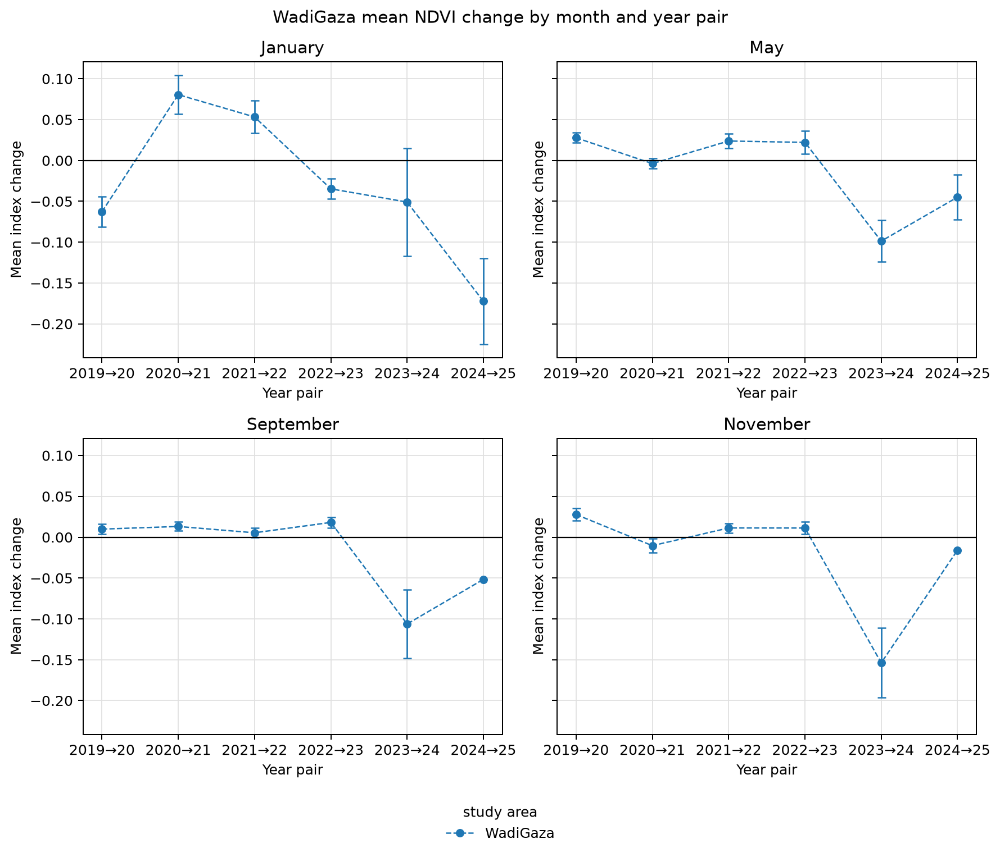

**Caption.** Mean year-to-year NDVI change at Wadi Gaza, with monthly panels and spatially adjusted 95% confidence intervals.

**Explanation.** Mean change in the normalized difference vegetation index (NDVI) at Wadi Gaza across consecutive year pairs, with one panel per calendar month. Points show spatial means and whiskers their uncertainty; the horizontal line marks no change. Change is the later year's index minus the earlier year's index for the same calendar month, averaged over pixels valid in both composites; negative values indicate a decrease. Intervals are spatially adjusted 95% Student's t confidence intervals, using effective sample sizes derived from Moran's I correlograms at the primary range threshold tau = 0.05. Means remain visible when an autocorrelation range, and hence an interval, cannot be estimated.

Source: [12_visualize_change_results.ipynb](../../../../notebooks/12_visualize_change_results.ipynb); [method](../../../../docs/white-papers/Mean-Index-Change-Confidence-Intervals.md).

<!-- Figure SHA-256: cd0ca706c6ee45edfe04587c7d808b7a5294d9e75ddcf42c1005eae8243457f2 -->

## Wadi Gaza NDVI effective sample sizes for changes

Figure: [WadiGaza_effective_sample_size.png](WadiGaza_effective_sample_size.png)

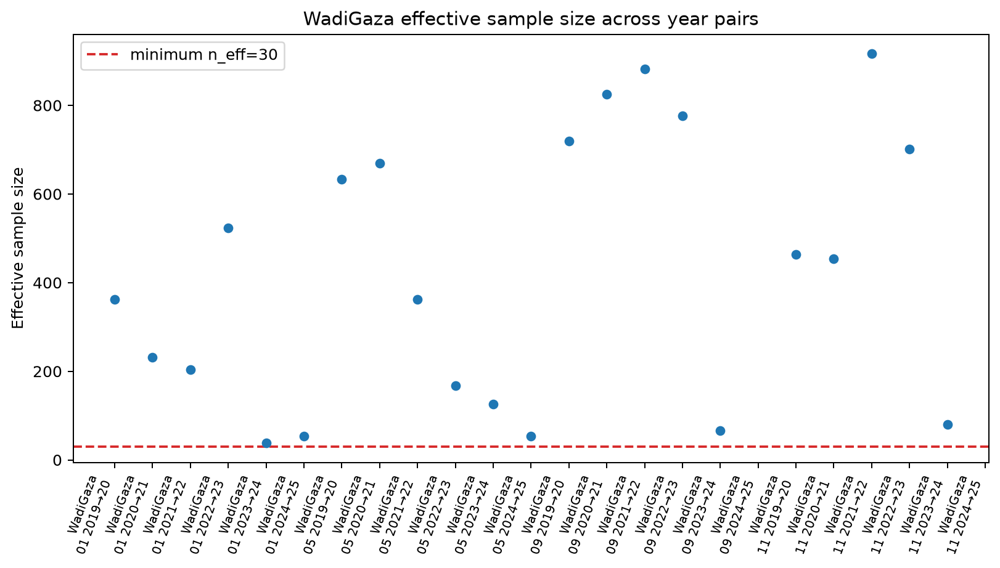

**Caption.** Spatial effective sample sizes for Wadi Gaza NDVI changes by month and year pair, with the review threshold at 30.

**Explanation.** Spatial effective sample size for Wadi Gaza NDVI change estimates, with each point representing one calendar month and consecutive year pair. Effective sample sizes account for spatial autocorrelation in difference rasters at the primary range threshold tau = 0.05, rather than treating all valid pixels as independent. The dashed line marks the plotted review threshold of 30; pairs without an estimated range have no effective-sample-size point.

Source: [12_visualize_change_results.ipynb](../../../../notebooks/12_visualize_change_results.ipynb); [method](../../../../docs/white-papers/Mean-Index-Change-Confidence-Intervals.md).

<!-- Figure SHA-256: 0cdd4dc5456b1b61c512cae1fe37798c1d25c6966c79c048ff288cfbc2ade979 -->

## Wadi Gaza NDVI change trajectories

Figure: [WadiGaza_mean_change_timeseries.png](WadiGaza_mean_change_timeseries.png)

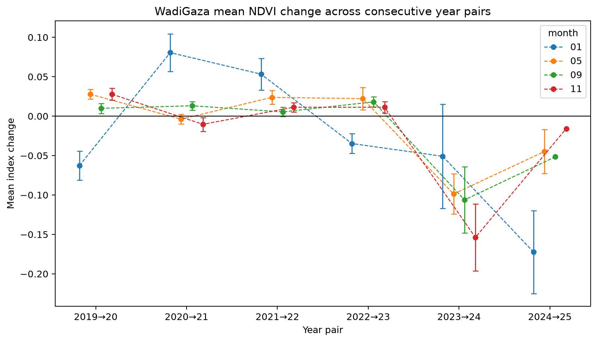

**Caption.** Mean year-to-year NDVI change at Wadi Gaza by calendar month, with spatially adjusted 95% confidence intervals.

**Explanation.** Mean change in the normalized difference vegetation index (NDVI) at Wadi Gaza across consecutive year pairs. Separate lines identify calendar months; points are spatial means and whiskers show uncertainty in each mean. Change is the later year's index minus the earlier year's index for the same calendar month, averaged over pixels valid in both composites; negative values indicate a decrease. Intervals are spatially adjusted 95% Student's t confidence intervals, using effective sample sizes derived from Moran's I correlograms at the primary range threshold tau = 0.05. Means remain visible when an autocorrelation range, and hence an interval, cannot be estimated.

Source: [12_visualize_change_results.ipynb](../../../../notebooks/12_visualize_change_results.ipynb); [method](../../../../docs/white-papers/Mean-Index-Change-Confidence-Intervals.md).

<!-- Figure SHA-256: 021d7e0109350e408663fb184933d179d4567736d0140a85d320a0b215e1bc0e -->

## NDVI change across sites, 2023-2024

Figure: [WadiGaza_vs_other_areas_2023_2024_monthly_small_multiples.png](WadiGaza_vs_other_areas_2023_2024_monthly_small_multiples.png)

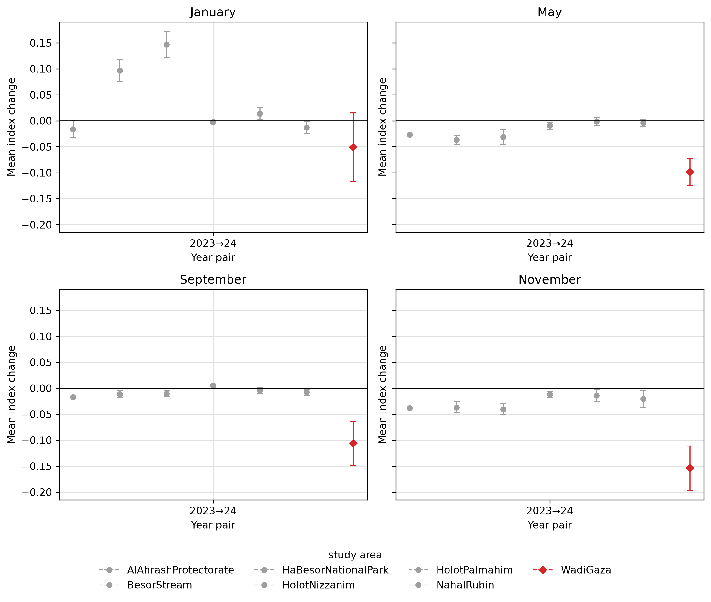

**Caption.** Mean 2023-2024 NDVI change across study sites by month, highlighting Wadi Gaza with spatially adjusted 95% confidence intervals for each site.

**Explanation.** Site-level mean change in the normalized difference vegetation index (NDVI) between 2023 and 2024, with one panel per calendar month. Wadi Gaza is highlighted by a red diamond; comparison sites are grey. Whiskers quantify uncertainty in individual site changes, not in differences between sites. Change is the later year's index minus the earlier year's index for the same calendar month, averaged over pixels valid in both composites; negative values indicate a decrease. Intervals are spatially adjusted 95% Student's t confidence intervals, using effective sample sizes derived from Moran's I correlograms at the primary range threshold tau = 0.05. Means remain visible when an autocorrelation range, and hence an interval, cannot be estimated.

Source: [12_visualize_change_results.ipynb](../../../../notebooks/12_visualize_change_results.ipynb); [method](../../../../docs/white-papers/Mean-Index-Change-Confidence-Intervals.md).

<!-- Figure SHA-256: 8354d59866aeabc25acbb3a621e8188ebdcfe23a0b5e8fa9c063b4a745612c42 -->

## NDVI change by site and year pair

Figure: [study_area_mean_change_heatmaps.png](study_area_mean_change_heatmaps.png)

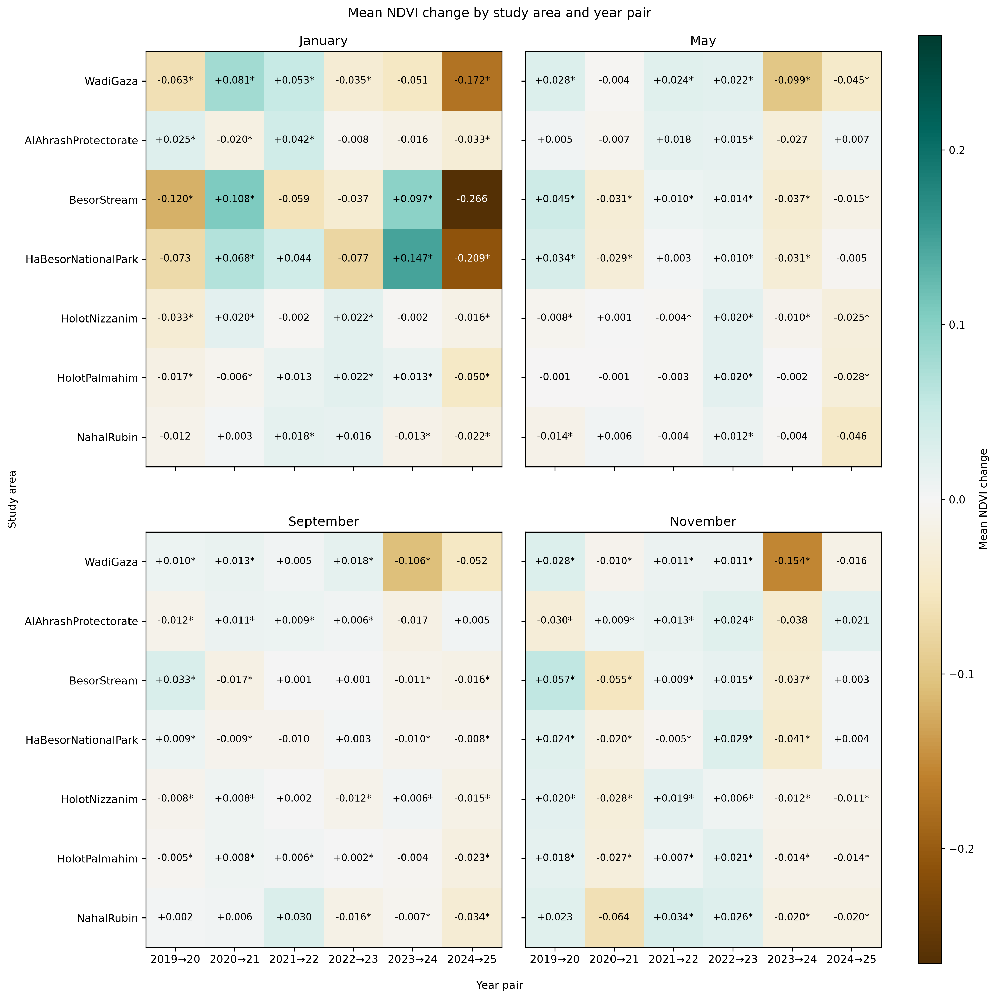

**Caption.** Mean NDVI change by site, month, and year pair; asterisks indicate spatially adjusted 95% confidence intervals excluding zero.

**Explanation.** Mean change in the normalized difference vegetation index (NDVI) by study site and consecutive year pair, with one panel per calendar month and Wadi Gaza in the top row. Brown denotes decreases and teal increases on a shared zero-centered scale. Cell labels report mean changes; asterisks mark individual spatially adjusted 95% confidence intervals excluding zero, without multiple-comparison adjustment. Change is the later year's index minus the earlier year's index for the same calendar month, averaged over pixels valid in both composites; negative values indicate a decrease. The primary range threshold is tau = 0.05; unmarked cells can include changes with undefined intervals.

Source: [12_visualize_change_results.ipynb](../../../../notebooks/12_visualize_change_results.ipynb); [method](../../../../docs/white-papers/Mean-Index-Change-Confidence-Intervals.md).

<!-- Figure SHA-256: a99e11055f66df247109f43d962056e9e877b650bd20d2f92be0c2d9cd7c1f91 -->
