<!-- Generated by generate_figure_captions.py; do not edit. -->

# Figure captions

Maintained in [figure-captions.yaml](../../../../../docs/figure-captions.yaml). Captions cover the current notebook selections only; other images in this folder may be retired or from a different selection. Figure numbering is assigned in the manuscript. Review captions alongside the images before publication.

## Al Ahrash Protectorate: January NDVI change correlograms

Figure: [AlAhrashProtectorate_01_correlograms_all_year_pairs.png](AlAhrashProtectorate_01_correlograms_all_year_pairs.png)

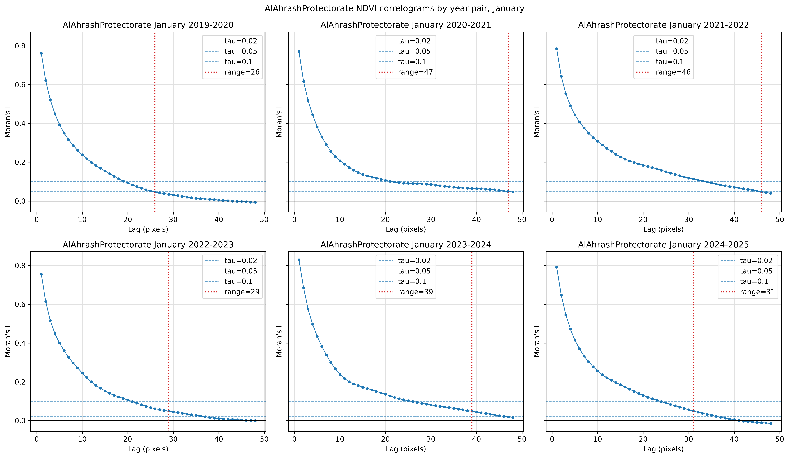

**Caption.** Moran's I correlograms of January NDVI changes at Al Ahrash Protectorate by year pair, showing range thresholds and selected decorrelation distances.

**Explanation.** Moran's I correlograms of January NDVI difference rasters at Al Ahrash Protectorate, with one panel per consecutive year pair. Lag is expressed in pixels using Chebyshev-distance rings. Horizontal dashed lines mark the tested range thresholds (0.02, 0.05, 0.1); a vertical dotted line, when present, marks the first lag with Moran's I below the primary threshold tau = 0.05. Absence of that line indicates that no range was found within the evaluated lags.

Source: [12_visualize_change_results.ipynb](../../../../../notebooks/12_visualize_change_results.ipynb); [method](../../../../../docs/white-papers/Mean-Index-Change-Confidence-Intervals.md).

<!-- Figure SHA-256: 1ab136cada7dc27db744751598ff9b87d7c0d6ee7162d9f516aec278c26d6d56 -->

## Al Ahrash Protectorate: May NDVI change correlograms

Figure: [AlAhrashProtectorate_05_correlograms_all_year_pairs.png](AlAhrashProtectorate_05_correlograms_all_year_pairs.png)

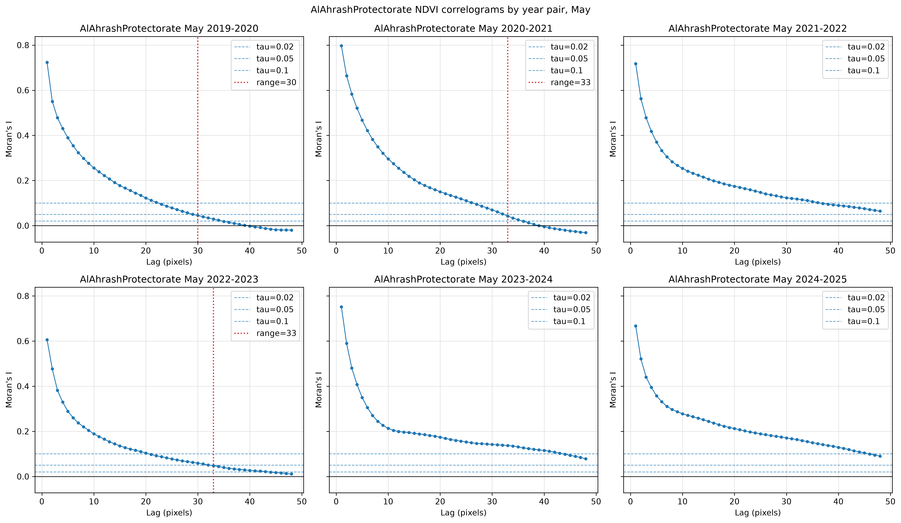

**Caption.** Moran's I correlograms of May NDVI changes at Al Ahrash Protectorate by year pair, showing range thresholds and selected decorrelation distances.

**Explanation.** Moran's I correlograms of May NDVI difference rasters at Al Ahrash Protectorate, with one panel per consecutive year pair. Lag is expressed in pixels using Chebyshev-distance rings. Horizontal dashed lines mark the tested range thresholds (0.02, 0.05, 0.1); a vertical dotted line, when present, marks the first lag with Moran's I below the primary threshold tau = 0.05. Absence of that line indicates that no range was found within the evaluated lags.

Source: [12_visualize_change_results.ipynb](../../../../../notebooks/12_visualize_change_results.ipynb); [method](../../../../../docs/white-papers/Mean-Index-Change-Confidence-Intervals.md).

<!-- Figure SHA-256: 723b2e641cd34b021e977d875ec594481ff02400db35ed8e4cd3609836617f86 -->

## Al Ahrash Protectorate: September NDVI change correlograms

Figure: [AlAhrashProtectorate_09_correlograms_all_year_pairs.png](AlAhrashProtectorate_09_correlograms_all_year_pairs.png)

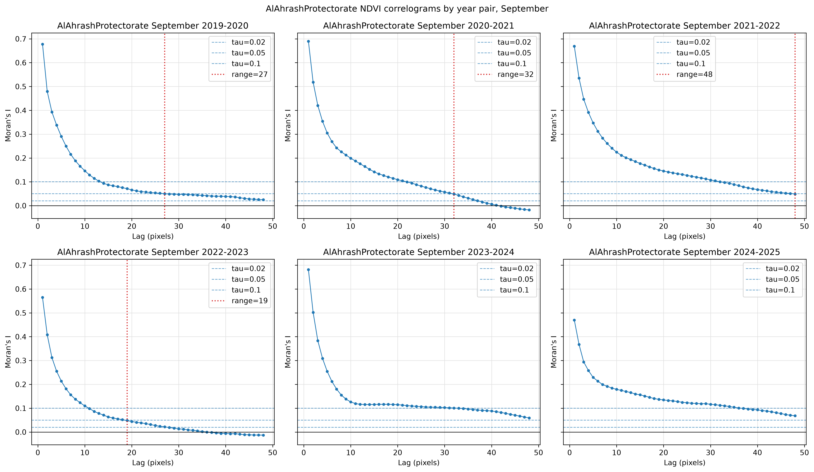

**Caption.** Moran's I correlograms of September NDVI changes at Al Ahrash Protectorate by year pair, showing range thresholds and selected decorrelation distances.

**Explanation.** Moran's I correlograms of September NDVI difference rasters at Al Ahrash Protectorate, with one panel per consecutive year pair. Lag is expressed in pixels using Chebyshev-distance rings. Horizontal dashed lines mark the tested range thresholds (0.02, 0.05, 0.1); a vertical dotted line, when present, marks the first lag with Moran's I below the primary threshold tau = 0.05. Absence of that line indicates that no range was found within the evaluated lags.

Source: [12_visualize_change_results.ipynb](../../../../../notebooks/12_visualize_change_results.ipynb); [method](../../../../../docs/white-papers/Mean-Index-Change-Confidence-Intervals.md).

<!-- Figure SHA-256: d23ed19adbe98b450f0429f079b9aaa3771958f7baab71772a36a2b68339e596 -->

## Al Ahrash Protectorate: November NDVI change correlograms

Figure: [AlAhrashProtectorate_11_correlograms_all_year_pairs.png](AlAhrashProtectorate_11_correlograms_all_year_pairs.png)

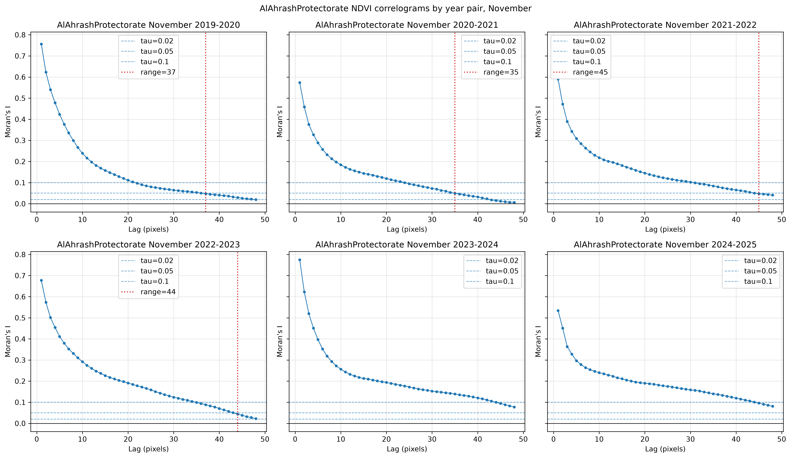

**Caption.** Moran's I correlograms of November NDVI changes at Al Ahrash Protectorate by year pair, showing range thresholds and selected decorrelation distances.

**Explanation.** Moran's I correlograms of November NDVI difference rasters at Al Ahrash Protectorate, with one panel per consecutive year pair. Lag is expressed in pixels using Chebyshev-distance rings. Horizontal dashed lines mark the tested range thresholds (0.02, 0.05, 0.1); a vertical dotted line, when present, marks the first lag with Moran's I below the primary threshold tau = 0.05. Absence of that line indicates that no range was found within the evaluated lags.

Source: [12_visualize_change_results.ipynb](../../../../../notebooks/12_visualize_change_results.ipynb); [method](../../../../../docs/white-papers/Mean-Index-Change-Confidence-Intervals.md).

<!-- Figure SHA-256: 9e8da27cb01182ed37c790cf3fc065d10e5f8913093741b20e9f892ff7dbe231 -->

## Besor Stream: January NDVI change correlograms

Figure: [BesorStream_01_correlograms_all_year_pairs.png](BesorStream_01_correlograms_all_year_pairs.png)

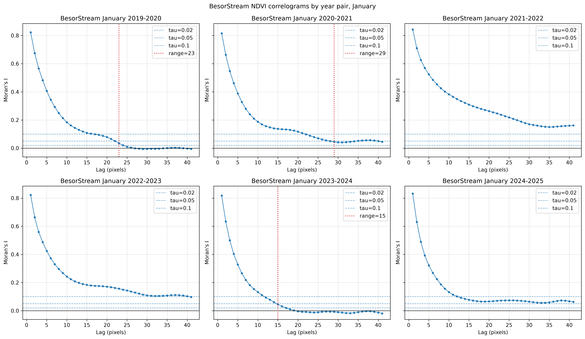

**Caption.** Moran's I correlograms of January NDVI changes at Besor Stream by year pair, showing range thresholds and selected decorrelation distances.

**Explanation.** Moran's I correlograms of January NDVI difference rasters at Besor Stream, with one panel per consecutive year pair. Lag is expressed in pixels using Chebyshev-distance rings. Horizontal dashed lines mark the tested range thresholds (0.02, 0.05, 0.1); a vertical dotted line, when present, marks the first lag with Moran's I below the primary threshold tau = 0.05. Absence of that line indicates that no range was found within the evaluated lags.

Source: [12_visualize_change_results.ipynb](../../../../../notebooks/12_visualize_change_results.ipynb); [method](../../../../../docs/white-papers/Mean-Index-Change-Confidence-Intervals.md).

<!-- Figure SHA-256: b71b6bc38572f0c89dc3ce90b5c77622ce2c77a9673df698c91ee34c45b146e7 -->

## Besor Stream: May NDVI change correlograms

Figure: [BesorStream_05_correlograms_all_year_pairs.png](BesorStream_05_correlograms_all_year_pairs.png)

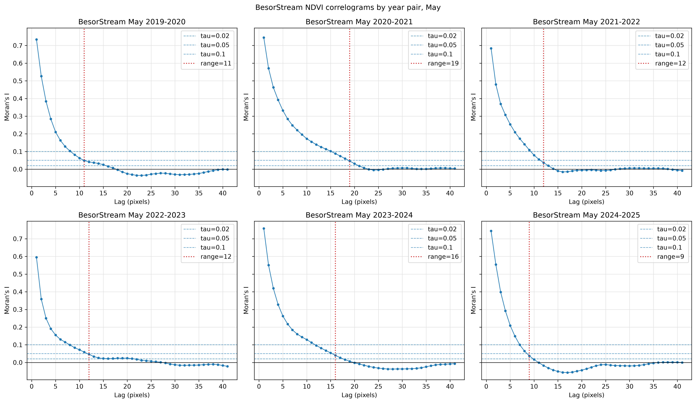

**Caption.** Moran's I correlograms of May NDVI changes at Besor Stream by year pair, showing range thresholds and selected decorrelation distances.

**Explanation.** Moran's I correlograms of May NDVI difference rasters at Besor Stream, with one panel per consecutive year pair. Lag is expressed in pixels using Chebyshev-distance rings. Horizontal dashed lines mark the tested range thresholds (0.02, 0.05, 0.1); a vertical dotted line, when present, marks the first lag with Moran's I below the primary threshold tau = 0.05. Absence of that line indicates that no range was found within the evaluated lags.

Source: [12_visualize_change_results.ipynb](../../../../../notebooks/12_visualize_change_results.ipynb); [method](../../../../../docs/white-papers/Mean-Index-Change-Confidence-Intervals.md).

<!-- Figure SHA-256: 20654f33d8c651f7972f5b2b86bdc80f76d2f3dd7879ebd22efd19412a1f9d83 -->

## Besor Stream: September NDVI change correlograms

Figure: [BesorStream_09_correlograms_all_year_pairs.png](BesorStream_09_correlograms_all_year_pairs.png)

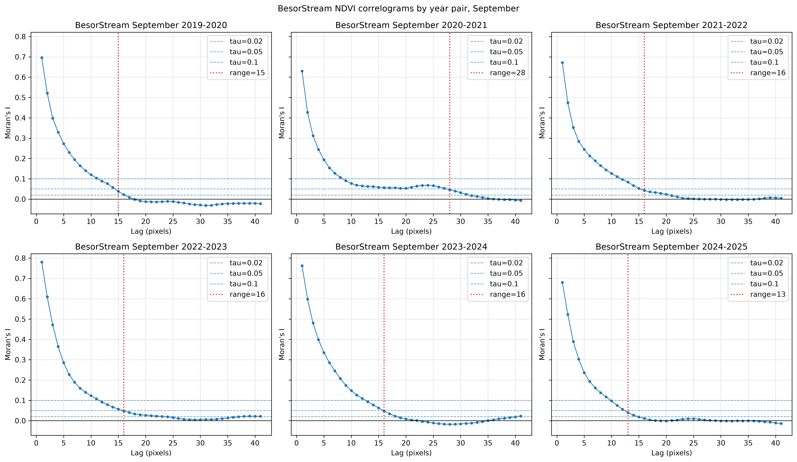

**Caption.** Moran's I correlograms of September NDVI changes at Besor Stream by year pair, showing range thresholds and selected decorrelation distances.

**Explanation.** Moran's I correlograms of September NDVI difference rasters at Besor Stream, with one panel per consecutive year pair. Lag is expressed in pixels using Chebyshev-distance rings. Horizontal dashed lines mark the tested range thresholds (0.02, 0.05, 0.1); a vertical dotted line, when present, marks the first lag with Moran's I below the primary threshold tau = 0.05. Absence of that line indicates that no range was found within the evaluated lags.

Source: [12_visualize_change_results.ipynb](../../../../../notebooks/12_visualize_change_results.ipynb); [method](../../../../../docs/white-papers/Mean-Index-Change-Confidence-Intervals.md).

<!-- Figure SHA-256: 7ec5417aa7a48404d6de339729e4112d8ad3d571fec9c8b123df260a02785f3f -->

## Besor Stream: November NDVI change correlograms

Figure: [BesorStream_11_correlograms_all_year_pairs.png](BesorStream_11_correlograms_all_year_pairs.png)

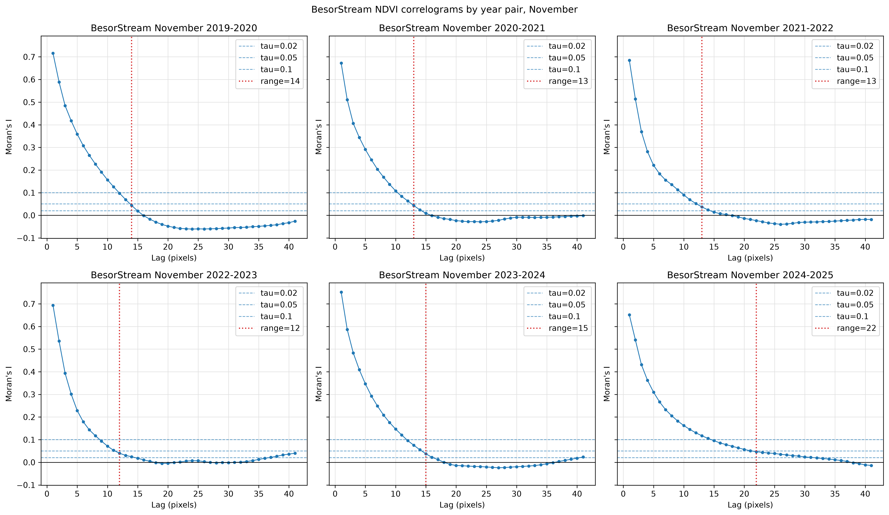

**Caption.** Moran's I correlograms of November NDVI changes at Besor Stream by year pair, showing range thresholds and selected decorrelation distances.

**Explanation.** Moran's I correlograms of November NDVI difference rasters at Besor Stream, with one panel per consecutive year pair. Lag is expressed in pixels using Chebyshev-distance rings. Horizontal dashed lines mark the tested range thresholds (0.02, 0.05, 0.1); a vertical dotted line, when present, marks the first lag with Moran's I below the primary threshold tau = 0.05. Absence of that line indicates that no range was found within the evaluated lags.

Source: [12_visualize_change_results.ipynb](../../../../../notebooks/12_visualize_change_results.ipynb); [method](../../../../../docs/white-papers/Mean-Index-Change-Confidence-Intervals.md).

<!-- Figure SHA-256: a227c3b1afd30e07a25eff0247aa46e824f1b4d6e83827932fe29168797550bb -->

## HaBesor National Park: January NDVI change correlograms

Figure: [HaBesorNationalPark_01_correlograms_all_year_pairs.png](HaBesorNationalPark_01_correlograms_all_year_pairs.png)

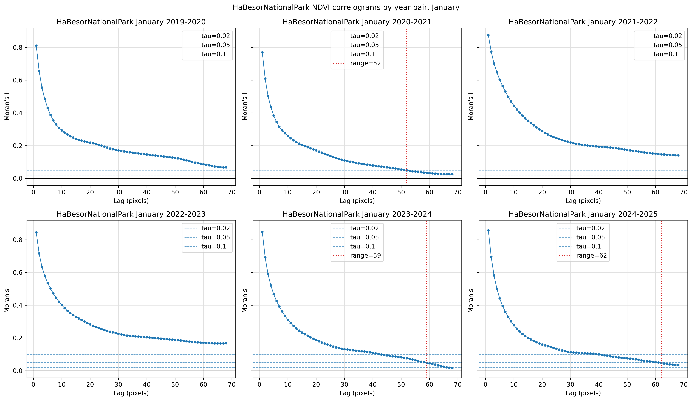

**Caption.** Moran's I correlograms of January NDVI changes at HaBesor National Park by year pair, showing range thresholds and selected decorrelation distances.

**Explanation.** Moran's I correlograms of January NDVI difference rasters at HaBesor National Park, with one panel per consecutive year pair. Lag is expressed in pixels using Chebyshev-distance rings. Horizontal dashed lines mark the tested range thresholds (0.02, 0.05, 0.1); a vertical dotted line, when present, marks the first lag with Moran's I below the primary threshold tau = 0.05. Absence of that line indicates that no range was found within the evaluated lags.

Source: [12_visualize_change_results.ipynb](../../../../../notebooks/12_visualize_change_results.ipynb); [method](../../../../../docs/white-papers/Mean-Index-Change-Confidence-Intervals.md).

<!-- Figure SHA-256: f6fdd88fe53033d10b6e519bf0972fec8b0a029740cf7204306a072fd9601af1 -->

## HaBesor National Park: May NDVI change correlograms

Figure: [HaBesorNationalPark_05_correlograms_all_year_pairs.png](HaBesorNationalPark_05_correlograms_all_year_pairs.png)

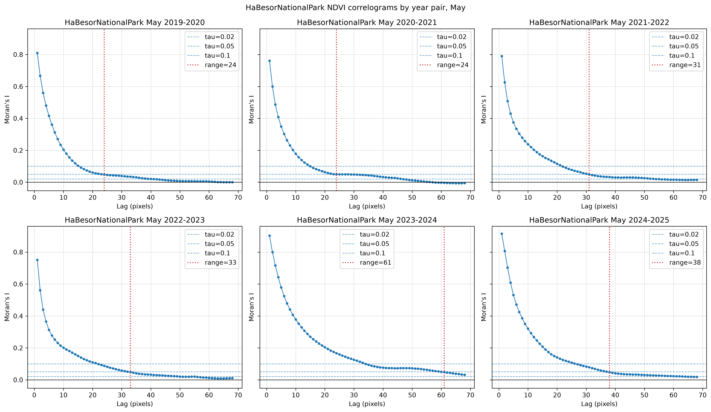

**Caption.** Moran's I correlograms of May NDVI changes at HaBesor National Park by year pair, showing range thresholds and selected decorrelation distances.

**Explanation.** Moran's I correlograms of May NDVI difference rasters at HaBesor National Park, with one panel per consecutive year pair. Lag is expressed in pixels using Chebyshev-distance rings. Horizontal dashed lines mark the tested range thresholds (0.02, 0.05, 0.1); a vertical dotted line, when present, marks the first lag with Moran's I below the primary threshold tau = 0.05. Absence of that line indicates that no range was found within the evaluated lags.

Source: [12_visualize_change_results.ipynb](../../../../../notebooks/12_visualize_change_results.ipynb); [method](../../../../../docs/white-papers/Mean-Index-Change-Confidence-Intervals.md).

<!-- Figure SHA-256: 006491a4263012d90d18ff1c9c41842bffb21cee3cd149c33f8106e1bbc97425 -->

## HaBesor National Park: September NDVI change correlograms

Figure: [HaBesorNationalPark_09_correlograms_all_year_pairs.png](HaBesorNationalPark_09_correlograms_all_year_pairs.png)

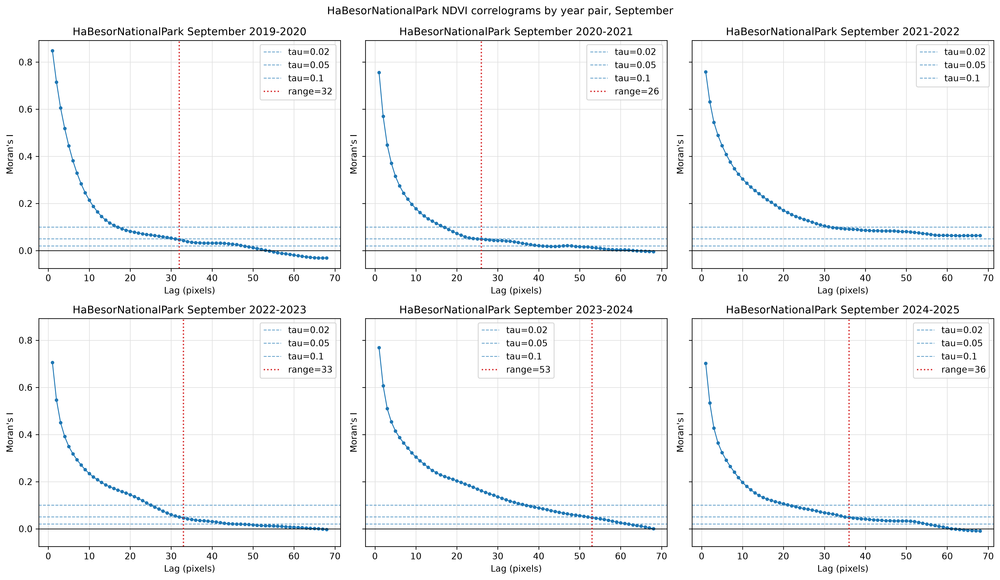

**Caption.** Moran's I correlograms of September NDVI changes at HaBesor National Park by year pair, showing range thresholds and selected decorrelation distances.

**Explanation.** Moran's I correlograms of September NDVI difference rasters at HaBesor National Park, with one panel per consecutive year pair. Lag is expressed in pixels using Chebyshev-distance rings. Horizontal dashed lines mark the tested range thresholds (0.02, 0.05, 0.1); a vertical dotted line, when present, marks the first lag with Moran's I below the primary threshold tau = 0.05. Absence of that line indicates that no range was found within the evaluated lags.

Source: [12_visualize_change_results.ipynb](../../../../../notebooks/12_visualize_change_results.ipynb); [method](../../../../../docs/white-papers/Mean-Index-Change-Confidence-Intervals.md).

<!-- Figure SHA-256: 40ca039394316d9be7068242853c3a86cf4780cf3e59006842a3e33df837087a -->

## HaBesor National Park: November NDVI change correlograms

Figure: [HaBesorNationalPark_11_correlograms_all_year_pairs.png](HaBesorNationalPark_11_correlograms_all_year_pairs.png)

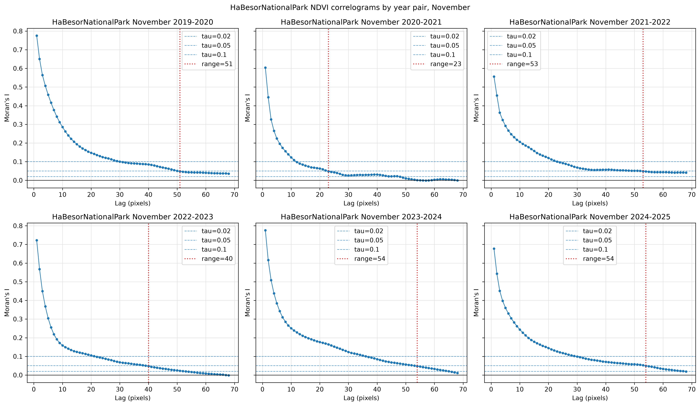

**Caption.** Moran's I correlograms of November NDVI changes at HaBesor National Park by year pair, showing range thresholds and selected decorrelation distances.

**Explanation.** Moran's I correlograms of November NDVI difference rasters at HaBesor National Park, with one panel per consecutive year pair. Lag is expressed in pixels using Chebyshev-distance rings. Horizontal dashed lines mark the tested range thresholds (0.02, 0.05, 0.1); a vertical dotted line, when present, marks the first lag with Moran's I below the primary threshold tau = 0.05. Absence of that line indicates that no range was found within the evaluated lags.

Source: [12_visualize_change_results.ipynb](../../../../../notebooks/12_visualize_change_results.ipynb); [method](../../../../../docs/white-papers/Mean-Index-Change-Confidence-Intervals.md).

<!-- Figure SHA-256: 090397567d7792693120506afd529056886d7de6f7646a86b13dc5f45abf2b4d -->

## Holot Nizzanim: January NDVI change correlograms

Figure: [HolotNizzanim_01_correlograms_all_year_pairs.png](HolotNizzanim_01_correlograms_all_year_pairs.png)

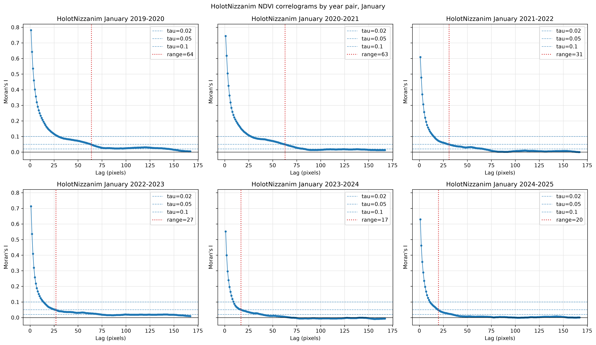

**Caption.** Moran's I correlograms of January NDVI changes at Holot Nizzanim by year pair, showing range thresholds and selected decorrelation distances.

**Explanation.** Moran's I correlograms of January NDVI difference rasters at Holot Nizzanim, with one panel per consecutive year pair. Lag is expressed in pixels using Chebyshev-distance rings. Horizontal dashed lines mark the tested range thresholds (0.02, 0.05, 0.1); a vertical dotted line, when present, marks the first lag with Moran's I below the primary threshold tau = 0.05. Absence of that line indicates that no range was found within the evaluated lags.

Source: [12_visualize_change_results.ipynb](../../../../../notebooks/12_visualize_change_results.ipynb); [method](../../../../../docs/white-papers/Mean-Index-Change-Confidence-Intervals.md).

<!-- Figure SHA-256: 8853b84c3854bebe0d6d59547be66e3655060f7a636a61746c315612236a0cc7 -->

## Holot Nizzanim: May NDVI change correlograms

Figure: [HolotNizzanim_05_correlograms_all_year_pairs.png](HolotNizzanim_05_correlograms_all_year_pairs.png)

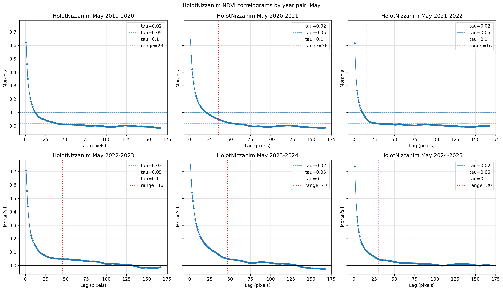

**Caption.** Moran's I correlograms of May NDVI changes at Holot Nizzanim by year pair, showing range thresholds and selected decorrelation distances.

**Explanation.** Moran's I correlograms of May NDVI difference rasters at Holot Nizzanim, with one panel per consecutive year pair. Lag is expressed in pixels using Chebyshev-distance rings. Horizontal dashed lines mark the tested range thresholds (0.02, 0.05, 0.1); a vertical dotted line, when present, marks the first lag with Moran's I below the primary threshold tau = 0.05. Absence of that line indicates that no range was found within the evaluated lags.

Source: [12_visualize_change_results.ipynb](../../../../../notebooks/12_visualize_change_results.ipynb); [method](../../../../../docs/white-papers/Mean-Index-Change-Confidence-Intervals.md).

<!-- Figure SHA-256: 39dee7de1448eb60f9d0a77ca99797ba12f6fc2b6e75a401aa1f7926a59a0f2c -->

## Holot Nizzanim: September NDVI change correlograms

Figure: [HolotNizzanim_09_correlograms_all_year_pairs.png](HolotNizzanim_09_correlograms_all_year_pairs.png)

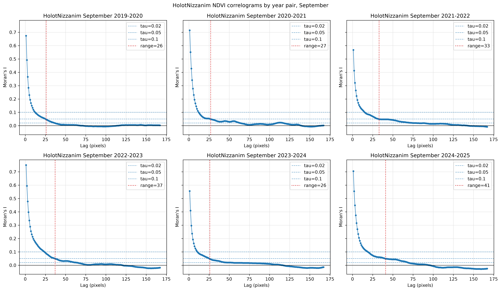

**Caption.** Moran's I correlograms of September NDVI changes at Holot Nizzanim by year pair, showing range thresholds and selected decorrelation distances.

**Explanation.** Moran's I correlograms of September NDVI difference rasters at Holot Nizzanim, with one panel per consecutive year pair. Lag is expressed in pixels using Chebyshev-distance rings. Horizontal dashed lines mark the tested range thresholds (0.02, 0.05, 0.1); a vertical dotted line, when present, marks the first lag with Moran's I below the primary threshold tau = 0.05. Absence of that line indicates that no range was found within the evaluated lags.

Source: [12_visualize_change_results.ipynb](../../../../../notebooks/12_visualize_change_results.ipynb); [method](../../../../../docs/white-papers/Mean-Index-Change-Confidence-Intervals.md).

<!-- Figure SHA-256: ddad2919cddeede43c1818023b814cc2733c129b6cdfccf2b945a47113f5d608 -->

## Holot Nizzanim: November NDVI change correlograms

Figure: [HolotNizzanim_11_correlograms_all_year_pairs.png](HolotNizzanim_11_correlograms_all_year_pairs.png)

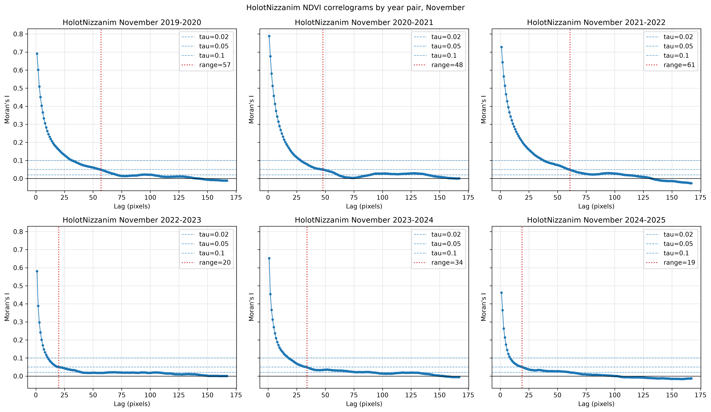

**Caption.** Moran's I correlograms of November NDVI changes at Holot Nizzanim by year pair, showing range thresholds and selected decorrelation distances.

**Explanation.** Moran's I correlograms of November NDVI difference rasters at Holot Nizzanim, with one panel per consecutive year pair. Lag is expressed in pixels using Chebyshev-distance rings. Horizontal dashed lines mark the tested range thresholds (0.02, 0.05, 0.1); a vertical dotted line, when present, marks the first lag with Moran's I below the primary threshold tau = 0.05. Absence of that line indicates that no range was found within the evaluated lags.

Source: [12_visualize_change_results.ipynb](../../../../../notebooks/12_visualize_change_results.ipynb); [method](../../../../../docs/white-papers/Mean-Index-Change-Confidence-Intervals.md).

<!-- Figure SHA-256: 05614643a5708e752a74da5724c1bb50c29bca92890d5f9a122be84ac9c3bf5a -->

## Holot Palmahim: January NDVI change correlograms

Figure: [HolotPalmahim_01_correlograms_all_year_pairs.png](HolotPalmahim_01_correlograms_all_year_pairs.png)

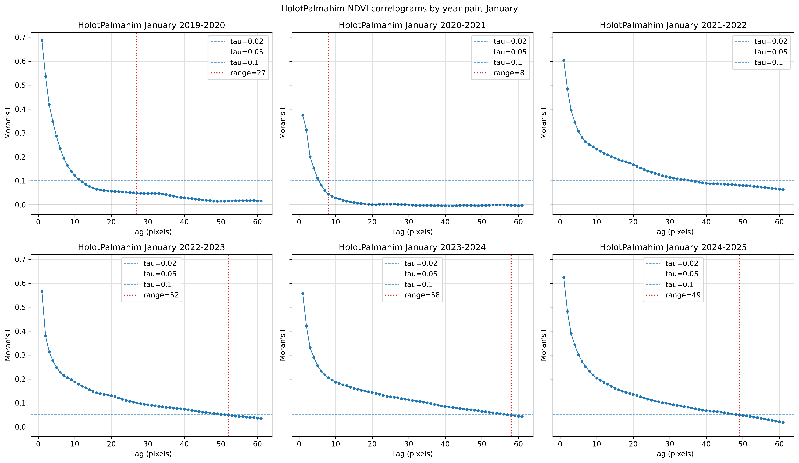

**Caption.** Moran's I correlograms of January NDVI changes at Holot Palmahim by year pair, showing range thresholds and selected decorrelation distances.

**Explanation.** Moran's I correlograms of January NDVI difference rasters at Holot Palmahim, with one panel per consecutive year pair. Lag is expressed in pixels using Chebyshev-distance rings. Horizontal dashed lines mark the tested range thresholds (0.02, 0.05, 0.1); a vertical dotted line, when present, marks the first lag with Moran's I below the primary threshold tau = 0.05. Absence of that line indicates that no range was found within the evaluated lags.

Source: [12_visualize_change_results.ipynb](../../../../../notebooks/12_visualize_change_results.ipynb); [method](../../../../../docs/white-papers/Mean-Index-Change-Confidence-Intervals.md).

<!-- Figure SHA-256: 094d8b6773cf4bda8f7eec01d9892c6dec30ff4faf96412cbc756569ae3a737b -->

## Holot Palmahim: May NDVI change correlograms

Figure: [HolotPalmahim_05_correlograms_all_year_pairs.png](HolotPalmahim_05_correlograms_all_year_pairs.png)

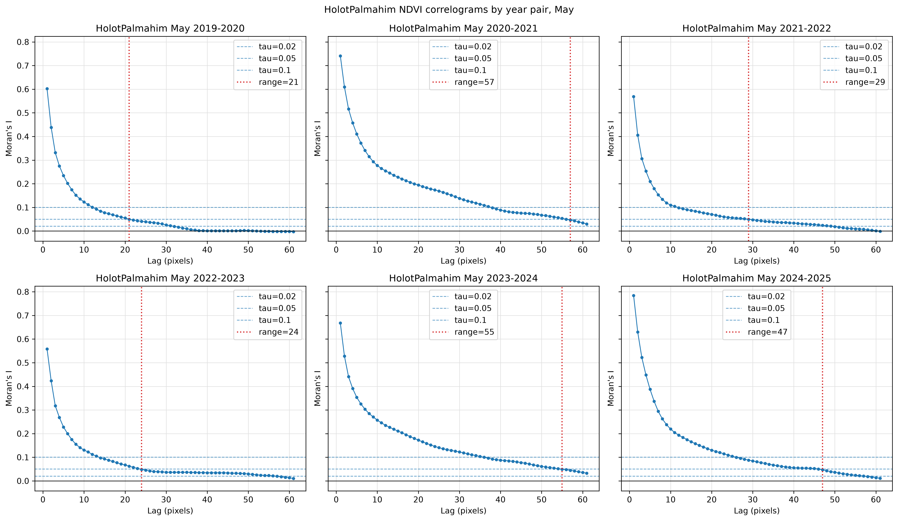

**Caption.** Moran's I correlograms of May NDVI changes at Holot Palmahim by year pair, showing range thresholds and selected decorrelation distances.

**Explanation.** Moran's I correlograms of May NDVI difference rasters at Holot Palmahim, with one panel per consecutive year pair. Lag is expressed in pixels using Chebyshev-distance rings. Horizontal dashed lines mark the tested range thresholds (0.02, 0.05, 0.1); a vertical dotted line, when present, marks the first lag with Moran's I below the primary threshold tau = 0.05. Absence of that line indicates that no range was found within the evaluated lags.

Source: [12_visualize_change_results.ipynb](../../../../../notebooks/12_visualize_change_results.ipynb); [method](../../../../../docs/white-papers/Mean-Index-Change-Confidence-Intervals.md).

<!-- Figure SHA-256: ccf694aadf71b2e3601c111df6a6fe3f4d68c19db79db0b0e521af3b3aeea9b3 -->

## Holot Palmahim: September NDVI change correlograms

Figure: [HolotPalmahim_09_correlograms_all_year_pairs.png](HolotPalmahim_09_correlograms_all_year_pairs.png)

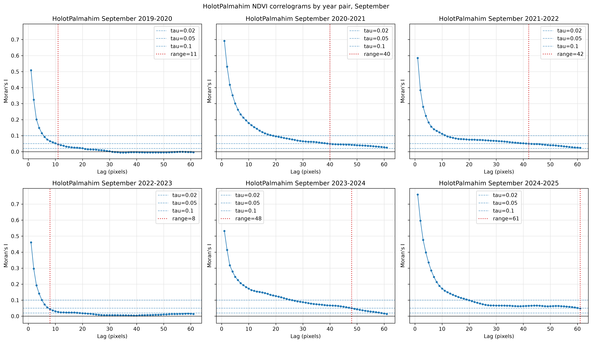

**Caption.** Moran's I correlograms of September NDVI changes at Holot Palmahim by year pair, showing range thresholds and selected decorrelation distances.

**Explanation.** Moran's I correlograms of September NDVI difference rasters at Holot Palmahim, with one panel per consecutive year pair. Lag is expressed in pixels using Chebyshev-distance rings. Horizontal dashed lines mark the tested range thresholds (0.02, 0.05, 0.1); a vertical dotted line, when present, marks the first lag with Moran's I below the primary threshold tau = 0.05. Absence of that line indicates that no range was found within the evaluated lags.

Source: [12_visualize_change_results.ipynb](../../../../../notebooks/12_visualize_change_results.ipynb); [method](../../../../../docs/white-papers/Mean-Index-Change-Confidence-Intervals.md).

<!-- Figure SHA-256: 455f8b205200a4d42de4b3e6835509d6fa634db533fc99e6d6f1f36e24bef7ae -->

## Holot Palmahim: November NDVI change correlograms

Figure: [HolotPalmahim_11_correlograms_all_year_pairs.png](HolotPalmahim_11_correlograms_all_year_pairs.png)

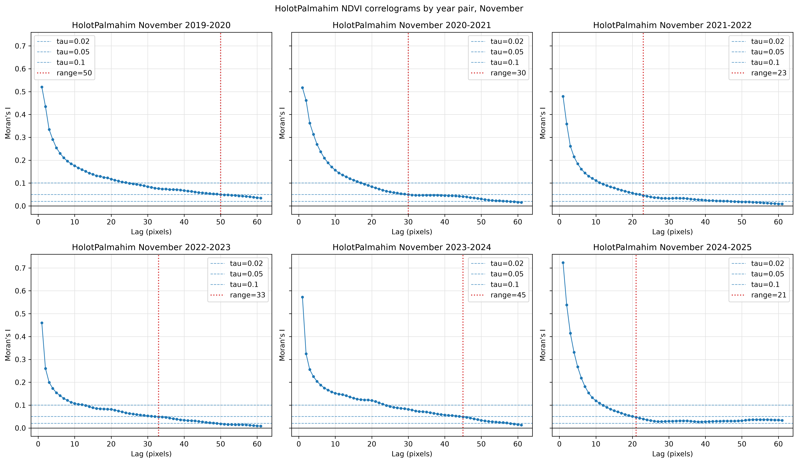

**Caption.** Moran's I correlograms of November NDVI changes at Holot Palmahim by year pair, showing range thresholds and selected decorrelation distances.

**Explanation.** Moran's I correlograms of November NDVI difference rasters at Holot Palmahim, with one panel per consecutive year pair. Lag is expressed in pixels using Chebyshev-distance rings. Horizontal dashed lines mark the tested range thresholds (0.02, 0.05, 0.1); a vertical dotted line, when present, marks the first lag with Moran's I below the primary threshold tau = 0.05. Absence of that line indicates that no range was found within the evaluated lags.

Source: [12_visualize_change_results.ipynb](../../../../../notebooks/12_visualize_change_results.ipynb); [method](../../../../../docs/white-papers/Mean-Index-Change-Confidence-Intervals.md).

<!-- Figure SHA-256: 30fe75cdf6bb9d2a668bfc157114ecbaa0c851c18e5cc4ee3907e94a1ccc13ef -->

## Nahal Rubin: January NDVI change correlograms

Figure: [NahalRubin_01_correlograms_all_year_pairs.png](NahalRubin_01_correlograms_all_year_pairs.png)

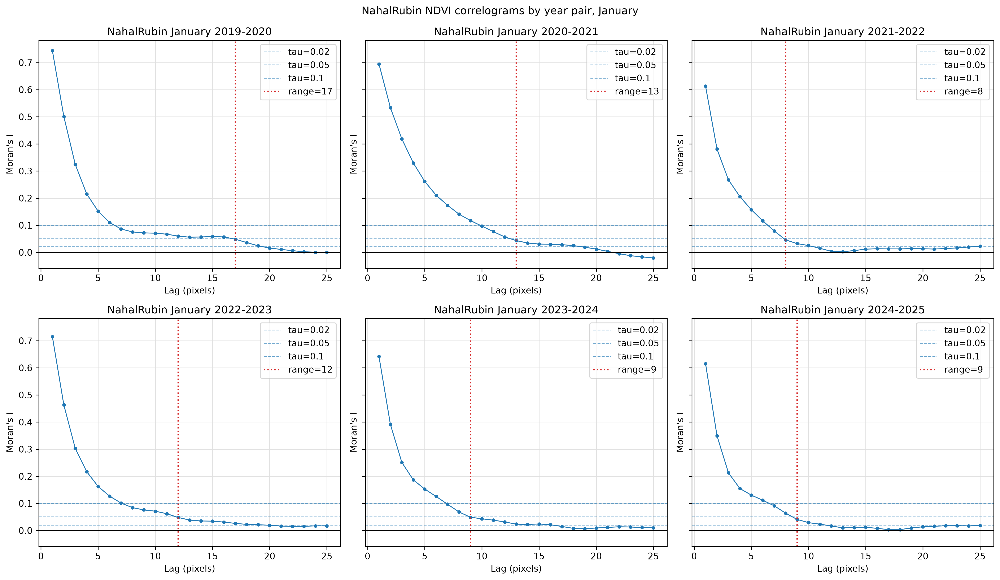

**Caption.** Moran's I correlograms of January NDVI changes at Nahal Rubin by year pair, showing range thresholds and selected decorrelation distances.

**Explanation.** Moran's I correlograms of January NDVI difference rasters at Nahal Rubin, with one panel per consecutive year pair. Lag is expressed in pixels using Chebyshev-distance rings. Horizontal dashed lines mark the tested range thresholds (0.02, 0.05, 0.1); a vertical dotted line, when present, marks the first lag with Moran's I below the primary threshold tau = 0.05. Absence of that line indicates that no range was found within the evaluated lags.

Source: [12_visualize_change_results.ipynb](../../../../../notebooks/12_visualize_change_results.ipynb); [method](../../../../../docs/white-papers/Mean-Index-Change-Confidence-Intervals.md).

<!-- Figure SHA-256: a2e4c5ce478a3ded4bdecdf230fdd05f0c7b2223dfed2f52f1783ca1070522e5 -->

## Nahal Rubin: May NDVI change correlograms

Figure: [NahalRubin_05_correlograms_all_year_pairs.png](NahalRubin_05_correlograms_all_year_pairs.png)

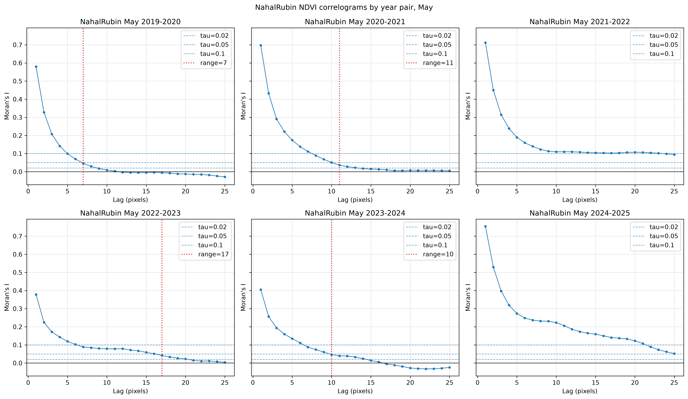

**Caption.** Moran's I correlograms of May NDVI changes at Nahal Rubin by year pair, showing range thresholds and selected decorrelation distances.

**Explanation.** Moran's I correlograms of May NDVI difference rasters at Nahal Rubin, with one panel per consecutive year pair. Lag is expressed in pixels using Chebyshev-distance rings. Horizontal dashed lines mark the tested range thresholds (0.02, 0.05, 0.1); a vertical dotted line, when present, marks the first lag with Moran's I below the primary threshold tau = 0.05. Absence of that line indicates that no range was found within the evaluated lags.

Source: [12_visualize_change_results.ipynb](../../../../../notebooks/12_visualize_change_results.ipynb); [method](../../../../../docs/white-papers/Mean-Index-Change-Confidence-Intervals.md).

<!-- Figure SHA-256: 5dc48a542e1193d279059acb99c3881e8e67c5f19d4447798249d1ce07165f37 -->

## Nahal Rubin: September NDVI change correlograms

Figure: [NahalRubin_09_correlograms_all_year_pairs.png](NahalRubin_09_correlograms_all_year_pairs.png)

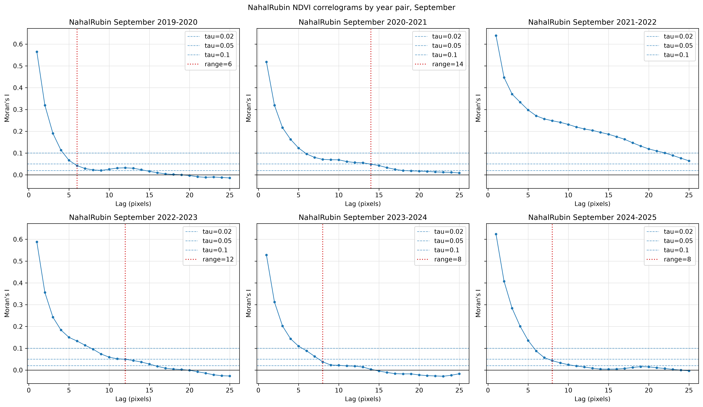

**Caption.** Moran's I correlograms of September NDVI changes at Nahal Rubin by year pair, showing range thresholds and selected decorrelation distances.

**Explanation.** Moran's I correlograms of September NDVI difference rasters at Nahal Rubin, with one panel per consecutive year pair. Lag is expressed in pixels using Chebyshev-distance rings. Horizontal dashed lines mark the tested range thresholds (0.02, 0.05, 0.1); a vertical dotted line, when present, marks the first lag with Moran's I below the primary threshold tau = 0.05. Absence of that line indicates that no range was found within the evaluated lags.

Source: [12_visualize_change_results.ipynb](../../../../../notebooks/12_visualize_change_results.ipynb); [method](../../../../../docs/white-papers/Mean-Index-Change-Confidence-Intervals.md).

<!-- Figure SHA-256: 23a94fcab160858745c263926ef85a63d8aab5a3f428d02edefc7e2d571c4988 -->

## Nahal Rubin: November NDVI change correlograms

Figure: [NahalRubin_11_correlograms_all_year_pairs.png](NahalRubin_11_correlograms_all_year_pairs.png)

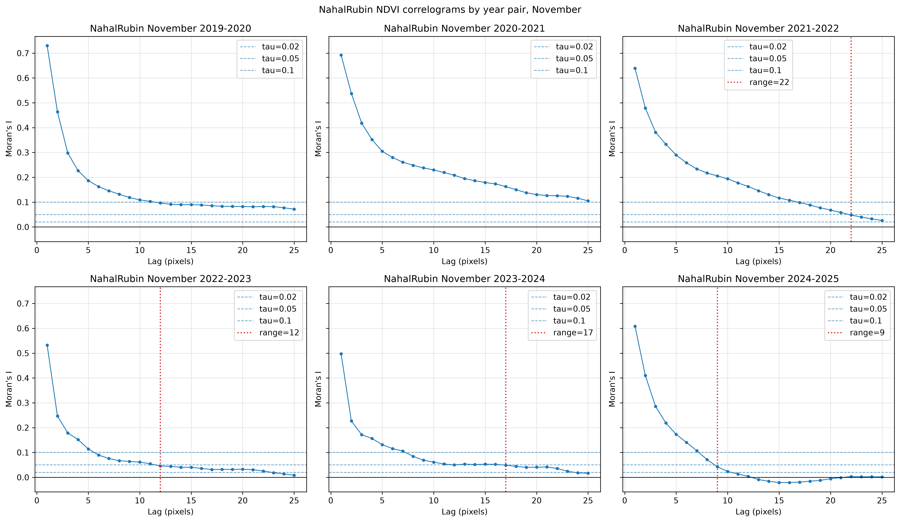

**Caption.** Moran's I correlograms of November NDVI changes at Nahal Rubin by year pair, showing range thresholds and selected decorrelation distances.

**Explanation.** Moran's I correlograms of November NDVI difference rasters at Nahal Rubin, with one panel per consecutive year pair. Lag is expressed in pixels using Chebyshev-distance rings. Horizontal dashed lines mark the tested range thresholds (0.02, 0.05, 0.1); a vertical dotted line, when present, marks the first lag with Moran's I below the primary threshold tau = 0.05. Absence of that line indicates that no range was found within the evaluated lags.

Source: [12_visualize_change_results.ipynb](../../../../../notebooks/12_visualize_change_results.ipynb); [method](../../../../../docs/white-papers/Mean-Index-Change-Confidence-Intervals.md).

<!-- Figure SHA-256: fa9721c4165155daef104dbce582fafbc7afcfc7666559e813b038f87407a289 -->

## Wadi Gaza: January NDVI change correlograms

Figure: [WadiGaza_01_correlograms_all_year_pairs.png](WadiGaza_01_correlograms_all_year_pairs.png)

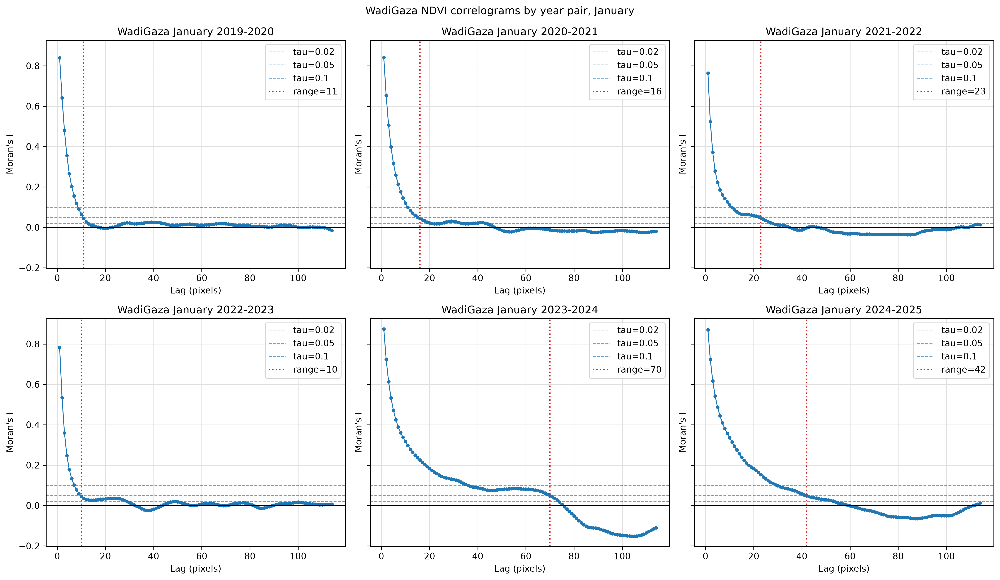

**Caption.** Moran's I correlograms of January NDVI changes at Wadi Gaza by year pair, showing range thresholds and selected decorrelation distances.

**Explanation.** Moran's I correlograms of January NDVI difference rasters at Wadi Gaza, with one panel per consecutive year pair. Lag is expressed in pixels using Chebyshev-distance rings. Horizontal dashed lines mark the tested range thresholds (0.02, 0.05, 0.1); a vertical dotted line, when present, marks the first lag with Moran's I below the primary threshold tau = 0.05. Absence of that line indicates that no range was found within the evaluated lags.

Source: [12_visualize_change_results.ipynb](../../../../../notebooks/12_visualize_change_results.ipynb); [method](../../../../../docs/white-papers/Mean-Index-Change-Confidence-Intervals.md).

<!-- Figure SHA-256: 1b26149419b7cddba0924b6c4e12b6fd717bd1964d3d1fc99498bbcd4c5af9ea -->

## Wadi Gaza: May NDVI change correlograms

Figure: [WadiGaza_05_correlograms_all_year_pairs.png](WadiGaza_05_correlograms_all_year_pairs.png)

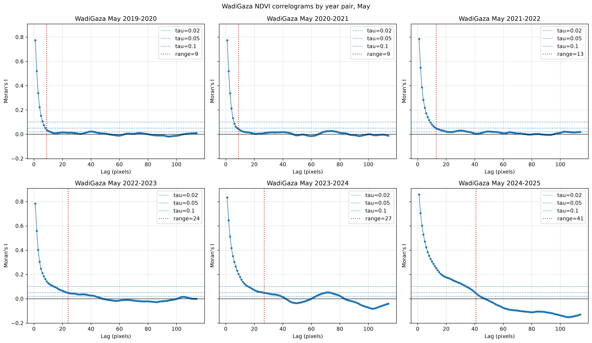

**Caption.** Moran's I correlograms of May NDVI changes at Wadi Gaza by year pair, showing range thresholds and selected decorrelation distances.

**Explanation.** Moran's I correlograms of May NDVI difference rasters at Wadi Gaza, with one panel per consecutive year pair. Lag is expressed in pixels using Chebyshev-distance rings. Horizontal dashed lines mark the tested range thresholds (0.02, 0.05, 0.1); a vertical dotted line, when present, marks the first lag with Moran's I below the primary threshold tau = 0.05. Absence of that line indicates that no range was found within the evaluated lags.

Source: [12_visualize_change_results.ipynb](../../../../../notebooks/12_visualize_change_results.ipynb); [method](../../../../../docs/white-papers/Mean-Index-Change-Confidence-Intervals.md).

<!-- Figure SHA-256: 284f9e433ef20339de77630aa72b7a1fedf11dd5eae9e97f519018d16e1bc6bf -->

## Wadi Gaza: September NDVI change correlograms

Figure: [WadiGaza_09_correlograms_all_year_pairs.png](WadiGaza_09_correlograms_all_year_pairs.png)

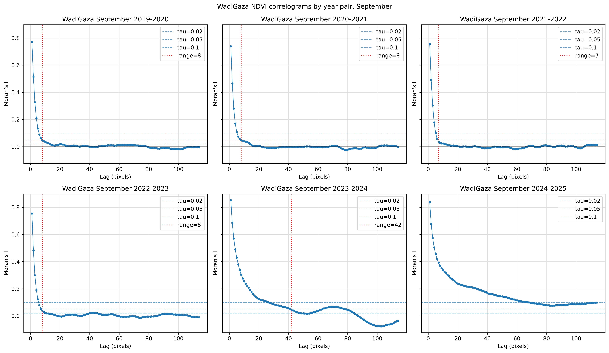

**Caption.** Moran's I correlograms of September NDVI changes at Wadi Gaza by year pair, showing range thresholds and selected decorrelation distances.

**Explanation.** Moran's I correlograms of September NDVI difference rasters at Wadi Gaza, with one panel per consecutive year pair. Lag is expressed in pixels using Chebyshev-distance rings. Horizontal dashed lines mark the tested range thresholds (0.02, 0.05, 0.1); a vertical dotted line, when present, marks the first lag with Moran's I below the primary threshold tau = 0.05. Absence of that line indicates that no range was found within the evaluated lags.

Source: [12_visualize_change_results.ipynb](../../../../../notebooks/12_visualize_change_results.ipynb); [method](../../../../../docs/white-papers/Mean-Index-Change-Confidence-Intervals.md).

<!-- Figure SHA-256: 8049c582b35a4832efaed886de5a25df2ada370465a003dc856e2422135dca6a -->

## Wadi Gaza: November NDVI change correlograms

Figure: [WadiGaza_11_correlograms_all_year_pairs.png](WadiGaza_11_correlograms_all_year_pairs.png)

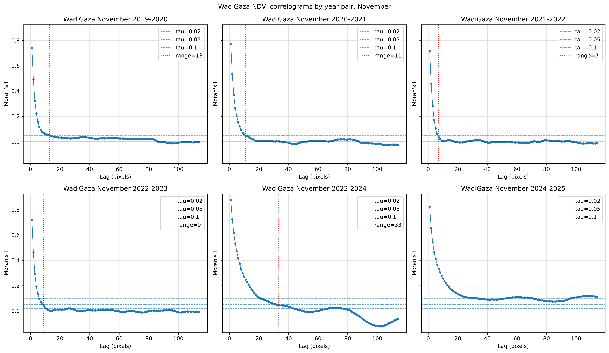

**Caption.** Moran's I correlograms of November NDVI changes at Wadi Gaza by year pair, showing range thresholds and selected decorrelation distances.

**Explanation.** Moran's I correlograms of November NDVI difference rasters at Wadi Gaza, with one panel per consecutive year pair. Lag is expressed in pixels using Chebyshev-distance rings. Horizontal dashed lines mark the tested range thresholds (0.02, 0.05, 0.1); a vertical dotted line, when present, marks the first lag with Moran's I below the primary threshold tau = 0.05. Absence of that line indicates that no range was found within the evaluated lags.

Source: [12_visualize_change_results.ipynb](../../../../../notebooks/12_visualize_change_results.ipynb); [method](../../../../../docs/white-papers/Mean-Index-Change-Confidence-Intervals.md).

<!-- Figure SHA-256: 78217bcdcbbc072fa71229aa4c7aa7f66c72b0bc0d69d860730597b892a30fb0 -->
