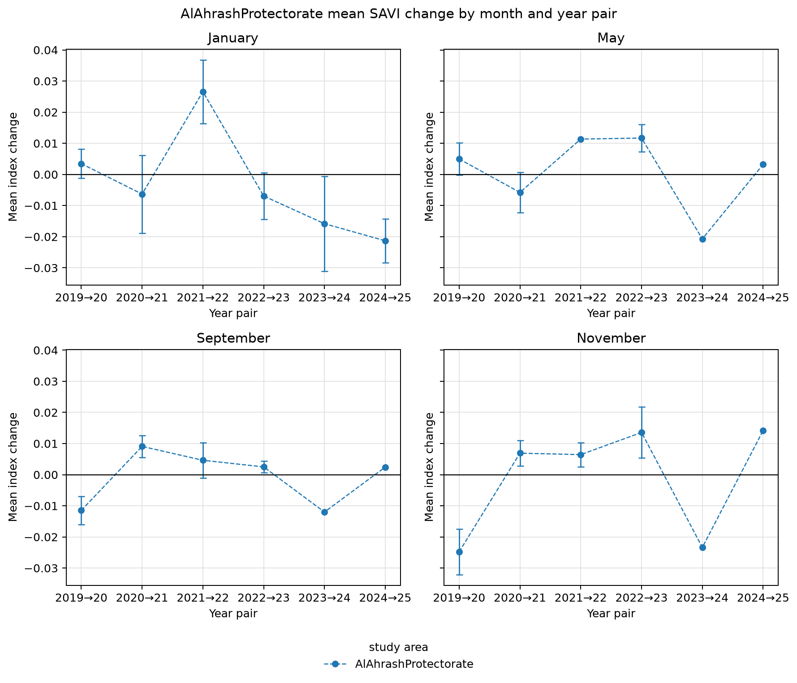
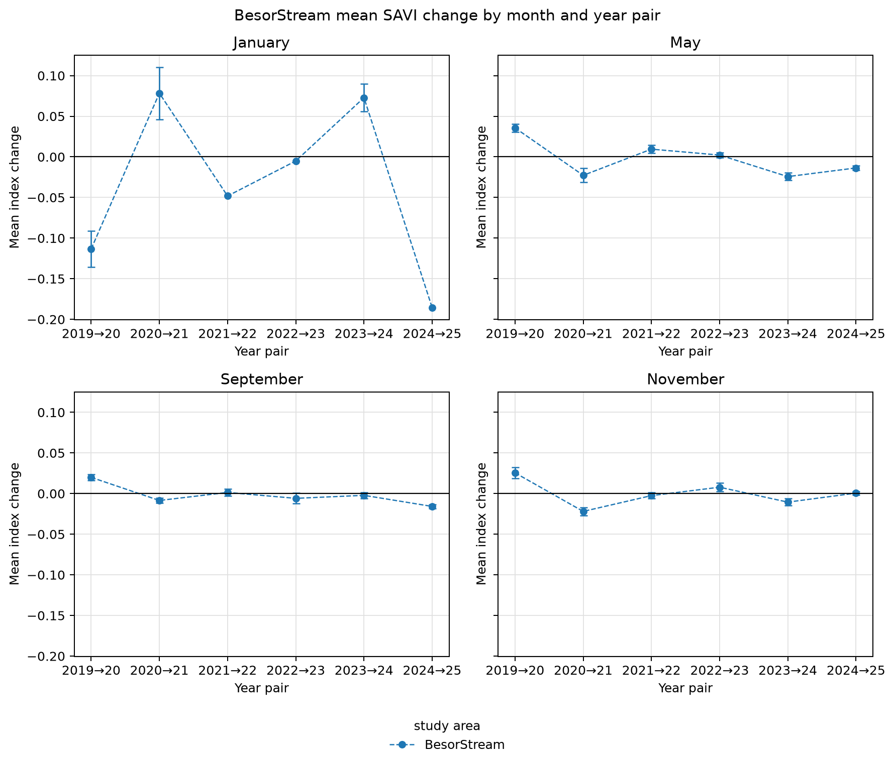
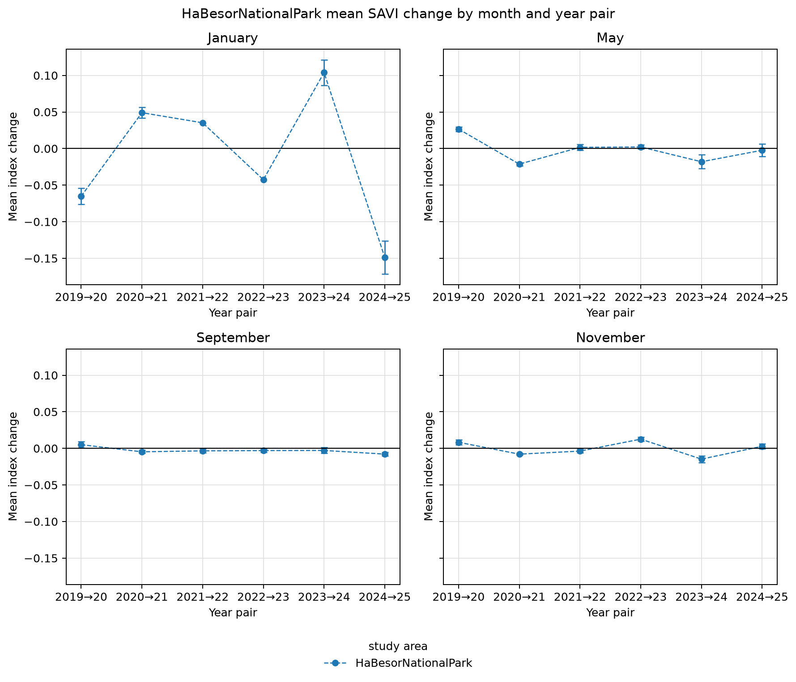
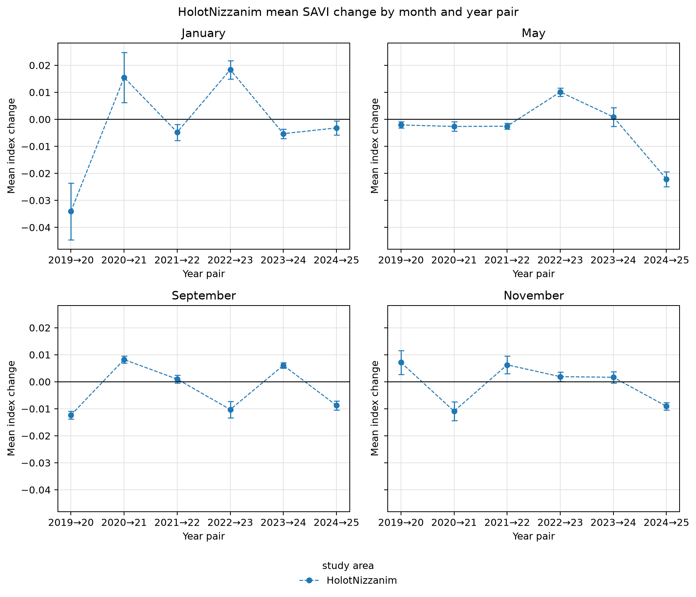
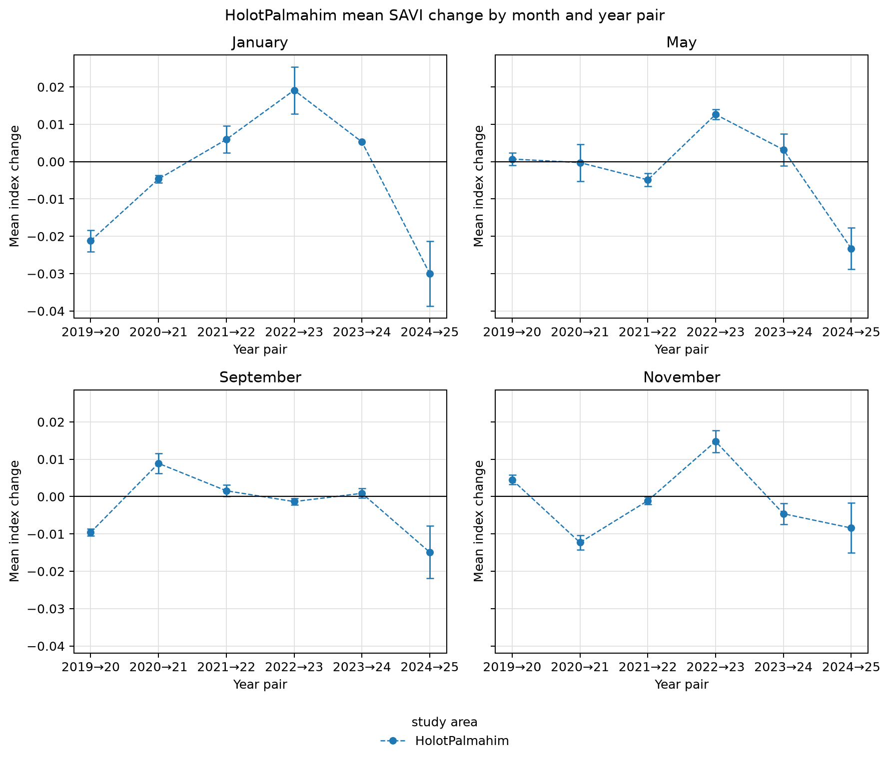
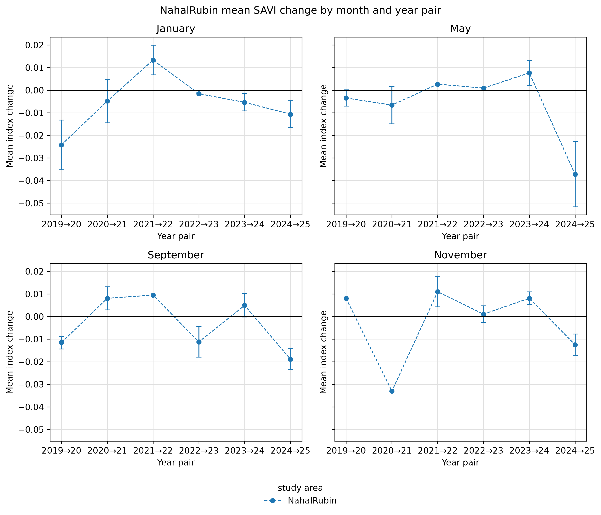
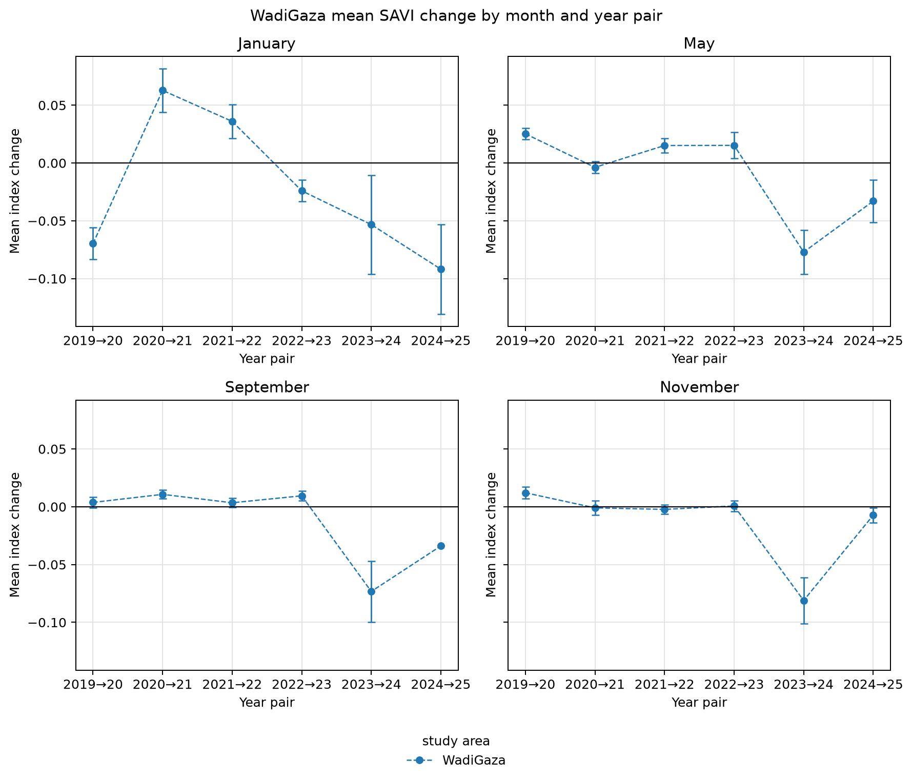
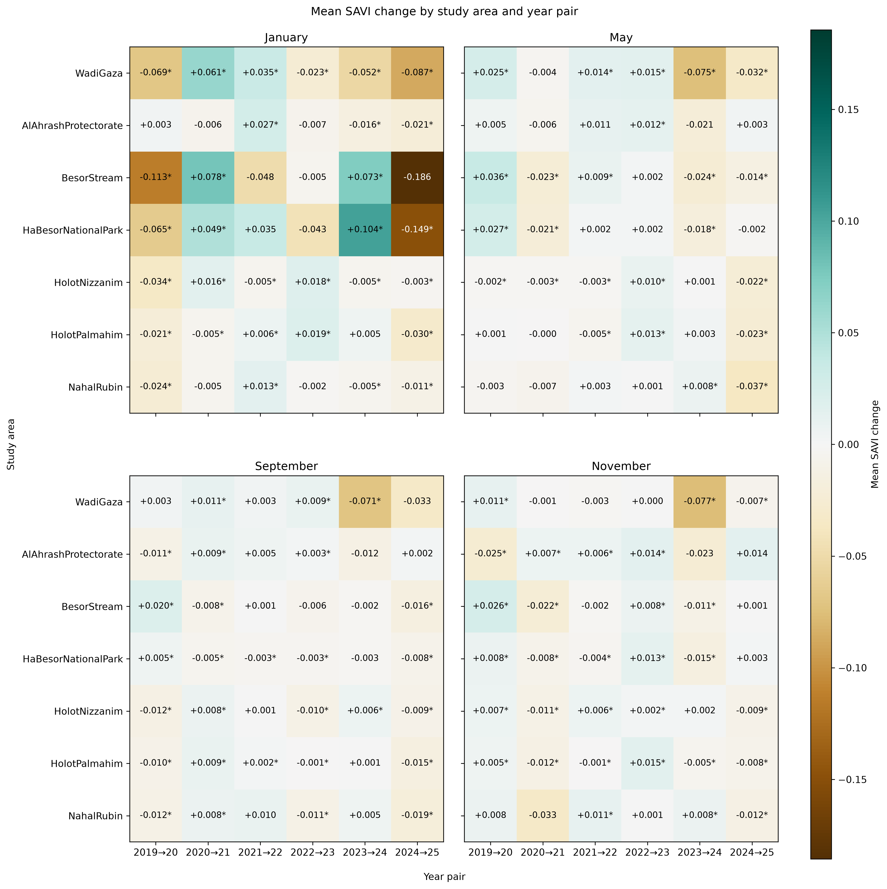

<!-- Generated by generate_figure_captions.py; do not edit. -->

# Figure captions

Maintained in [figure-captions.yaml](../../../../docs/figure-captions.yaml). Captions cover the current notebook selections only; other images in this folder may be retired or from a different selection. Figure numbering is assigned in the manuscript. Review captions alongside the images before publication.

## Al Ahrash Protectorate: monthly SAVI changes

Figure: [AlAhrashProtectorate_SAVI_mean_change_month_panels.png](AlAhrashProtectorate_SAVI_mean_change_month_panels.png)

**Caption.** Mean year-to-year SAVI change at Al Ahrash Protectorate, with monthly panels and spatially adjusted 95% confidence intervals.

**Explanation.** Mean change in the soil-adjusted vegetation index (SAVI) at Al Ahrash Protectorate across consecutive year pairs, with one panel per calendar month. Points show spatial means and whiskers their uncertainty; the horizontal line marks no change. Change is the later year's index minus the earlier year's index for the same calendar month, averaged over pixels valid in both composites; negative values indicate a decrease. Intervals are spatially adjusted 95% Student's t confidence intervals, using effective sample sizes derived from Moran's I correlograms at the primary range threshold tau = 0.05. Means remain visible when an autocorrelation range, and hence an interval, cannot be estimated.

Source: [12_visualize_change_results.ipynb](../../../../notebooks/12_visualize_change_results.ipynb); [method](../../../../docs/white-papers/Mean-Index-Change-Confidence-Intervals.md).

<!-- Figure SHA-256: 7e720fd442cdf5275f1623fd3c6c2dea948da40382067993228d7323345d6477 -->

## Besor Stream: monthly SAVI changes

Figure: [BesorStream_SAVI_mean_change_month_panels.png](BesorStream_SAVI_mean_change_month_panels.png)

**Caption.** Mean year-to-year SAVI change at Besor Stream, with monthly panels and spatially adjusted 95% confidence intervals.

**Explanation.** Mean change in the soil-adjusted vegetation index (SAVI) at Besor Stream across consecutive year pairs, with one panel per calendar month. Points show spatial means and whiskers their uncertainty; the horizontal line marks no change. Change is the later year's index minus the earlier year's index for the same calendar month, averaged over pixels valid in both composites; negative values indicate a decrease. Intervals are spatially adjusted 95% Student's t confidence intervals, using effective sample sizes derived from Moran's I correlograms at the primary range threshold tau = 0.05. Means remain visible when an autocorrelation range, and hence an interval, cannot be estimated.

Source: [12_visualize_change_results.ipynb](../../../../notebooks/12_visualize_change_results.ipynb); [method](../../../../docs/white-papers/Mean-Index-Change-Confidence-Intervals.md).

<!-- Figure SHA-256: 4a4e3fef473e3b565608d5c8a8e62063a7da47294fd27dbeab42489c121b0889 -->

## HaBesor National Park: monthly SAVI changes

Figure: [HaBesorNationalPark_SAVI_mean_change_month_panels.png](HaBesorNationalPark_SAVI_mean_change_month_panels.png)

**Caption.** Mean year-to-year SAVI change at HaBesor National Park, with monthly panels and spatially adjusted 95% confidence intervals.

**Explanation.** Mean change in the soil-adjusted vegetation index (SAVI) at HaBesor National Park across consecutive year pairs, with one panel per calendar month. Points show spatial means and whiskers their uncertainty; the horizontal line marks no change. Change is the later year's index minus the earlier year's index for the same calendar month, averaged over pixels valid in both composites; negative values indicate a decrease. Intervals are spatially adjusted 95% Student's t confidence intervals, using effective sample sizes derived from Moran's I correlograms at the primary range threshold tau = 0.05. Means remain visible when an autocorrelation range, and hence an interval, cannot be estimated.

Source: [12_visualize_change_results.ipynb](../../../../notebooks/12_visualize_change_results.ipynb); [method](../../../../docs/white-papers/Mean-Index-Change-Confidence-Intervals.md).

<!-- Figure SHA-256: 70f1880f9eec72636d04a00e7d0353a9de8758d31050ae22555cbd0e7301c317 -->

## Holot Nizzanim: monthly SAVI changes

Figure: [HolotNizzanim_SAVI_mean_change_month_panels.png](HolotNizzanim_SAVI_mean_change_month_panels.png)

**Caption.** Mean year-to-year SAVI change at Holot Nizzanim, with monthly panels and spatially adjusted 95% confidence intervals.

**Explanation.** Mean change in the soil-adjusted vegetation index (SAVI) at Holot Nizzanim across consecutive year pairs, with one panel per calendar month. Points show spatial means and whiskers their uncertainty; the horizontal line marks no change. Change is the later year's index minus the earlier year's index for the same calendar month, averaged over pixels valid in both composites; negative values indicate a decrease. Intervals are spatially adjusted 95% Student's t confidence intervals, using effective sample sizes derived from Moran's I correlograms at the primary range threshold tau = 0.05. Means remain visible when an autocorrelation range, and hence an interval, cannot be estimated.

Source: [12_visualize_change_results.ipynb](../../../../notebooks/12_visualize_change_results.ipynb); [method](../../../../docs/white-papers/Mean-Index-Change-Confidence-Intervals.md).

<!-- Figure SHA-256: 6bb9dec15f5aee1c5028ea1af2f7c675425cd8d36c6d12f86a092541d81e5d80 -->

## Holot Palmahim: monthly SAVI changes

Figure: [HolotPalmahim_SAVI_mean_change_month_panels.png](HolotPalmahim_SAVI_mean_change_month_panels.png)

**Caption.** Mean year-to-year SAVI change at Holot Palmahim, with monthly panels and spatially adjusted 95% confidence intervals.

**Explanation.** Mean change in the soil-adjusted vegetation index (SAVI) at Holot Palmahim across consecutive year pairs, with one panel per calendar month. Points show spatial means and whiskers their uncertainty; the horizontal line marks no change. Change is the later year's index minus the earlier year's index for the same calendar month, averaged over pixels valid in both composites; negative values indicate a decrease. Intervals are spatially adjusted 95% Student's t confidence intervals, using effective sample sizes derived from Moran's I correlograms at the primary range threshold tau = 0.05. Means remain visible when an autocorrelation range, and hence an interval, cannot be estimated.

Source: [12_visualize_change_results.ipynb](../../../../notebooks/12_visualize_change_results.ipynb); [method](../../../../docs/white-papers/Mean-Index-Change-Confidence-Intervals.md).

<!-- Figure SHA-256: 9bfaeb69483bc5858d590a8095d0f23656376fb26dfcfb92f09057d1afb24976 -->

## Nahal Rubin: monthly SAVI changes

Figure: [NahalRubin_SAVI_mean_change_month_panels.png](NahalRubin_SAVI_mean_change_month_panels.png)

**Caption.** Mean year-to-year SAVI change at Nahal Rubin, with monthly panels and spatially adjusted 95% confidence intervals.

**Explanation.** Mean change in the soil-adjusted vegetation index (SAVI) at Nahal Rubin across consecutive year pairs, with one panel per calendar month. Points show spatial means and whiskers their uncertainty; the horizontal line marks no change. Change is the later year's index minus the earlier year's index for the same calendar month, averaged over pixels valid in both composites; negative values indicate a decrease. Intervals are spatially adjusted 95% Student's t confidence intervals, using effective sample sizes derived from Moran's I correlograms at the primary range threshold tau = 0.05. Means remain visible when an autocorrelation range, and hence an interval, cannot be estimated.

Source: [12_visualize_change_results.ipynb](../../../../notebooks/12_visualize_change_results.ipynb); [method](../../../../docs/white-papers/Mean-Index-Change-Confidence-Intervals.md).

<!-- Figure SHA-256: f046e284043b88412b31e5c68d3b3b013821369736214a3e7b830a55174691c2 -->

## Wadi Gaza: monthly SAVI changes

Figure: [WadiGaza_SAVI_mean_change_month_panels.png](WadiGaza_SAVI_mean_change_month_panels.png)

**Caption.** Mean year-to-year SAVI change at Wadi Gaza, with monthly panels and spatially adjusted 95% confidence intervals.

**Explanation.** Mean change in the soil-adjusted vegetation index (SAVI) at Wadi Gaza across consecutive year pairs, with one panel per calendar month. Points show spatial means and whiskers their uncertainty; the horizontal line marks no change. Change is the later year's index minus the earlier year's index for the same calendar month, averaged over pixels valid in both composites; negative values indicate a decrease. Intervals are spatially adjusted 95% Student's t confidence intervals, using effective sample sizes derived from Moran's I correlograms at the primary range threshold tau = 0.05. Means remain visible when an autocorrelation range, and hence an interval, cannot be estimated.

Source: [12_visualize_change_results.ipynb](../../../../notebooks/12_visualize_change_results.ipynb); [method](../../../../docs/white-papers/Mean-Index-Change-Confidence-Intervals.md).

<!-- Figure SHA-256: 830dafb40ec1546d971f0c4f86897e21cf3de69aac2c5440d57ab9353c213a87 -->

## SAVI change by site and year pair

Figure: [study_area_mean_change_heatmaps.png](study_area_mean_change_heatmaps.png)

**Caption.** Mean SAVI change by site, month, and year pair; asterisks indicate spatially adjusted 95% confidence intervals excluding zero.

**Explanation.** Mean change in the soil-adjusted vegetation index (SAVI) by study site and consecutive year pair, with one panel per calendar month and Wadi Gaza in the top row. Brown denotes decreases and teal increases on a shared zero-centered scale. Cell labels report mean changes; asterisks mark individual spatially adjusted 95% confidence intervals excluding zero, without multiple-comparison adjustment. Change is the later year's index minus the earlier year's index for the same calendar month, averaged over pixels valid in both composites; negative values indicate a decrease. The primary range threshold is tau = 0.05; unmarked cells can include changes with undefined intervals.

Source: [12_visualize_change_results.ipynb](../../../../notebooks/12_visualize_change_results.ipynb); [method](../../../../docs/white-papers/Mean-Index-Change-Confidence-Intervals.md).

<!-- Figure SHA-256: 0b48be9ce089779d8d333c32ed6c2c6348000d73fcdb94ca8ef7f51d6bad1afd -->
