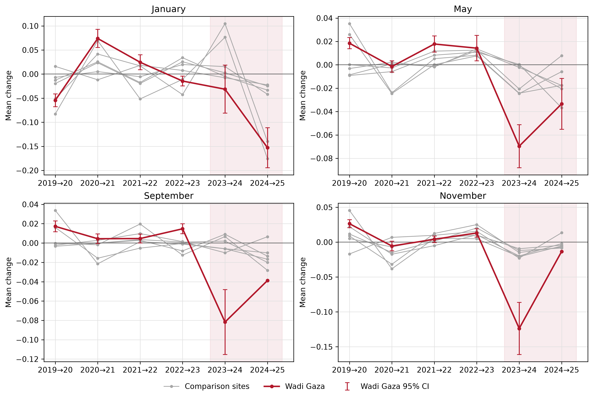
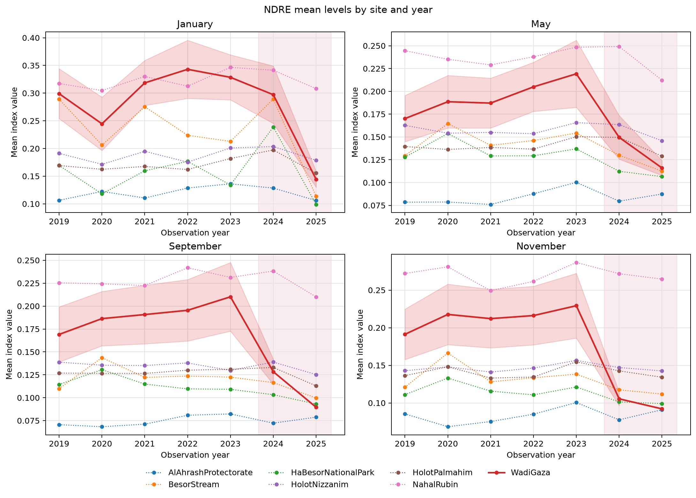

<!-- Generated by generate_figure_captions.py; do not edit. -->

# Figure captions

Maintained in [figure-captions.yaml](../../../../docs/figure-captions.yaml). Captions cover the current notebook selections only; other images in this folder may be retired or from a different selection. Figure numbering is assigned in the manuscript. Review captions alongside the images before publication.

## NDRE change trajectories across sites

Figure: [change_trajectories.png](change_trajectories.png)

**Caption.** Mean year-to-year NDRE changes across study sites by month, with Wadi Gaza's spatially adjusted 95% confidence intervals and event pairs shaded.

**Explanation.** Mean NDRE change across consecutive year pairs for Wadi Gaza (red) and comparison sites (grey), with one panel per calendar month. Shading marks 2023-2024 and 2024-2025. Error bars at Wadi Gaza show spatially adjusted 95% confidence intervals from difference-raster autocorrelation; undefined intervals are omitted. These describe individual mean changes, not model event-effect uncertainty. Change is the later year's index minus the earlier year's index for the same calendar month, averaged over pixels valid in both composites; negative values indicate a decrease.

Source: [31_visualize_did_results.ipynb](../../../../notebooks/31_visualize_did_results.ipynb); [method](../../../../docs/white-papers/Mean-Index-Change-Confidence-Intervals.md).

<!-- Figure SHA-256: 5c4e10680bd36c07535c95ed4689a7709538f8718d3057e0ba23f71f3eef0058 -->

## NDRE level trajectories across sites

Figure: [level_trajectories.png](level_trajectories.png)

**Caption.** Annual mean NDRE across study sites by month, highlighting Wadi Gaza and shading observation years 2024, 2025.

**Explanation.** Annual spatial mean of the normalized difference red-edge index (NDRE) at Wadi Gaza (solid red) and comparison sites (dotted), with one panel per calendar month. Shading marks observation years 2024, 2025, the ending years of the event and persistence pairs. No confidence intervals are shown. This figure provides descriptive context in index levels; the comparison models are fitted to changes, not these levels.

Source: [31_visualize_did_results.ipynb](../../../../notebooks/31_visualize_did_results.ipynb); [method](../../../../docs/white-papers/Mean-Index-Level-Confidence-Intervals.md).

<!-- Figure SHA-256: 552afa5596623aac311e8455a2b1b318b66fb83eee1d32aae2326145c4845ea5 -->
