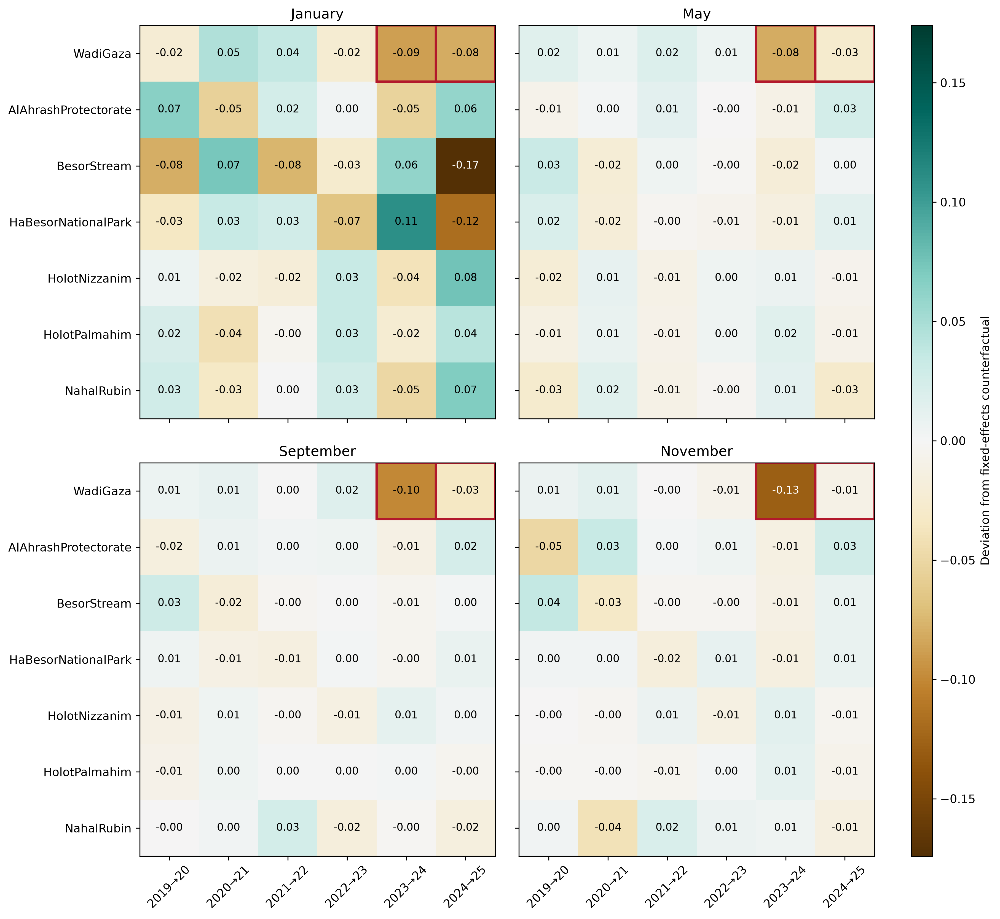
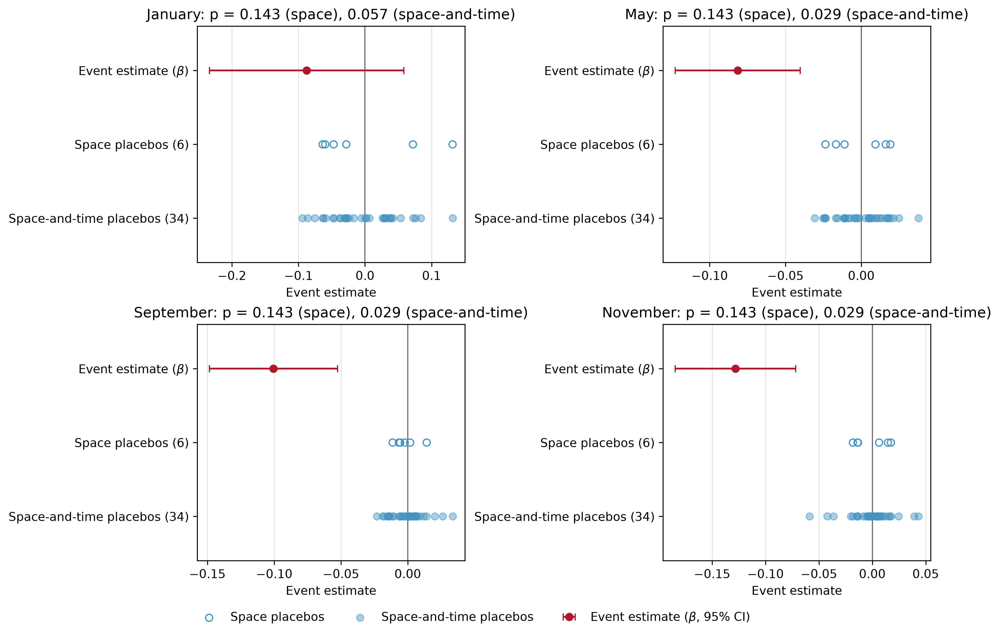
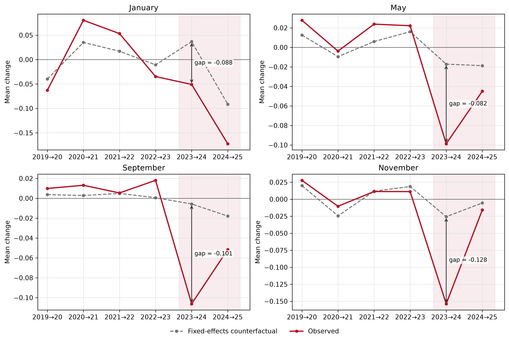
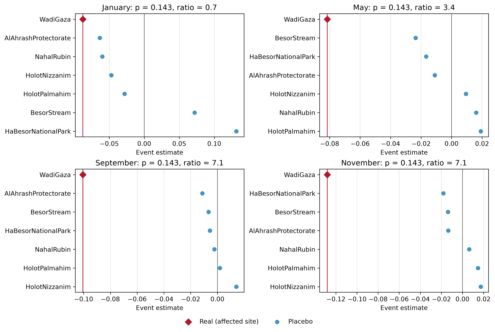
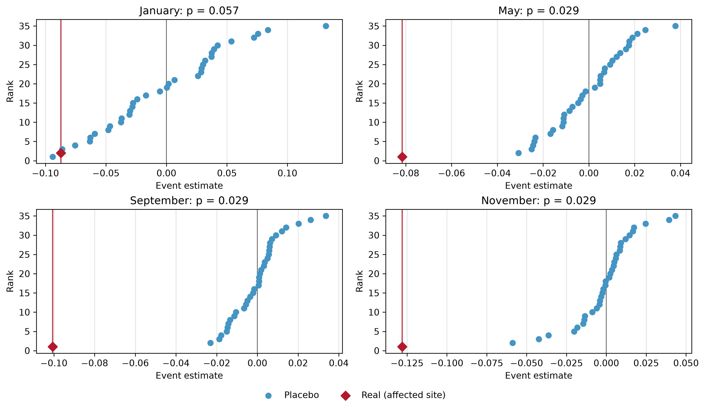
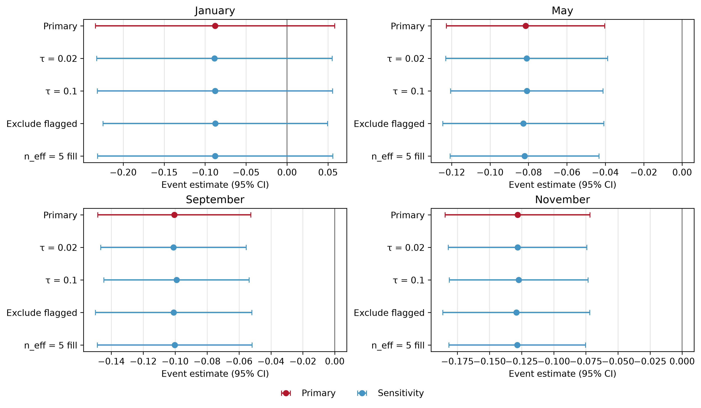

<!-- Generated by generate_figure_captions.py; do not edit. -->

# Figure captions

Maintained in [figure-captions.yaml](../../../../../docs/figure-captions.yaml). Captions cover the current notebook selections only; other images in this folder may be retired or from a different selection. Figure numbering is assigned in the manuscript. Review captions alongside the images before publication.

## NDVI departures from expected change (period_only)

Figure: [anomaly_heatmap.png](anomaly_heatmap.png)

**Caption.** Site-year-pair NDVI changes relative to the period-only counterfactual by month, with Wadi Gaza's event and persistence cells outlined.

**Explanation.** Observed site-year-pair NDVI change minus the fixed-effects counterfactual under the period-only model, which includes shared year-pair effects but no site-specific mean changes, with one panel per calendar month and Wadi Gaza in the top row. The counterfactual sets both event indicators to zero. Brown denotes negative departures and teal positive departures on a shared zero-centered scale; labels are in index units. Outlined Wadi Gaza cells in 2023-2024 and 2024-2025 equal the event and persistence coefficients, respectively; other cells are model residuals. Intervals are not shown.

Source: [31_visualize_did_results.ipynb](../../../../../notebooks/31_visualize_did_results.ipynb); [method](../../../../../docs/white-papers/Period-Only-Control-Impact-Analysis.md).

<!-- Figure SHA-256: c2bbe285aa934cd017b7ccabe9c8f24c1229cd6b0402a97282697ffa517e8148 -->

## NDVI combined event evidence (period_only)

Figure: [combined_evidence.png](combined_evidence.png)

**Caption.** Wadi Gaza's 2023-2024 NDVI event estimates with 95% confidence intervals and space and space-and-time placebo distributions by month under the period-only model.

**Explanation.** Combined evidence for the Wadi Gaza 2023-2024 NDVI event effect under the period-only model, which includes shared year-pair effects but no site-specific mean changes, with one panel per calendar month. The top row shows the main event estimate and its interval; middle and bottom rows show space and space-and-time placebo estimates. All are plotted in index units against a zero reference line; panel titles report the two lower-tail rank p-values. Model intervals are 95% plug-in t confidence intervals from inverse total-variance weighted least squares, with leverage-adjusted Hedges residual-variance estimation; they are not cluster-robust intervals. Space placebos reassign the event and persistence indicators to comparison sites after excluding Wadi Gaza. Space-and-time placebos omit the 2024-2025 pair and reassign a single event indicator among unaffected site-year-pair cells, excluding the real event cell from each placebo fit. The space-and-time p-value uses its own reduced-sample real refit, which can differ from the main estimate. Both reported p-values are lower-tail rank proportions for a decline, including the real assignment; interpreting them inferentially requires comparable assignments.

Source: [31_visualize_did_results.ipynb](../../../../../notebooks/31_visualize_did_results.ipynb); [method](../../../../../docs/white-papers/Period-Only-Control-Impact-Analysis.md).

<!-- Figure SHA-256: 6c07a21ee7de2af9a55df0873475f905e303ddaa827883c1ac9e3cca38763333 -->

## NDVI observed and counterfactual changes (period_only)

Figure: [observed_vs_counterfactual.png](observed_vs_counterfactual.png)

**Caption.** Observed and period-only counterfactual NDVI changes at Wadi Gaza by month, highlighting the 2023-2024 event and 2024-2025 persistence pairs.

**Explanation.** Observed mean NDVI changes at Wadi Gaza (solid red) and expected changes with event indicators set to zero (dashed grey), under the period-only model, which includes shared year-pair effects but no site-specific mean changes. Each panel represents a calendar month; shading marks 2023-2024 and 2024-2025. The annotated gap (observed minus counterfactual) at 2023-2024 equals the fitted event coefficient. Values are changes in index units, not index levels, and intervals are not shown.

Source: [31_visualize_did_results.ipynb](../../../../../notebooks/31_visualize_did_results.ipynb); [method](../../../../../docs/white-papers/Period-Only-Control-Impact-Analysis.md).

<!-- Figure SHA-256: 4ba5a94511482e65ecffdd589a7799dded3c301167586ef5a757863966494f40 -->

## NDVI placebo-in-space evidence (period_only)

Figure: [placebo_space.png](placebo_space.png)

**Caption.** Wadi Gaza's 2023-2024 NDVI event estimate versus comparison-site placebos by month under the period-only model, with one-sided rank p-values.

**Explanation.** Placebo-in-space estimates of the 2023-2024 NDVI event effect under the period-only model, which includes shared year-pair effects but no site-specific mean changes, with one panel per calendar month. The red diamond and vertical line identify Wadi Gaza; blue points identify comparison-site placebo estimates. Panel titles report lower-tail rank p-values and the absolute real estimate divided by the largest absolute placebo estimate. Each placebo excludes Wadi Gaza and jointly reassigns the event and persistence indicators to one comparison site. The one-sided p-value is the fraction of assignments, including the real one, at least as negative as the real estimate; inferential interpretation requires comparable assignments.

Source: [31_visualize_did_results.ipynb](../../../../../notebooks/31_visualize_did_results.ipynb); [method](../../../../../docs/white-papers/Period-Only-Control-Impact-Analysis.md).

<!-- Figure SHA-256: 7af6b166708765b4ad1dfcb26e2f7a7155d5341d25b2892aae0f5e64e5053255 -->

## NDVI placebo-in-space-and-time evidence (period_only)

Figure: [placebo_spacetime.png](placebo_spacetime.png)

**Caption.** Ranked space-and-time placebo estimates and the reduced-sample real NDVI event estimate by month under the period-only model, with one-sided rank p-values.

**Explanation.** Ranked space-and-time placebo estimates for NDVI under the period-only model, which includes shared year-pair effects but no site-specific mean changes, with one panel per calendar month. The red diamond and vertical line identify the real Wadi Gaza 2023-2024 estimate refitted without the persistence pair; blue points identify fake-event assignments. Panel titles report lower-tail rank p-values. Fits omit 2024-2025 and use a single event indicator. Each fake-event fit also excludes the real event cell and assigns that indicator to an unaffected site-year-pair cell. The one-sided p-value is the fraction of assignments, including the real one, at least as negative as the real estimate; inferential interpretation requires comparable assignments.

Source: [31_visualize_did_results.ipynb](../../../../../notebooks/31_visualize_did_results.ipynb); [method](../../../../../docs/white-papers/Period-Only-Control-Impact-Analysis.md).

<!-- Figure SHA-256: be60be947d7d7dd92f323922b488d0f6c7f4f72d5c11b77bee6483bdd7930efe -->

## NDVI event-estimate sensitivity (period_only)

Figure: [sensitivity_forest.png](sensitivity_forest.png)

**Caption.** Sensitivity of Wadi Gaza's 2023-2024 NDVI event estimate to range thresholds and missing-error policies under the period-only model, with 95% confidence intervals.

**Explanation.** Sensitivity of the Wadi Gaza 2023-2024 NDVI event estimate under the period-only model, which includes shared year-pair effects but no site-specific mean changes, with one panel per calendar month. Points and horizontal intervals show the primary fit (red) and sensitivity fits (blue). Variants change the range threshold among 0.02, 0.05, 0.1 or replace the primary maximum-SE fill for undefined spatial errors by exclusion or an n_eff = 5 fill. The vertical line marks zero departure from expected change. Model intervals are 95% plug-in t confidence intervals from inverse total-variance weighted least squares, with leverage-adjusted Hedges residual-variance estimation; they are not cluster-robust intervals.

Source: [31_visualize_did_results.ipynb](../../../../../notebooks/31_visualize_did_results.ipynb); [method](../../../../../docs/white-papers/Period-Only-Control-Impact-Analysis.md).

<!-- Figure SHA-256: 604ee8d74563633af704345dc541bcd90468c792bdbea01bc5cbaa598c86312a -->
