<!-- Generated by generate_figure_captions.py; do not edit. -->

# Figure captions

Maintained in [figure-captions.yaml](../../../docs/figure-captions.yaml). Captions cover the current notebook selections only; other images in this folder may be retired or from a different selection. Figure numbering is assigned in the manuscript. Review captions alongside the images before publication.

## Wadi Gaza climate-cell sensitivity

Figure: [WadiGaza_cell_sensitivity.png](WadiGaza_cell_sensitivity.png)

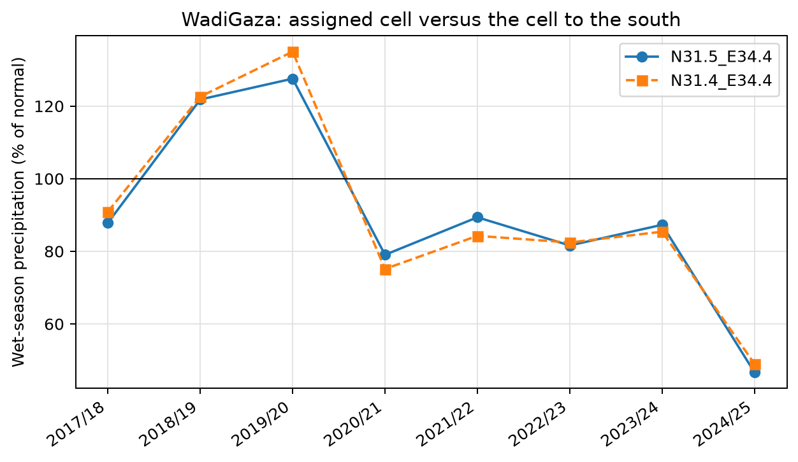

**Caption.** Wet-season precipitation at Wadi Gaza's assigned ERA5-Land cell and its southern neighbor, expressed as percentages of their respective 1991-2020 normals.

**Explanation.** Sensitivity of wet-season precipitation context for Wadi Gaza to grid-cell assignment. Solid circles show the assigned ERA5-Land cell and dashed squares the adjacent cell to the south; coordinate identifiers appear in the legend. Each series expresses October-April precipitation as a percentage of its own 1991-2020 normal. The horizontal line marks 100%. This is a descriptive cell-choice diagnostic, not an uncertainty interval.

Source: [22_visualize_climate_context.ipynb](../../../notebooks/22_visualize_climate_context.ipynb); [method](../../../docs/white-papers/ERA5-Land-Climate-Context.md).

<!-- Figure SHA-256: f5145bfa72a63775ae6215b2d6625190e1e9c4dfe4aeb5d80095dae4b8e8c3dc -->

## Wadi Gaza cumulative rainfall since October 1

Figure: [WadiGaza_cumulative_since_oct1.png](WadiGaza_cumulative_since_oct1.png)

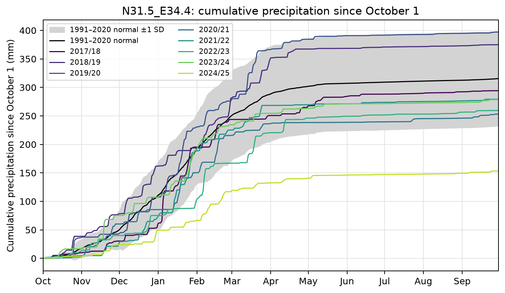

**Caption.** Cumulative precipitation since October 1 at Wadi Gaza, with the ERA5-Land 1991-2020 reference mean and plus or minus one interannual standard deviation.

**Explanation.** Cumulative precipitation (mm) from October 1 at the ERA5-Land cell assigned to Wadi Gaza, with colored lines identifying the seasons in the legend. The black curve is the mean of reference seasons ending in 1991-2020; grey shading is plus or minus one interannual standard deviation, not a confidence interval. The horizontal axis covers the first 365 days of each October-start season.

Source: [22_visualize_climate_context.ipynb](../../../notebooks/22_visualize_climate_context.ipynb); [method](../../../docs/white-papers/ERA5-Land-Climate-Context.md).

<!-- Figure SHA-256: 00b9198298786837445c914e68f71118f73deee5b1e5f507ac8c225ad205c71e -->

## Wadi Gaza monthly rainfall in July-June seasons

Figure: [WadiGaza_monthly_climatology.png](WadiGaza_monthly_climatology.png)

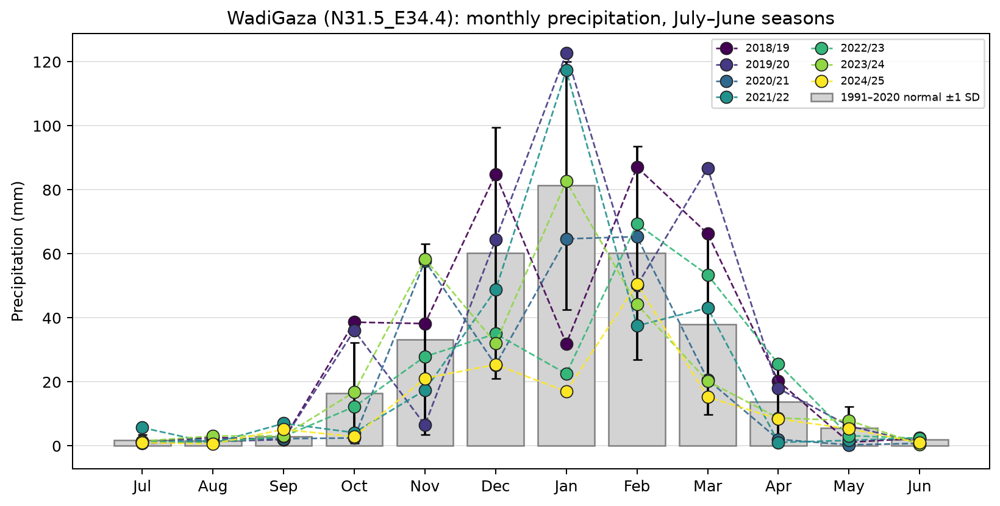

**Caption.** Monthly precipitation at Wadi Gaza by July-June season against ERA5-Land 1991-2020 monthly means and interannual standard deviations.

**Explanation.** Monthly precipitation at the grid cell assigned to Wadi Gaza, arranged July-June to keep each wet season on one trajectory. Grey bars and whiskers show 1991-2020 monthly means plus or minus one interannual standard deviation, not confidence intervals. Colored points connected by dashed lines show observed monthly totals (mm); legend labels identify each July-June season. Values are from ERA5-Land reanalysis at 0.1-degree resolution, referenced to the 1991-2020 climatology. Site values represent their assigned grid cells, not measurements within site polygons; sites sharing a cell share a climate record.

Source: [22_visualize_climate_context.ipynb](../../../notebooks/22_visualize_climate_context.ipynb); [method](../../../docs/white-papers/ERA5-Land-Climate-Context.md).

<!-- Figure SHA-256: 93e9abc25dd0e52d2e5913923be4cfac5bef9c55f7dcc600707f4fb8498fc309 -->

## Wadi Gaza temperature anomalies

Figure: [WadiGaza_temperature_anomaly.png](WadiGaza_temperature_anomaly.png)

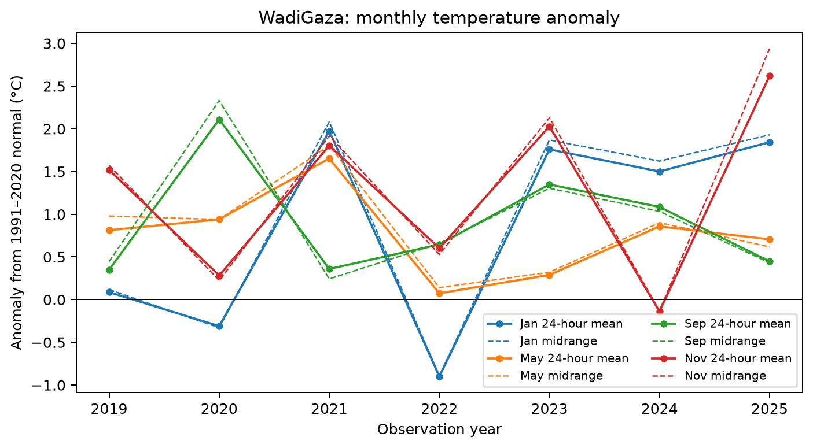

**Caption.** ERA5-Land monthly temperature anomalies at Wadi Gaza relative to 1991-2020 normals, comparing daily 24-hour means and midranges.

**Explanation.** Monthly 2 m air-temperature anomalies at the grid cell assigned to Wadi Gaza, in degrees Celsius relative to 1991-2020 normals. Colors distinguish study months; solid lines use daily 24-hour means and dashed lines use daily midranges, (hourly maximum + hourly minimum) / 2. The horizontal line marks zero anomaly. Values are from ERA5-Land reanalysis at 0.1-degree resolution, referenced to the 1991-2020 climatology. Site values represent their assigned grid cells, not measurements within site polygons; sites sharing a cell share a climate record.

Source: [22_visualize_climate_context.ipynb](../../../notebooks/22_visualize_climate_context.ipynb); [method](../../../docs/white-papers/ERA5-Land-Climate-Context.md).

<!-- Figure SHA-256: 9a46c269cf0fcd6396da7ce49c71a5936ae476b3e8d26a18ea509073a9264c59 -->

## Antecedent cumulative precipitation by site

Figure: [cumulative_pct_normal_heatmaps.png](cumulative_pct_normal_heatmaps.png)

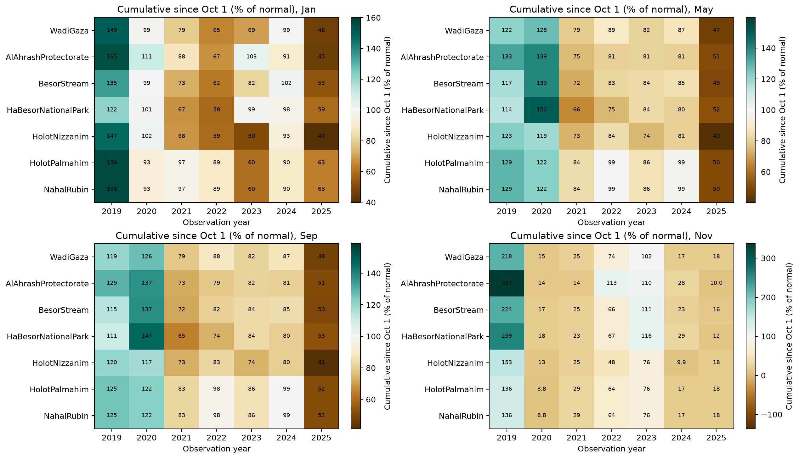

**Caption.** Precipitation accumulated from October 1 through the month preceding each observation, by site and year, as a percentage of 1991-2020 normals.

**Explanation.** Cumulative precipitation from the preceding October 1 through the end of the month before each observation month, as a percentage of the corresponding normal. Panels show study months, columns observation years, and rows sites with Wadi Gaza first. The shared scale is centered on 100%; brown indicates below-normal and teal above-normal totals. Hatching flags normals below 10 mm, for which percentages are undefined. The May window is October-April and equals the wet-season total. Values are from ERA5-Land reanalysis at 0.1-degree resolution, referenced to the 1991-2020 climatology. Site values represent their assigned grid cells, not measurements within site polygons; sites sharing a cell share a climate record.

Source: [22_visualize_climate_context.ipynb](../../../notebooks/22_visualize_climate_context.ipynb); [method](../../../docs/white-papers/ERA5-Land-Climate-Context.md).

<!-- Figure SHA-256: f343d673ca54a96de134efdc8edbc96b4085caafd64f051c780d3f7af6b30830 -->

## Monthly precipitation climatology at site-assigned cells

Figure: [monthly_climatology.png](monthly_climatology.png)

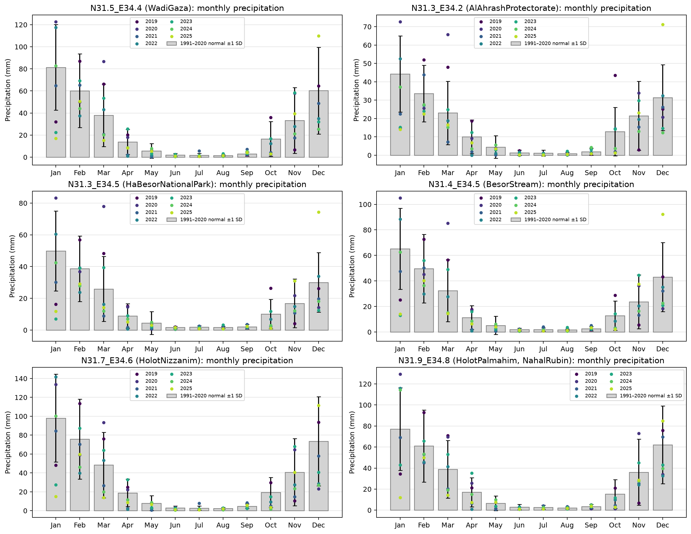

**Caption.** Observed 2019-2025 monthly precipitation at site-assigned ERA5-Land cells against 1991-2020 monthly means and interannual standard deviations.

**Explanation.** Monthly precipitation at each ERA5-Land cell used by a study site, with the Wadi Gaza cell first. Grey bars show 1991-2020 monthly means and whiskers show plus or minus one interannual standard deviation, not confidence intervals. Colored points show observed calendar-month totals for 2019-2025, in mm; panel titles identify the cell and the sites sharing it. Values are from ERA5-Land reanalysis at 0.1-degree resolution, referenced to the 1991-2020 climatology. Site values represent their assigned grid cells, not measurements within site polygons; sites sharing a cell share a climate record.

Source: [22_visualize_climate_context.ipynb](../../../notebooks/22_visualize_climate_context.ipynb); [method](../../../docs/white-papers/ERA5-Land-Climate-Context.md).

<!-- Figure SHA-256: 0bbfb1bdeef7b06ddf0d95d5d7b1378628baa36c064947536f05fbcb3ff11f62 -->

## Monthly precipitation anomalies by site

Figure: [precip_anomaly_heatmaps.png](precip_anomaly_heatmaps.png)

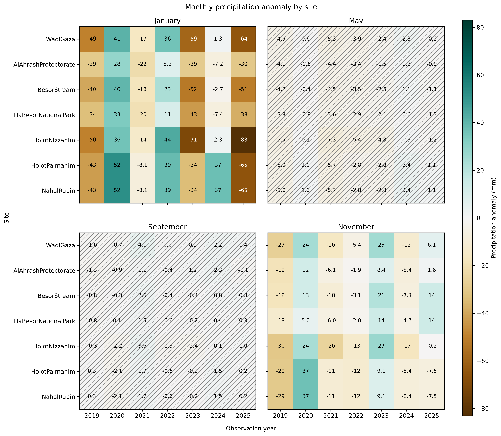

**Caption.** ERA5-Land monthly precipitation anomalies (mm) by site and observation year, relative to 1991-2020 normals.

**Explanation.** Monthly precipitation anomalies (observed minus normal, mm) by site and year in 2019-2025, with one panel per study month and Wadi Gaza in the top row. Brown denotes drier and teal wetter conditions on a shared zero-centered scale. Hatched cells have a monthly normal below 10 mm, for which percentage-of-normal values are suppressed; absolute anomalies remain reported. Values are from ERA5-Land reanalysis at 0.1-degree resolution, referenced to the 1991-2020 climatology. Site values represent their assigned grid cells, not measurements within site polygons; sites sharing a cell share a climate record.

Source: [22_visualize_climate_context.ipynb](../../../notebooks/22_visualize_climate_context.ipynb); [method](../../../docs/white-papers/ERA5-Land-Climate-Context.md).

<!-- Figure SHA-256: c1aa2afe09636d4770dd51ca2997b5756d3f4ff6761e1d67ba59bedffa30b1cc -->

## Regional precipitation and temperature normals

Figure: [regional_normals.png](regional_normals.png)

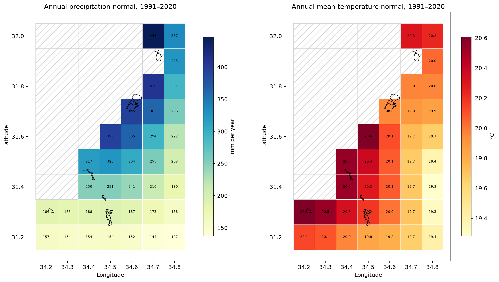

**Caption.** ERA5-Land 1991-2020 annual precipitation (mm per year) and mean 2 m air-temperature (degrees Celsius) normals across the study region.

**Explanation.** ERA5-Land 1991-2020 annual precipitation normal (left, mm per year) and annual mean 2 m air-temperature normal (right, degrees Celsius). Annual precipitation is the sum of monthly normals; annual temperature is the unweighted mean of monthly 24-hour-mean temperature normals. Black outlines locate study sites; hatched cells have no data. These panels show separate variables with separate color scales.

Source: [22_visualize_climate_context.ipynb](../../../notebooks/22_visualize_climate_context.ipynb); [method](../../../docs/white-papers/ERA5-Land-Climate-Context.md).

<!-- Figure SHA-256: f5767bf12d7ff587e75dc097f2d8783715fa70f60bc91b8c0775f45bf1db881d -->

## Regional mean temperature anomaly

Figure: [regional_temperature_anomaly.png](regional_temperature_anomaly.png)

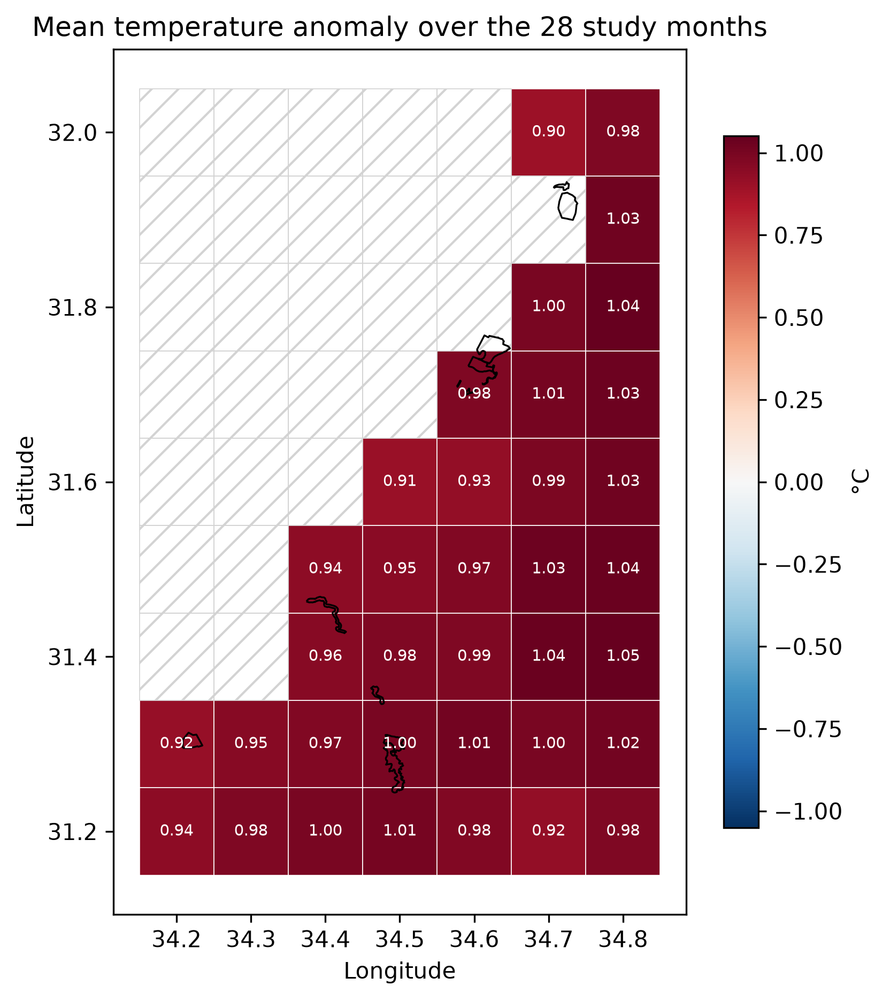

**Caption.** Regional mean 2 m air-temperature anomaly (degrees Celsius) over 2019-2025 study months relative to ERA5-Land 1991-2020 normals.

**Explanation.** Mean ERA5-Land 2 m air-temperature anomaly over the selected study months in 2019-2025, in degrees Celsius relative to the corresponding 1991-2020 monthly normals. Each cell equally averages the monthly anomalies of daily 24-hour means. Red indicates warmer and blue cooler conditions on a zero-centered scale; black outlines show study sites and hatching denotes no data.

Source: [22_visualize_climate_context.ipynb](../../../notebooks/22_visualize_climate_context.ipynb); [method](../../../docs/white-papers/ERA5-Land-Climate-Context.md).

<!-- Figure SHA-256: d78ef12cfc6bd62c28cd6485a894b5692da05344727e5a5fc7b8066895ed25a8 -->

## Regional wet-season precipitation relative to normal

Figure: [regional_wet_season_pct_normal.png](regional_wet_season_pct_normal.png)

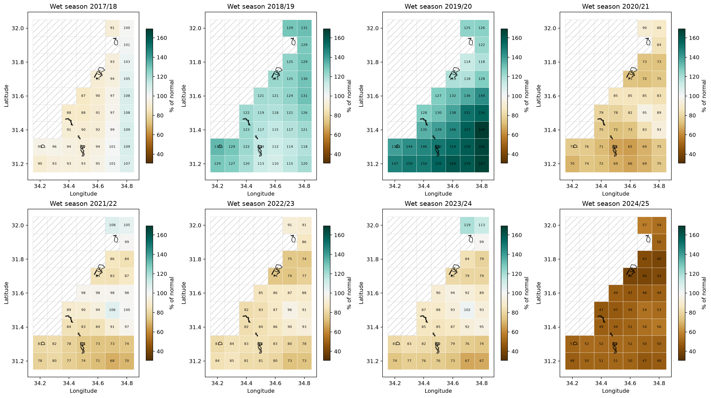

**Caption.** Regional October-April precipitation by wet season, expressed as a percentage of the ERA5-Land 1991-2020 normal.

**Explanation.** October-April precipitation as a percentage of the 1991-2020 normal, with one ERA5-Land map per wet season shown. The common diverging scale is centered on 100%, with brown below normal and teal above normal. Black outlines locate study sites; hatched cells have no data. Seasons are labeled by their starting and ending years.

Source: [22_visualize_climate_context.ipynb](../../../notebooks/22_visualize_climate_context.ipynb); [method](../../../docs/white-papers/ERA5-Land-Climate-Context.md).

<!-- Figure SHA-256: 96f94c5930ea1c0cfc552b1754290a9d37f70f8a019c59b0b463ff44213d0e9d -->

## Study sites and the ERA5-Land grid

Figure: [sites_over_cells.png](sites_over_cells.png)

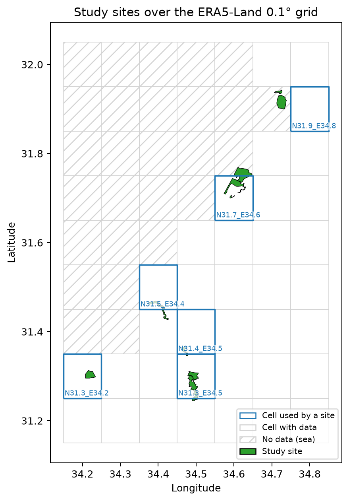

**Caption.** Study-site locations and assigned ERA5-Land 0.1-degree grid cells, with cells lacking data hatched.

**Explanation.** Study-site polygons (green with black boundaries) over the ERA5-Land 0.1-degree grid. Blue outlines and coordinate labels identify cells assigned to sites; light-grey outlines show other cells with data and hatching denotes cells without data. Axes give geographic longitude and latitude. Values are from ERA5-Land reanalysis at 0.1-degree resolution, referenced to the 1991-2020 climatology. Site values represent their assigned grid cells, not measurements within site polygons; sites sharing a cell share a climate record.

Source: [22_visualize_climate_context.ipynb](../../../notebooks/22_visualize_climate_context.ipynb); [method](../../../docs/white-papers/ERA5-Land-Climate-Context.md).

<!-- Figure SHA-256: 9ed8b69c075be4621854210bd0f77a2b77240b107a4be9e101d2c0330f66e3b2 -->

## Monthly temperature anomalies by site

Figure: [temperature_anomaly_heatmaps.png](temperature_anomaly_heatmaps.png)

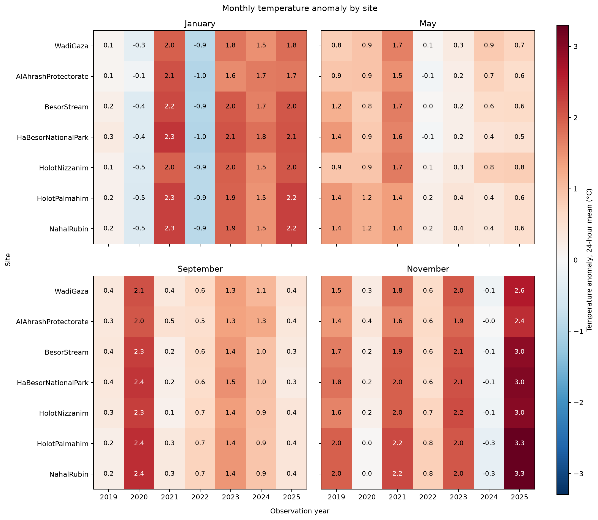

**Caption.** ERA5-Land monthly 2 m air-temperature anomalies (degrees Celsius) by site and observation year, relative to 1991-2020 normals.

**Explanation.** Monthly 2 m air-temperature anomalies by site and observation year, with one panel per study month and Wadi Gaza first. Values are monthly averages of daily 24-hour means minus the corresponding 1991-2020 normal, in degrees Celsius. Red denotes warmer and blue cooler conditions on a common zero-centered scale. Values are from ERA5-Land reanalysis at 0.1-degree resolution, referenced to the 1991-2020 climatology. Site values represent their assigned grid cells, not measurements within site polygons; sites sharing a cell share a climate record.

Source: [22_visualize_climate_context.ipynb](../../../notebooks/22_visualize_climate_context.ipynb); [method](../../../docs/white-papers/ERA5-Land-Climate-Context.md).

<!-- Figure SHA-256: e723b53755b786f58b0f9e681e64c41a2ee033af5640cdbeee3a5c0f562bd62d -->

## Temperature-method comparison

Figure: [temperature_method_difference.png](temperature_method_difference.png)

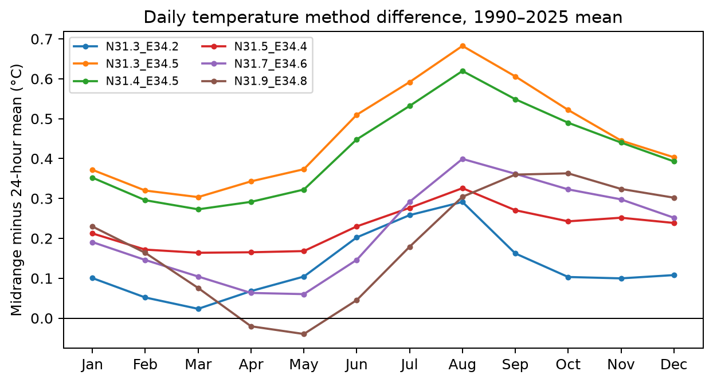

**Caption.** Mean daily temperature midrange minus 24-hour mean (degrees Celsius) by calendar month at site-assigned ERA5-Land cells.

**Explanation.** Mean daily temperature midrange minus daily 24-hour mean at each site-assigned ERA5-Land cell, grouped by calendar month over the available daily record. Midrange is (hourly maximum + hourly minimum) / 2. Values are in degrees Celsius; positive values mean that the midrange runs warmer. Lines distinguish cells, and the horizontal line marks agreement between the two methods.

Source: [22_visualize_climate_context.ipynb](../../../notebooks/22_visualize_climate_context.ipynb); [method](../../../docs/white-papers/ERA5-Land-Climate-Context.md).

<!-- Figure SHA-256: c5fe5471b881ab74e7f49a2c0e902990026a47ae940aece4a59173a8d6291ea3 -->

## Wet-season precipitation by site

Figure: [wet_season_pct_normal.png](wet_season_pct_normal.png)

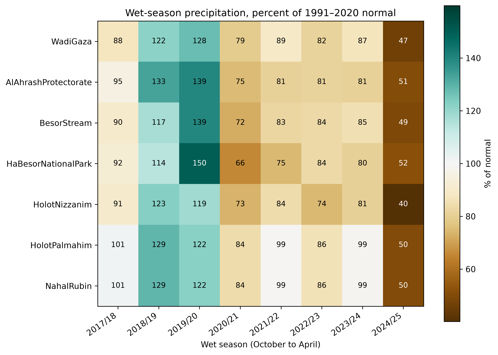

**Caption.** October-April precipitation by study site and wet season, expressed as a percentage of ERA5-Land 1991-2020 normals.

**Explanation.** Total precipitation for each completed October-April wet season by site, expressed as a percentage of its corresponding normal. Seasons are shown once each and labeled by starting and ending years; Wadi Gaza appears first. Brown indicates below-normal and teal above-normal totals on a scale centered on 100%. Values are from ERA5-Land reanalysis at 0.1-degree resolution, referenced to the 1991-2020 climatology. Site values represent their assigned grid cells, not measurements within site polygons; sites sharing a cell share a climate record.

Source: [22_visualize_climate_context.ipynb](../../../notebooks/22_visualize_climate_context.ipynb); [method](../../../docs/white-papers/ERA5-Land-Climate-Context.md).

<!-- Figure SHA-256: b6b98e89b4cb89982e92e930c15cd5c2e09dfe0b481031f29e77724bf095a788 -->
