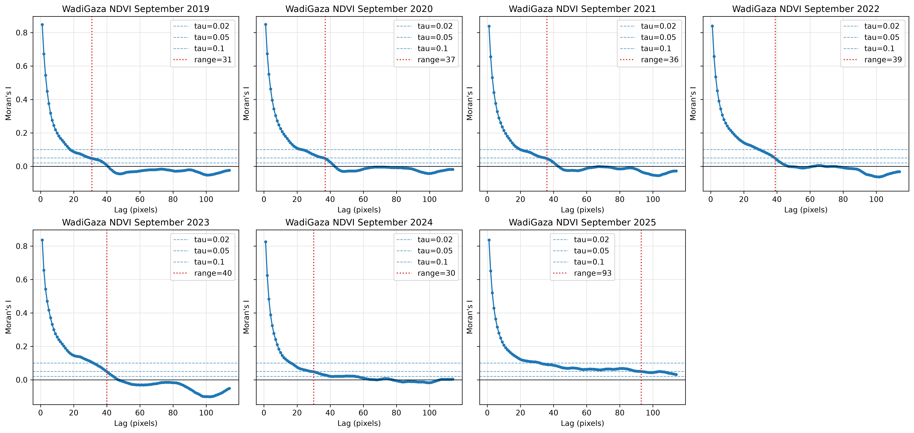
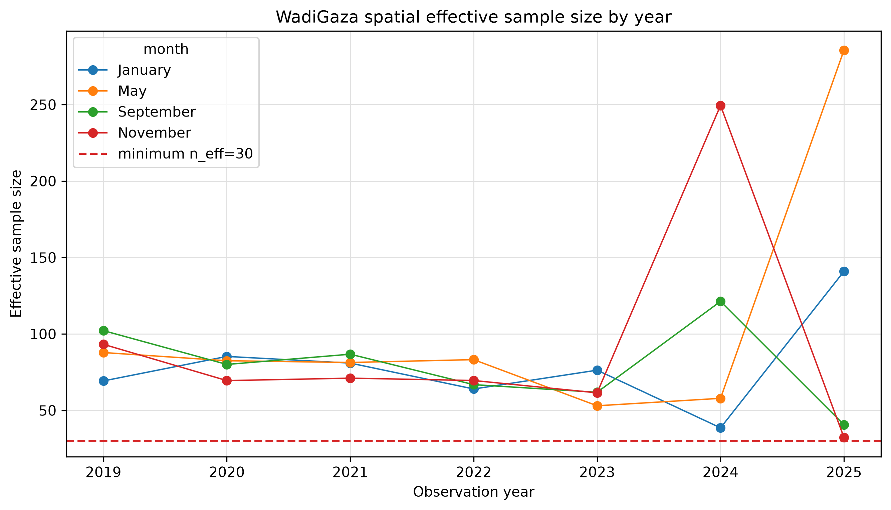
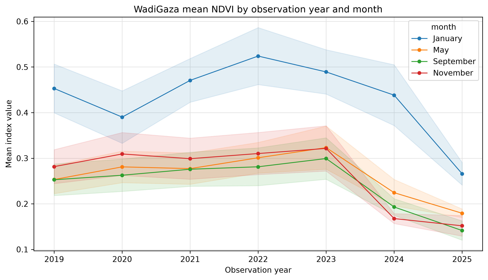
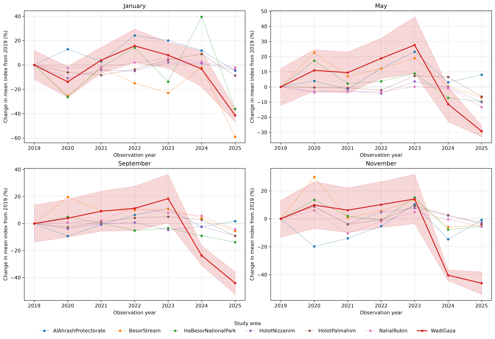
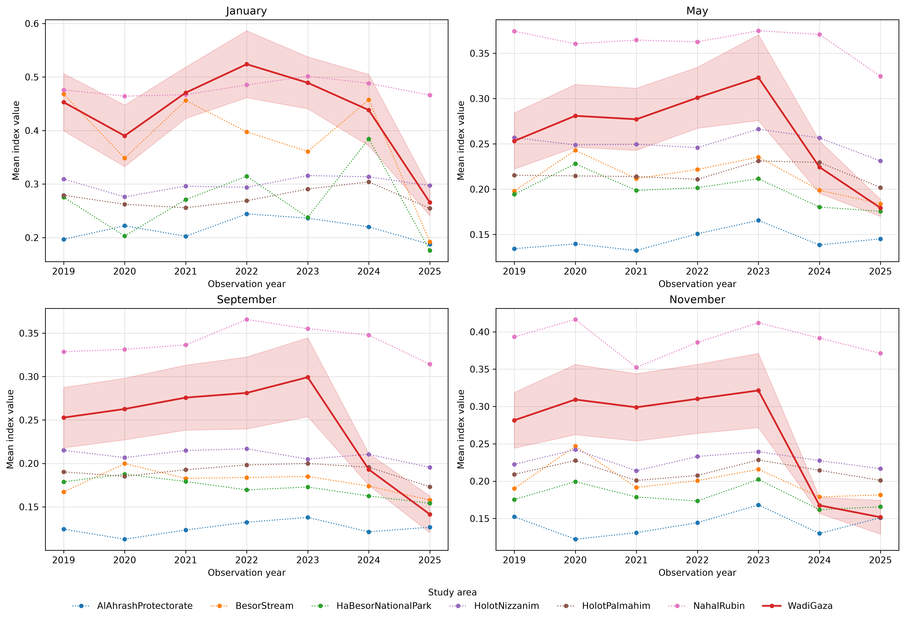
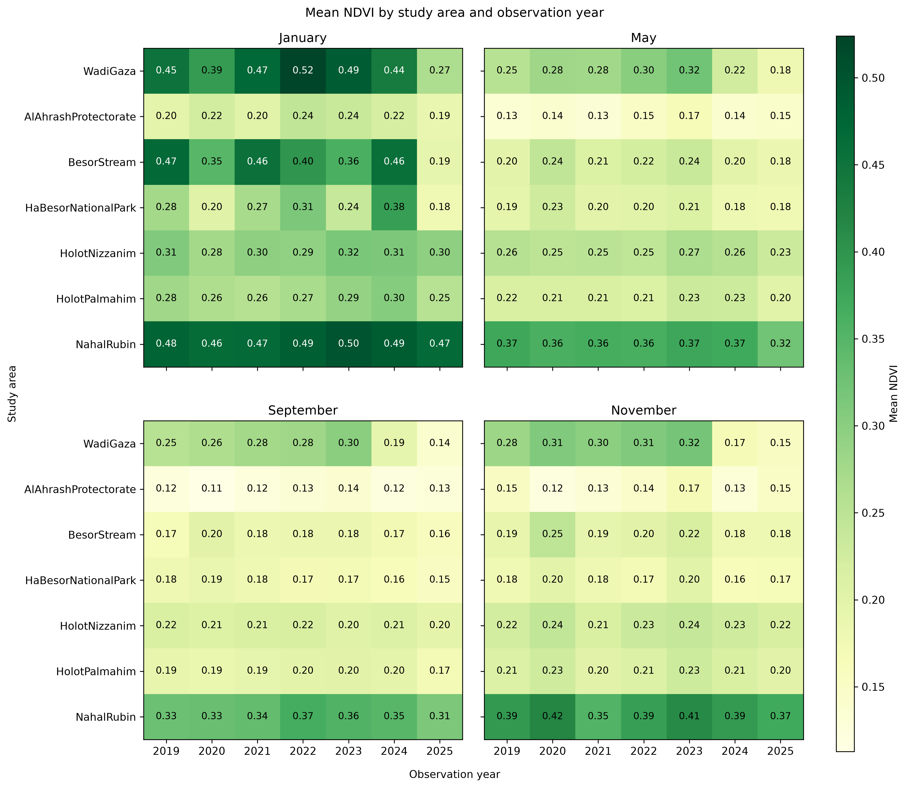

<!-- Generated by generate_figure_captions.py; do not edit. -->

# Figure captions

Maintained in [figure-captions.yaml](../../../../docs/figure-captions.yaml). Captions cover the current notebook selections only; other images in this folder may be retired or from a different selection. Figure numbering is assigned in the manuscript. Review captions alongside the images before publication.

## Wadi Gaza September NDVI level correlograms

Figure: [WadiGaza_09_index_correlograms_by_year.png](WadiGaza_09_index_correlograms_by_year.png)

**Caption.** Moran's I correlograms of September NDVI levels at Wadi Gaza by observation year, showing range thresholds and selected decorrelation distances.

**Explanation.** Moran's I correlograms of September NDVI levels at Wadi Gaza, with one panel per observation year. Lags are Chebyshev distances in pixels. Dashed horizontal lines show range thresholds (0.02, 0.05, 0.1); the vertical dotted line, when present, marks the first lag below the primary threshold tau = 0.05. These correlograms describe index levels, not the difference rasters used to estimate change uncertainty.

Source: [14_visualize_index_results.ipynb](../../../../notebooks/14_visualize_index_results.ipynb); [method](../../../../docs/white-papers/Mean-Index-Level-Confidence-Intervals.md).

<!-- Figure SHA-256: 56ddf0f1db272c11ed5bb3cc5b7b85aafa57f5fc8d846be35b25e099d43d3441 -->

## Wadi Gaza annual NDVI effective sample sizes

Figure: [WadiGaza_index_effective_sample_size.png](WadiGaza_index_effective_sample_size.png)

**Caption.** Spatial effective sample sizes for annual mean NDVI at Wadi Gaza by month, with the review threshold at 30.

**Explanation.** Spatial effective sample sizes for annual mean NDVI at Wadi Gaza, with separate lines for calendar months. Values are derived from autocorrelation in the index-level rasters using the primary range threshold tau = 0.05. The dashed line marks the review threshold n_eff = 30; undefined ranges yield missing effective sample sizes.

Source: [14_visualize_index_results.ipynb](../../../../notebooks/14_visualize_index_results.ipynb); [method](../../../../docs/white-papers/Mean-Index-Level-Confidence-Intervals.md).

<!-- Figure SHA-256: 5912f6d58fd967a82038cd953db03082873c35f69f13e581452b59869d1bd864 -->

## Wadi Gaza annual NDVI levels

Figure: [WadiGaza_mean_index_timeseries.png](WadiGaza_mean_index_timeseries.png)

**Caption.** Annual mean NDVI at Wadi Gaza by calendar month, with spatially adjusted 95% confidence bands.

**Explanation.** Annual spatial mean of the normalized difference vegetation index (NDVI) at Wadi Gaza. Separate lines identify calendar months; translucent bands show uncertainty in annual means. Intervals are spatially adjusted 95% Student's t confidence intervals, using effective sample sizes derived from Moran's I correlograms at the primary range threshold tau = 0.05. Means remain visible when an autocorrelation range, and hence an interval, cannot be estimated.

Source: [14_visualize_index_results.ipynb](../../../../notebooks/14_visualize_index_results.ipynb); [method](../../../../docs/white-papers/Mean-Index-Level-Confidence-Intervals.md).

<!-- Figure SHA-256: 0d0146a3997a0921849895c948b09ea7ad1364367a3ebf47fbe0f014f76f84c8 -->

## NDVI levels relative to 2019

Figure: [WadiGaza_vs_study_areas_index_change_from_2019.png](WadiGaza_vs_study_areas_index_change_from_2019.png)

**Caption.** Annual mean NDVI relative to each site's 2019 mean (%), with Wadi Gaza's 95% confidence bands conditional on a fixed baseline.

**Explanation.** Percentage change in each site's annual mean NDVI from its own 2019 mean, calculated as 100 times (annual mean / base-year mean minus 1), with one panel per calendar month. Wadi Gaza is highlighted with a solid red line; dotted lines show comparison sites. Its band rescales the spatially adjusted 95% confidence interval by the fixed base-year mean and does not propagate uncertainty in that baseline. Missing bands indicate undefined spatial intervals.

Source: [14_visualize_index_results.ipynb](../../../../notebooks/14_visualize_index_results.ipynb); [method](../../../../docs/white-papers/Mean-Index-Level-Confidence-Intervals.md).

<!-- Figure SHA-256: fce9c6ff1fda9a4fdd6e3b6617b9a913fc98e5d380449cf3baf140a23aa30159 -->

## Annual NDVI levels across sites

Figure: [WadiGaza_vs_study_areas_index_timeseries.png](WadiGaza_vs_study_areas_index_timeseries.png)

**Caption.** Annual mean NDVI across study sites by month, highlighting Wadi Gaza with spatially adjusted 95% confidence bands.

**Explanation.** Annual spatial mean of the normalized difference vegetation index (NDVI) at Wadi Gaza and comparison sites, with one panel per calendar month. Wadi Gaza is highlighted by a solid red line and uncertainty band; other sites are dotted and shown without bands for clarity. Intervals are spatially adjusted 95% Student's t confidence intervals, using effective sample sizes derived from Moran's I correlograms at the primary range threshold tau = 0.05. Means remain visible when an autocorrelation range, and hence an interval, cannot be estimated.

Source: [14_visualize_index_results.ipynb](../../../../notebooks/14_visualize_index_results.ipynb); [method](../../../../docs/white-papers/Mean-Index-Level-Confidence-Intervals.md).

<!-- Figure SHA-256: e0e6da99659963a1267f7afc0ab5e668d91ff021d4e037d10f7f44fcefc37dc2 -->

## NDVI levels by site and observation year

Figure: [study_area_mean_index_heatmaps.png](study_area_mean_index_heatmaps.png)

**Caption.** Annual mean NDVI by study site and observation year, with separate panels for each calendar month.

**Explanation.** Annual spatial mean of the normalized difference vegetation index (NDVI) by site and observation year, with one panel per calendar month and Wadi Gaza in the top row. Colors and cell labels encode mean index values on one scale shared across panels. These are index levels rather than changes or significance tests; uncertainty is not displayed.

Source: [14_visualize_index_results.ipynb](../../../../notebooks/14_visualize_index_results.ipynb); [method](../../../../docs/white-papers/Mean-Index-Level-Confidence-Intervals.md).

<!-- Figure SHA-256: f1b48c6c2402a13b73555555dadeacbea5fd64301fe31bcd8a1a88320859757e -->
