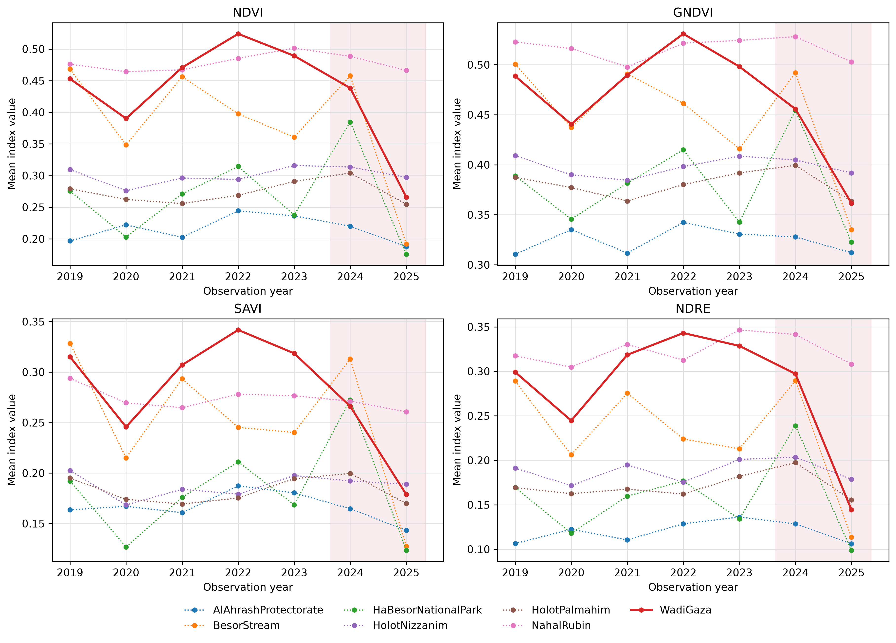
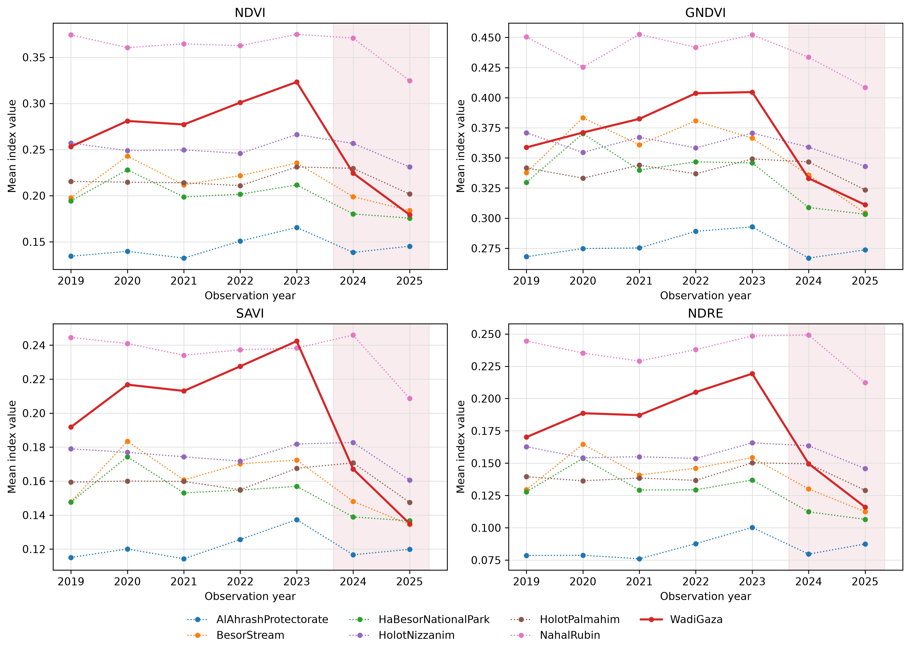
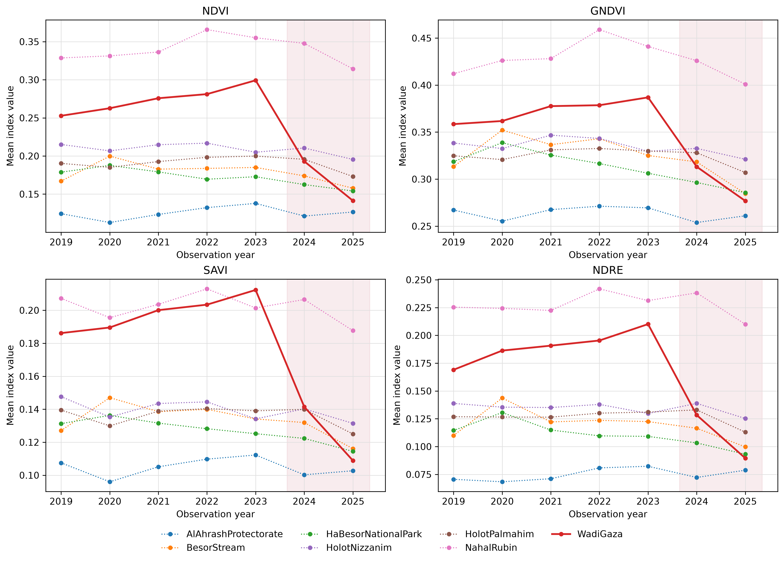
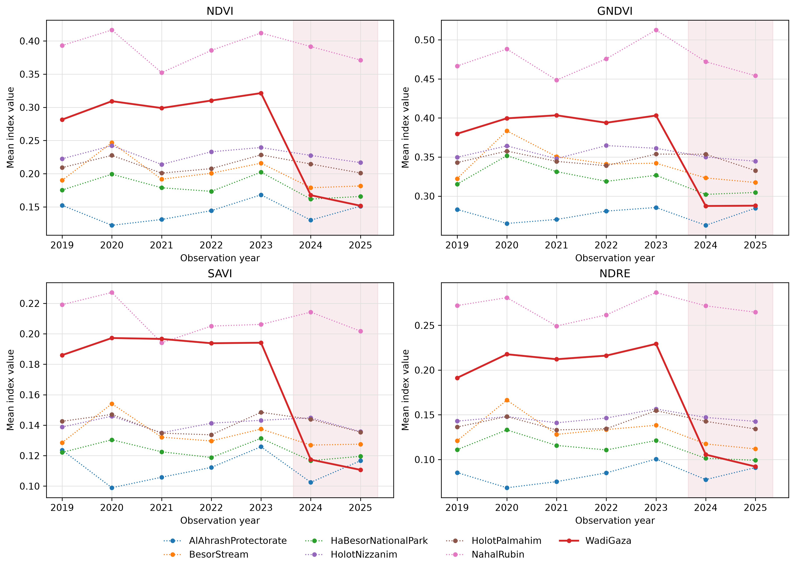

<!-- Generated by generate_figure_captions.py; do not edit. -->

# Figure captions

Maintained in [figure-captions.yaml](../../../docs/figure-captions.yaml). Captions cover the current notebook selections only; other images in this folder may be retired or from a different selection. Figure numbering is assigned in the manuscript. Review captions alongside the images before publication.

## January level trajectories across indices

Figure: [level_trajectories_01.png](level_trajectories_01.png)

**Caption.** Annual January vegetation-index means across study sites and indices, highlighting Wadi Gaza and shading observation years 2024, 2025.

**Explanation.** Annual January spatial means at Wadi Gaza (solid red) and comparison sites (dotted), with separate panels for NDVI (normalized difference vegetation index), GNDVI (green normalized difference vegetation index), SAVI (soil-adjusted vegetation index), and NDRE (normalized difference red-edge index). Shading marks 2024, 2025. Values retain each index's units and no uncertainty bands are shown. These are descriptive level trajectories, not fitted event effects.

Source: [31_visualize_did_results.ipynb](../../../notebooks/31_visualize_did_results.ipynb); [method](../../../docs/white-papers/Mean-Index-Level-Confidence-Intervals.md).

<!-- Figure SHA-256: 513c7d4c76997e03d8e41697306fd8006ba8ec1f1d6ebdc9dcd8bfa04acb26a7 -->

## May level trajectories across indices

Figure: [level_trajectories_05.png](level_trajectories_05.png)

**Caption.** Annual May vegetation-index means across study sites and indices, highlighting Wadi Gaza and shading observation years 2024, 2025.

**Explanation.** Annual May spatial means at Wadi Gaza (solid red) and comparison sites (dotted), with separate panels for NDVI (normalized difference vegetation index), GNDVI (green normalized difference vegetation index), SAVI (soil-adjusted vegetation index), and NDRE (normalized difference red-edge index). Shading marks 2024, 2025. Values retain each index's units and no uncertainty bands are shown. These are descriptive level trajectories, not fitted event effects.

Source: [31_visualize_did_results.ipynb](../../../notebooks/31_visualize_did_results.ipynb); [method](../../../docs/white-papers/Mean-Index-Level-Confidence-Intervals.md).

<!-- Figure SHA-256: b3cb4310ff133c28bcc2e04ce628c3ac314f1fe4e4a12810b702217705e14205 -->

## September level trajectories across indices

Figure: [level_trajectories_09.png](level_trajectories_09.png)

**Caption.** Annual September vegetation-index means across study sites and indices, highlighting Wadi Gaza and shading observation years 2024, 2025.

**Explanation.** Annual September spatial means at Wadi Gaza (solid red) and comparison sites (dotted), with separate panels for NDVI (normalized difference vegetation index), GNDVI (green normalized difference vegetation index), SAVI (soil-adjusted vegetation index), and NDRE (normalized difference red-edge index). Shading marks 2024, 2025. Values retain each index's units and no uncertainty bands are shown. These are descriptive level trajectories, not fitted event effects.

Source: [31_visualize_did_results.ipynb](../../../notebooks/31_visualize_did_results.ipynb); [method](../../../docs/white-papers/Mean-Index-Level-Confidence-Intervals.md).

<!-- Figure SHA-256: 59c55c94d7366df7d00f4a2033418abaa1ce67cc01effaaf66d36b4ee1f0486a -->

## November level trajectories across indices

Figure: [level_trajectories_11.png](level_trajectories_11.png)

**Caption.** Annual November vegetation-index means across study sites and indices, highlighting Wadi Gaza and shading observation years 2024, 2025.

**Explanation.** Annual November spatial means at Wadi Gaza (solid red) and comparison sites (dotted), with separate panels for NDVI (normalized difference vegetation index), GNDVI (green normalized difference vegetation index), SAVI (soil-adjusted vegetation index), and NDRE (normalized difference red-edge index). Shading marks 2024, 2025. Values retain each index's units and no uncertainty bands are shown. These are descriptive level trajectories, not fitted event effects.

Source: [31_visualize_did_results.ipynb](../../../notebooks/31_visualize_did_results.ipynb); [method](../../../docs/white-papers/Mean-Index-Level-Confidence-Intervals.md).

<!-- Figure SHA-256: 6cc5cc5621e82656ee60723f7a743bc6cd109283f366bcd4962bff133e41f06e -->
