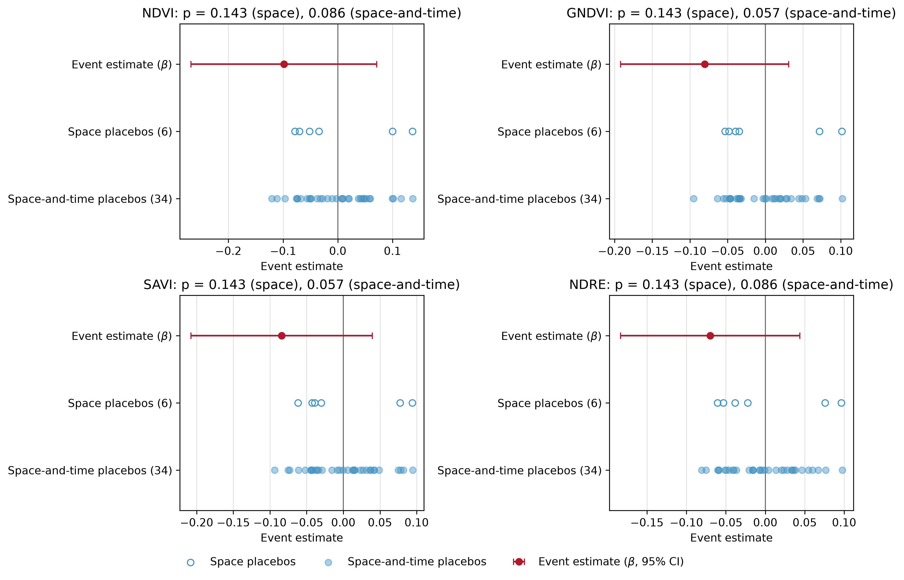
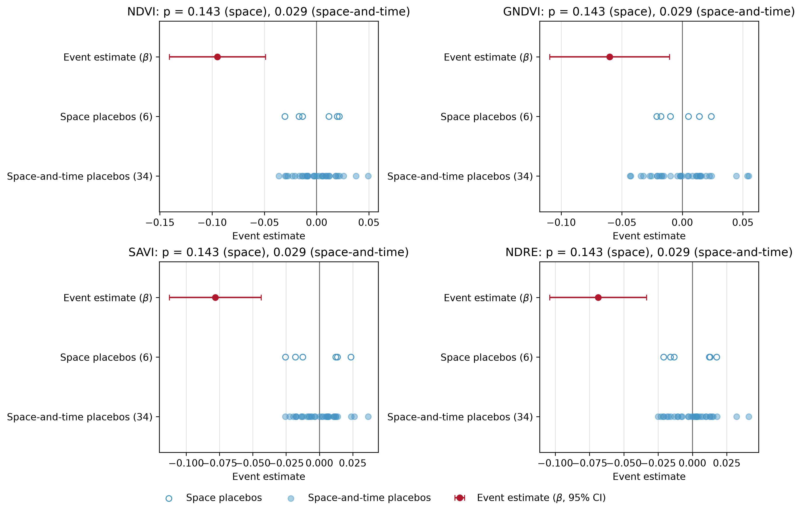
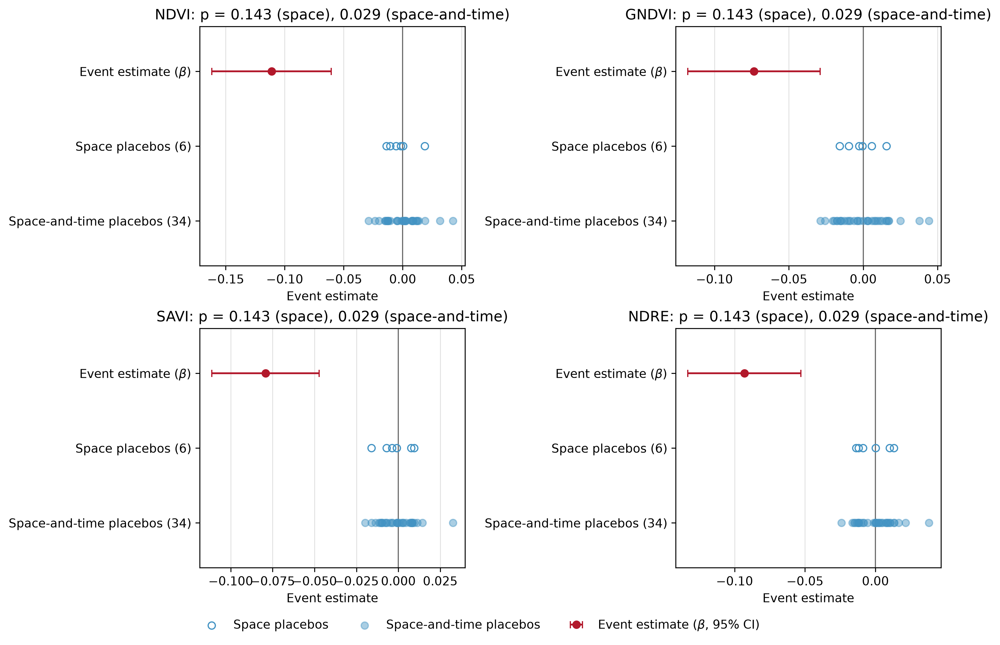
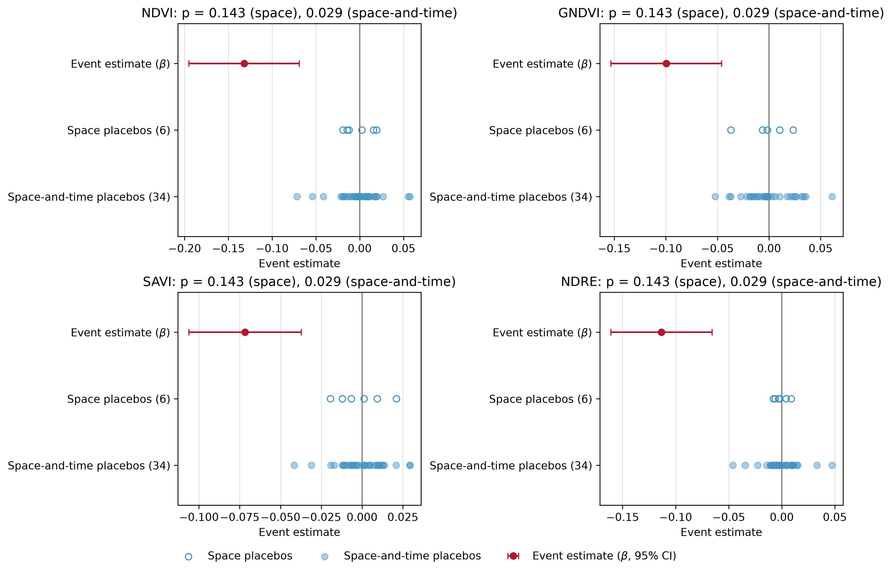

<!-- Generated by generate_figure_captions.py; do not edit. -->

# Figure captions

Maintained in [figure-captions.yaml](../../../../docs/figure-captions.yaml). Captions cover the current notebook selections only; other images in this folder may be retired or from a different selection. Figure numbering is assigned in the manuscript. Review captions alongside the images before publication.

## January combined evidence across indices (site_period)

Figure: [combined_evidence_01.png](combined_evidence_01.png)

**Caption.** January event estimates with 95% confidence intervals and placebo distributions across vegetation indices for Wadi Gaza under the site + period model.

**Explanation.** Combined event evidence for January at Wadi Gaza, with separate panels for NDVI (normalized difference vegetation index), GNDVI (green normalized difference vegetation index), SAVI (soil-adjusted vegetation index), and NDRE (normalized difference red-edge index), under the site + period model, which includes site-specific mean changes and shared year-pair effects. Top rows show the main 2023-2024 event estimates and intervals; middle and bottom rows show space and space-and-time placebo estimates. Values are in each index's units; panel titles give lower-tail rank p-values. Model intervals are 95% plug-in t confidence intervals from inverse total-variance weighted least squares, with leverage-adjusted Hedges residual-variance estimation; they are not cluster-robust intervals. Space placebos reassign the event and persistence indicators to comparison sites after excluding Wadi Gaza. Space-and-time placebos omit the 2024-2025 pair and reassign a single event indicator among unaffected site-year-pair cells, excluding the real event cell from each placebo fit. The space-and-time p-value uses its own reduced-sample real refit, which can differ from the main estimate. Both reported p-values are lower-tail rank proportions for a decline, including the real assignment; interpreting them inferentially requires comparable assignments.

Source: [31_visualize_did_results.ipynb](../../../../notebooks/31_visualize_did_results.ipynb); [method](../../../../docs/white-papers/Before-After-Control-Impact-Analysis.md).

<!-- Figure SHA-256: 8324ce03fc6d20c8b008d9b11273099a269be97a4e0c37b918515a2fbfd3e08d -->

## May combined evidence across indices (site_period)

Figure: [combined_evidence_05.png](combined_evidence_05.png)

**Caption.** May event estimates with 95% confidence intervals and placebo distributions across vegetation indices for Wadi Gaza under the site + period model.

**Explanation.** Combined event evidence for May at Wadi Gaza, with separate panels for NDVI (normalized difference vegetation index), GNDVI (green normalized difference vegetation index), SAVI (soil-adjusted vegetation index), and NDRE (normalized difference red-edge index), under the site + period model, which includes site-specific mean changes and shared year-pair effects. Top rows show the main 2023-2024 event estimates and intervals; middle and bottom rows show space and space-and-time placebo estimates. Values are in each index's units; panel titles give lower-tail rank p-values. Model intervals are 95% plug-in t confidence intervals from inverse total-variance weighted least squares, with leverage-adjusted Hedges residual-variance estimation; they are not cluster-robust intervals. Space placebos reassign the event and persistence indicators to comparison sites after excluding Wadi Gaza. Space-and-time placebos omit the 2024-2025 pair and reassign a single event indicator among unaffected site-year-pair cells, excluding the real event cell from each placebo fit. The space-and-time p-value uses its own reduced-sample real refit, which can differ from the main estimate. Both reported p-values are lower-tail rank proportions for a decline, including the real assignment; interpreting them inferentially requires comparable assignments.

Source: [31_visualize_did_results.ipynb](../../../../notebooks/31_visualize_did_results.ipynb); [method](../../../../docs/white-papers/Before-After-Control-Impact-Analysis.md).

<!-- Figure SHA-256: b90d823e6b020f85208797e9cc0b79a36f3f7427c4702324550dfe2d57d82456 -->

## September combined evidence across indices (site_period)

Figure: [combined_evidence_09.png](combined_evidence_09.png)

**Caption.** September event estimates with 95% confidence intervals and placebo distributions across vegetation indices for Wadi Gaza under the site + period model.

**Explanation.** Combined event evidence for September at Wadi Gaza, with separate panels for NDVI (normalized difference vegetation index), GNDVI (green normalized difference vegetation index), SAVI (soil-adjusted vegetation index), and NDRE (normalized difference red-edge index), under the site + period model, which includes site-specific mean changes and shared year-pair effects. Top rows show the main 2023-2024 event estimates and intervals; middle and bottom rows show space and space-and-time placebo estimates. Values are in each index's units; panel titles give lower-tail rank p-values. Model intervals are 95% plug-in t confidence intervals from inverse total-variance weighted least squares, with leverage-adjusted Hedges residual-variance estimation; they are not cluster-robust intervals. Space placebos reassign the event and persistence indicators to comparison sites after excluding Wadi Gaza. Space-and-time placebos omit the 2024-2025 pair and reassign a single event indicator among unaffected site-year-pair cells, excluding the real event cell from each placebo fit. The space-and-time p-value uses its own reduced-sample real refit, which can differ from the main estimate. Both reported p-values are lower-tail rank proportions for a decline, including the real assignment; interpreting them inferentially requires comparable assignments.

Source: [31_visualize_did_results.ipynb](../../../../notebooks/31_visualize_did_results.ipynb); [method](../../../../docs/white-papers/Before-After-Control-Impact-Analysis.md).

<!-- Figure SHA-256: f53192e53abd6e5d776f6970910b3093e37e7a80b8f8f55b6c46c95d4678f444 -->

## November combined evidence across indices (site_period)

Figure: [combined_evidence_11.png](combined_evidence_11.png)

**Caption.** November event estimates with 95% confidence intervals and placebo distributions across vegetation indices for Wadi Gaza under the site + period model.

**Explanation.** Combined event evidence for November at Wadi Gaza, with separate panels for NDVI (normalized difference vegetation index), GNDVI (green normalized difference vegetation index), SAVI (soil-adjusted vegetation index), and NDRE (normalized difference red-edge index), under the site + period model, which includes site-specific mean changes and shared year-pair effects. Top rows show the main 2023-2024 event estimates and intervals; middle and bottom rows show space and space-and-time placebo estimates. Values are in each index's units; panel titles give lower-tail rank p-values. Model intervals are 95% plug-in t confidence intervals from inverse total-variance weighted least squares, with leverage-adjusted Hedges residual-variance estimation; they are not cluster-robust intervals. Space placebos reassign the event and persistence indicators to comparison sites after excluding Wadi Gaza. Space-and-time placebos omit the 2024-2025 pair and reassign a single event indicator among unaffected site-year-pair cells, excluding the real event cell from each placebo fit. The space-and-time p-value uses its own reduced-sample real refit, which can differ from the main estimate. Both reported p-values are lower-tail rank proportions for a decline, including the real assignment; interpreting them inferentially requires comparable assignments.

Source: [31_visualize_did_results.ipynb](../../../../notebooks/31_visualize_did_results.ipynb); [method](../../../../docs/white-papers/Before-After-Control-Impact-Analysis.md).

<!-- Figure SHA-256: 4a9afc3e661cdeb85b8564b646fb3a5b0f42bedb8f80a501176a3324188ea2fd -->
